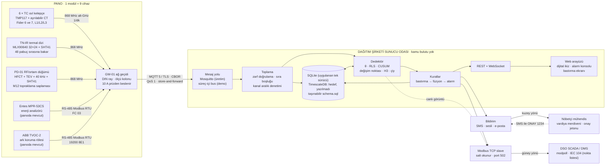
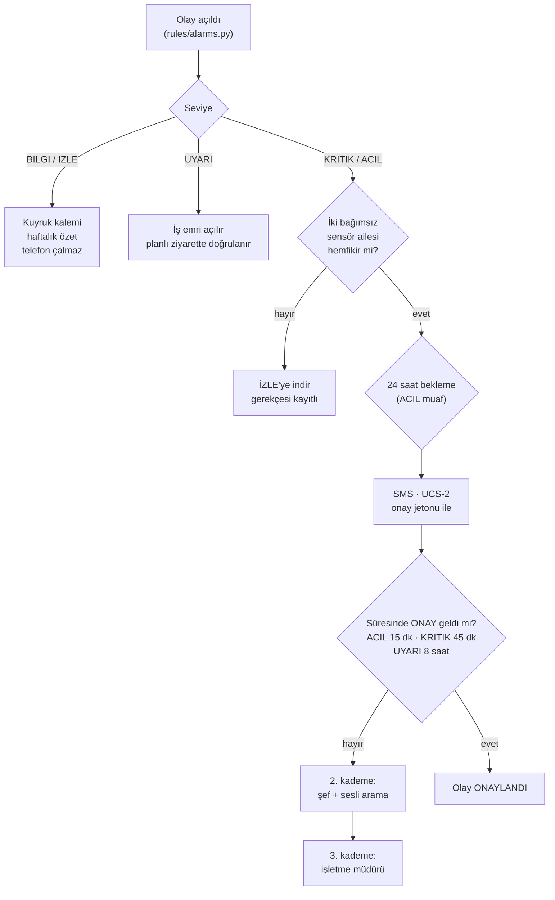

# 01 · Sistem Mimarisi

PANO GÖZ · TEDAŞ-MLZ/2003-06.B 1600 kVA AG dağıtım panosu için pano içi anomali erken
uyarı sistemi.

---

## 1. "Modül" ne demek — şartname bunu tanımlamıyor, biz tanımlıyoruz

Yarışma metni "en az 100 modül" ister. Bu kelime belirsizdir ve belirsiz bırakılırsa her
taraf farklı bir sayı anlar. Bu belgede tanım şudur ve her yerde bu geçerlidir:

> **1 modül = 1 enstrümante edilmiş pano = 1 ağ geçidi + 8 algılama cihazı = 9 cihaz.**

| Terim | Sayı | Açıklama |
|---|---:|---|
| Modül | 1 | Bir panoyu izleyen, kendi başına anlamlı en küçük teslim birimi |
| Modül başına cihaz | 9 | 6 × TC ısıl kelepçe, 1 × TN-IR termal dizi, 1 × PD RF/ortam düğümü, 1 × GW ağ geçidi |
| Modül başına izlenen bağlantı | 40 | 10 fider × 4 iletken, yalnız alt kablo bölmesi |
| Modül başına modellenen bağlantı | **74** | 40 pabuç + 30 bara-DSYA + 4 giriş sapması. Tasarımda 12 yol × 4 = 48 pabuç ve 36 bara bağlantısı **pozisyonu** vardır; 2 Yedek yol Madde 2.2.9.vii uyarınca fiziksel olarak **boş** bırakıldığı için fiilen cıvatalanmış bağlantı sayısı 74'tür. İzlenmeyenler ekranda "izlenmiyor" yazar |
| Modül başına kanal (seri) | ~120 | 53 kanal **tipi**, panoda seri hâline gelince: 6 kelepçe × 2 + 40 pabuç IR + ~40 pano kanalı (analizör, ark, ortam, RF) + 9 cihaz sağlığı ≈ 120, hepsi 1/dk |

Dolayısıyla **"≥ 100 modül" = ≥ 100 pano ≈ 900 cihaz**. Cihaz sayısı `contracts/assets.py`
içinde `DEVICES_PER_PANEL == 9` olarak **donmuştur** ve import anında assert edilir: ekrandaki
noktaları sayan bir jüri üyesi ile BOM'daki satırları sayan bir satın almacı aynı sayıyı
bulmak zorundadır.

---

## 2. Uçtan uca mimari



Akış tek yönlüdür ve bu bilinçlidir: sahadan sunucuya veri, sunucudan SCADA'ya **yalnız
okuma**, sunucudan insana bildirim. Sistemin hiçbir yerinde panoya komut veren bir yol
yoktur. TVOC-2'nin reg 213 otokontrol komutu ve açma sıfırlama, ağ geçidinde operatör kimlik
doğrulaması ve fiziksel anahtar arkasındadır; ne MQTT'den, ne SCADA'dan, ne API'den
erişilebilir.

### 2.1 Ağ geçidinde yerel kritik kurallar

Ağ geçidi aptal bir köprü değildir. Sunucuya giden yol kopsa bile üç kural yerel çalışır
(`gateway/gateway.py`):

| Kural | Eşik | Neden yerelde |
|---|---|---|
| Mutlak sıcaklık | herhangi bir bağlantı ≥ 90 °C | Sunucu erişilemezken de doğru olan tek gösterge |
| Kardeş farkı | Δ ≥ 20 K ve yük faktörü ≥ 0.35 | Bir fiderin üç fazından en az üçü raporluyorsa hesaplanır |
| Ark açması | TVOC-2 reg 1300 bit0 | Olay, tamponun başına alınır ve ilk bağlantıda önce o gider |

Bağlantı yokken çerçeveler halka tamponda (20 000 çerçeve) tutulur; PUBACK geldikçe filigran
ilerler. Tampon dolarsa **en eski** çerçeveler düşürülür ve düşürülen sayısı bir cihaz sağlık
metriği olarak yayınlanır — sessizce kaybetmek yoktur.

---

## 3. Katmanlar ve sözleşmeler

Mimarinin taşıyıcı fikri şudur: **her sayı tek bir yerde tanımlanır.** Ekrandaki değer ile
Modbus register'ındaki değer aynı nesneden üretilir, dolayısıyla çelişemezler.

| Katman | Paket | Sözleşmesi | Sorumluluğu |
|---|---|---|---|
| Varlık modeli | `contracts/assets.py` | `FEEDERS`, `JOINTS`, `DEVICES`, `sibling_groups()` | Pano geometrisi ve kardeş grupları |
| Kanal kütüğü | `contracts/channels.py` | `CHANNELS`, `FAILURE_MODES`, `SEVERITIES` | Ne ölçülür, birimi, makul aralığı |
| Taşıma | `contracts/envelope.py` + `bus/` | `Envelope`, `topic()`, `SeqTracker` | Konu şeması, doğum/vasiyet, sıra boşluğu |
| Kalıcılık | `store/` | `schema.sql` | Ham örnek, günlük özet, olay, denetim zinciri |
| Canlı görüntü | `contracts/live.py` | `PanelLive` | Tek görüntü; UI, REST ve ICD aynı nesneyi okur |
| SCADA arayüzü | `contracts/icd.py` | `PANEL_REGS`, `STATUS_BITS` | Register haritası; ICD belgesi buradan üretilir |

Sözleşme dosyaları hiçbir uygulama katmanı tarafından değiştirilmez. Bu, altı ayrı geliştirme
akışının paralel çalışmasını ve sonunda birbirine oturmasını sağlayan tek kuraldır.

---

## 4. On-premise duruş

**Hiçbir yerde kamu bulutu yoktur.** Ne hesaplama, ne depolama, ne bildirim.

Gerekçe teknik değil, kurumsaldır: bir dağıtım şirketinin şebeke topolojisi ve arıza geçmişi
kritik altyapı verisidir; bunun yurt dışındaki bir hiper-ölçekleyicide durması bir güvenlik
sorusudur ve o soru, hackathon jürisinde değil, satın alma komitesinde sorulur. Buluta
bağımlı bir mimari o komitede ölür.

Fiziksel kurulum:

| Bileşen | Adet | Konum | Not |
|---|---:|---|---|
| Uygulama sunucusu (birincil) | 1 | DSO sunucu odası | 4 vCPU / 16 GB / 500 GB NVMe |
| Uygulama sunucusu (yedek) | 1 | Aynı oda ya da ikinci merkez | Sıcak yedek, aynı imaj, streaming replikasyon |
| MQTT broker | Aynı düğüm | — | Mosquitto, TLS, cihaz sertifikası başına ACL |
| Zaman serisi DB | Aynı düğüm | — | TimescaleDB (PostgreSQL eklentisi) — **hedeflenen**; bugün uygulanan sürücü SQLite'tır |

1000 panoya kadar tek düğüm yeterlidir; ölçüm ve gerekçe [06-OLCEKLENEBILIRLIK.md] belgesinde.
Yedek düğüm, kullanılabilirlik için değil **veri kaybını önlemek** için vardır: birincil
düğüm çökerse ağ geçitleri zaten tamponlar ve bağlantı geri geldiğinde geçmişi yükler.

Broker güvenliği: her ağ geçidi kendi X.509 istemci sertifikasıyla bağlanır, ACL sertifika
CN'sini `panogoz/v1/<saha>/<pano>/#` konusuna eşler. Ele geçirilmiş bir ağ geçidi yalnız
kendi panosu için yayın yapabilir; filo çapında sahte alarm üretemez.

---

## 5. Depolama aritmetiği — türetilmiş, iddia edilmiş değil

### 5.1 Nokta hızı

```
Pano başına seri sayısı                    ~120  (contracts/channels.py kütüğü)
Örnekleme                                  1/dk
  → pano başına                            120 / 60 s = 2.0 nokta/s
  → pano başına günlük                     120 × 1440 = 172 800 nokta
100 pano                                   200 nokta/s = 17.28 M nokta/gün = 6.31 G nokta/yıl
```

Bu 200 nokta/s, veri tabanına **200 ayrı yazma işlemi** olarak gitmez. Ölçtüğümüz zarf hızı
100 pano için **15 zarf/s**'dir (9 cihaz × 100 pano / 60 s) ve her zarf tek bir toplu yazıma
dönüşür. Bir TimescaleDB düğümü toplu `COPY` ile 100 000 satır/s mertebesinde yazar; 15
işlem/s ve 200 satır/s bunun **binde ikisidir**. Toplama katmanı bu sistemin darboğazı değildir
ve öyle olduğunu iddia etmek yanlış olur.

### 5.2 Saklama politikası ve boyut

| Katman | Adım | Seri/pano | Süre | Nokta (100 pano) | Boyut |
|---|---|---:|---|---:|---:|
| Ham | 1 dk | 120 | 90 gün | 1.56 G | 3.9 GB |
| 5 dk özet (ort/min/maks) | 5 dk | 60 | 2 yıl | 3.78 G değer | 9.5 GB |
| Saatlik özet (ort/min/maks) | 1 saat | 60 | 10 yıl | 1.58 G değer | 3.9 GB |
| Olay, alarm, bastırma, denetim, PRPD | olay | — | 10 yıl | — | 0.6 GB |
| **Toplam kararlı hâl** | | | | | **≈ 18 GB** |

> **VARSAYIM (etiketli):** sıkıştırılmış nokta başına **2.5 bayt**. TimescaleDB'nin sütunlu
> sıkıştırması yavaş değişen kayan noktalı fiziksel sinyallerde tipik olarak 1.5–4 B/nokta
> verir. Duyarlılık: 1.5 B → 11 GB, 4 B → 29 GB. Sonuç her durumda **on gigabaytlar
> mertebesindedir**, terabaytlar değil.

500 GB'lık tek bir NVMe, 100 pano için 25 kat, 1000 pano için 2.5 kat baş boşluğu bırakır.
**On-premise kısıtı bu sistemde depolama açısından pratikte bedavadır** ve bunu yüksek sesle
söylemek gerekir, çünkü "buluta ihtiyacımız var" iddiasının arkasındaki tek teknik gerekçe
budur ve bu projede geçerli değildir.

> **Not (sözleşme dosyasıyla tutarlılık):** `store/schema.sql` başındaki yorum aynı hesabı
> "20 nokta/s" olarak yuvarlar. 1/dk tam hızda doğru rakam **200 nokta/s**'dir; 20/s, yazma
> **işlemi** mertebesine (ölçülen 15/s) yakın olan sayıdır. Depolama sonucu (on gigabaytlar)
> her iki okumada da aynıdır. Sözleşme dosyasına dokunmadık; doğru aritmetiği burada
> yazıyoruz.

---

## 6. Neden düz MQTT + CBOR, neden Sparkplug B değil

Bu bir marka tercihi değil, teknik bir zorunluluktur ve bir enerji şirketi mühendisi
soracaktır.

**Sparkplug B'nin dört iyi fikri vardır** ve dördünü de aldık:

| Sparkplug fikri | Bizde karşılığı | Neden değerli |
|---|---|---|
| NBIRTH/DBIRTH | `kind="birth"`, tam metrik listesi | Yeni pano kendini tanıtır; sunucuda ön yapılandırma gerekmez |
| Last Will (NDEATH) | `will_topic()`, `kind="death"` | Çevrimdışı olan pano zaman aşımıyla değil **anında** bilinir |
| Monoton `seq` | `Envelope.seq` + `SeqTracker` | Kayıp çerçeve tespit edilir; üstünü örtmek yerine sayılır |
| Rebirth el sıkışması | `boot` sayacı + `emit_birth()` | Yeniden başlatma ile sıra sarması karışmaz |

**Ama markayı almadık, çünkü:** Sparkplug 3.0 spesifikasyonu DDATA mesajları için **QoS 0
zorunlu** kılar. Bizim dayanıklılık hikâyemiz, ağ geçidinde PUBACK ile ilerleyen bir
store-and-forward filigranına dayanır: bir çerçeve, broker'dan onayı gelene kadar tampondan
silinmez. QoS 0'da PUBACK yoktur, dolayısıyla filigran da yoktur. Spesifikasyonun yasakladığı
bir mekanizma üzerine garanti kurmak dürüst olmaz; uyum rozetini takıp QoS 1 kullanmak ise
sahtekârlık olur. Bu yüzden **rozeti bırakıp mekanizmayı tuttuk.**

Yük biçimi: hackathon teslimi **JSON**'dur. Sebep şudur: bir jüri üyesi konu dökümünü
`mosquitto_sub` ile kendi gözüyle okuyabilsin. Üretimde **CBOR**'a geçiş iki satırdır
(`cbor2.dumps` / `cbor2.loads`) ve tipik zarf boyutunu yaklaşık yarıya indirir. Kanal adları
sözlükleştirildiğinde (kütükteki indeks numarası) ek %35 kazanç vardır; bu, kanal kütüğünün
kod tarafında merkezî tutulmasının bir başka getirisidir.

Konu grameri:

```
panogoz/v1/<saha>/<pano>/<tip>[/<cihaz>]
  tip ∈ birth | data | event | death | state | cmd
örnek: panogoz/v1/Soke/SOKE-14/data/TC-03
```

`panel_key` çıplak pano adıdır (`SOKE-14`), eğik çizgi içermez. Konu şemasında saha ayrı bir
seviyedir (ACL saha bazında yazılabilsin diye), ancak depolama ve REST katmanı çıplak adı
kullanır: `/api/panel/SOKE-14` yazabilen bir jüri üyesi, konu simetrisinden daha değerlidir.

---

## 7. Güney yönü: SCADA

Ayrıntı `docs/PANOGOZ-ICD-v2.0.md` belgesindedir; burada mimari kararlar:

* **Modbus TCP slave, istisnasız salt okunur.** FC 03 ve 04 aynı adres uzayını okur; 05, 06,
  15, 16 `0x01 ILLEGAL_FUNCTION` döner.
* **Sabit adım, delik yok:** her pano `1000 + 48 × (n−1)` adresinde tam 48 register.
  SCADA mühendisi tek blok tanımlar, 100 kez kopyalar.
* **Doldurulmamış pano bloğu sıfır okur ve `DATA_VALID` biti temizdir.** Tarama hatası ile
  boş pano birbirinden ayırt edilebilir olmalıdır; ikisini "cevap yok"a indirgemek, olmayan
  bir kapsamı varmış gibi gösterir.
* **En değerli iki register, kaynak cihazların üretemediği ikisidir:** `STATUS_WORD` bit 8
  "ark rölesiyle bağımız koptu" der, `DATA_AGE_S` bu bloğun ne kadar bayat olduğunu söyler.
  Klasik bir ağ geçidi son iyi değeri sonsuza dek sessizce yayınlar; bu, kendi sağlığı
  hakkında doğruyu söyler.
* Ölçülen tarama başarımı: 100 panonun tamamı (4800 register) FC 03'ün 125 register sınırı
  nedeniyle **en az 39 istek** eder ve 19.0 ms sürer; bir SCADA ön yüzünün 1 Hz'de fiilen
  yaptığı iki istek (global blok + ilgili pano bloğu) medyan 0.72 ms'dir. İki isteğe sığdığını
  iddia etmiyoruz, çünkü sığmıyor.

---

## 8. Kuzey yönü: bildirim



Yalnız `KRITIK` ve `ACIL` bir telefonu çaldırır. Bu tek kural, sistemin üçüncü aydan sonra
da açık kalmasını sağlayan kuraldır ve bu yüzden yapılandırma değeri değil, **sözleşmedir**
(`channels.DISPATCH_SEVERITIES`).

---

## 9. Zamanlama ve gecikme bütçesi

| Adım | Süre | Kaynak |
|---|---|---|
| TVOC-2 ışık → kontak | ~1 ms | ABB, SIL-2 donanım. **Bizi beklemez.** |
| TVOC-2 Modbus görüntüsünün yenilenmesi | 0.2–2 s | **Modellendi**; ABB dokümante etmiyor |
| Ağ geçidi tarama periyodu | 1 s | Yapılandırma |
| Sunucu işleme (toplama → kural → bildirim) | 0.3–2 s | Ölçüm + baş boşluğu |
| SMS yolu (modem → SMSC → telefon) | 2.5–8 s | Operatör bağımlı |
| **Toplam bildirim gecikmesi** | **4–13 s** | |

Bu bir **aralıktır** ve öyle raporlanır. Tek bir temiz sayı vermek (örneğin "5 saniye")
dokümante edilmemiş bir ABB davranışını ölçülmüş gibi göstermek olurdu.

Dedektör çevrimi ayrı bir zaman ölçeğinde çalışır: θ dakikada bir güncellenir, CUSUM **günlük
medyan** üzerinde ilerler. Avladığımız sinyal 0.2 K/hafta'dır; onun doğru örnekleme adımı
gün, saniye değil.

---

## 10. Sağlamlık kararları

| Karar | Gerekçe |
|---|---|
| Kanal aralık denetimi toplama katmanında | Takılı ya da çöp veren bir sensör, temel çizgiyi zehirlemeden **kenarda** yakalanır |
| Sıra boşluğu sayılır, doldurulmaz | Boşluğu enterpolasyonla kapatmak, kimsenin ölçmediği bir değeri kendinden emin biçimde raporlamaktır |
| Bayat veri üzerinden alarm yok | `STALE` bayrağı ayrı bir durumdur, pano arızası değildir |
| Denetim kaydı hash zincirli | Her satır bir öncekine bağlanır; geçmişte bir silme ya da düzenleme tespit edilebilir |
| Simülatör ve dedektör açık `ts` alır | Testler deterministiktir; gizli saat yoktur |

---

## 11. Belgelendi, kodlanmadı

| Konu | Durum |
|---|---|
| CBOR yük biçimi | Karar verildi ve gerekçelendirildi; teslimde JSON çalışıyor |
| MQTT 5 / TLS, cihaz sertifikası, ACL | Şema ve gerekçe yazıldı; teslimde süreç-içi bus varsayılan, `MqttBus` sürücüsü mevcut ama saha sertifikalarıyla denenmedi |
| TimescaleDB sürücüsü | **Yok.** `Store` yalnız SQLite'tır ve `postgresql://` adresini reddeder |
| TimescaleDB hipertablo, sıkıştırma, sürekli toplam | **Yazılmadı.** `schema_timescale.sql` diye bir dosya yoktur; `schema.sql` yalnızca taşınabilir SQL olarak yazılmıştır |
| Timescale toplu `COPY` yazma yolu | Yok; §5.1'deki Timescale rakamları yayınlanmış başarım verisinden türetilmiştir |
| Sıcak yedek sunucu / streaming replikasyon | Mimari kararı; kurulmadı |
| IEC 60870-5-104 ve OPC UA | Nokta listesi ve IOA şeması yazıldı; sunucu kurulmadı |
| Kanal adı sözlükleştirme (%35 ek kazanç) | Hesaplandı; uygulanmadı |
