# 03 · Elektronik Dokümantasyon

Kart yapısı, I/O bağlantıları, bağlantı şemaları ve ana bileşenler.

> **AÇIK BEYAN:** Bu pakette **KiCad kaynak dosyası yoktur.** Şematik ve PCB **çizilmemiştir**.
> Aşağıdakiler blok şema, tam I/O tablosu, konnektör pin dizilimi, katman yığını, analog
> zincir hesabı, güç ağacı, derating tablosu ve iki adet fiyatlandırılmış BOM düzeyindedir.
> Saklanan bir dosya yok; üretilmemiş bir dosya var. Bunu belirtmemek, olmayan bir olgunluk
> iddia etmek olurdu.

Düğüm yazılımı ayrı bir teslim kalemidir ve **yazılmıştır**: `firmware/node/`, C99,
STM32WLE5CC hedefli, sabit noktalı (tek bir `float` yok), `malloc` yok, `libm` yok.
Durum makinesi `COLD_START → SELF_TEST → PROVISION → SAMPLE → AGGREGATE → TX → SLEEP`
şeklindedir ve `DE_ENERGISED` ile `LOW_BATTERY` **birinci sınıf durumlardır**, hata yolu
değil — enerjisiz bir panoda soğuk bir okumayı sağlık kanıtı gibi yayınlamak yerine düğüm
durumu söyler. `theta_edge.c`, θ'nın RLS kestiricisini sabit noktada uçta çalıştırır.

Dört kart:

| Kart | Kod | Adet/modül | Rolü |
|---|---|---:|---|
| Isıl kelepçe | `PANOGOZ-TC-A1` | 6 | TMP117 + split-core CT, sub-GHz |
| Termal dizi | `PANOGOZ-IR-A1` | 1 | MLX90640 32×24 + SHT41, sub-GHz |
| RF / ortam düğümü | `PANOGOZ-PD-A1` | 1 | HFCT + TEV + ultrasonik + SHT41 (analog + sayısal) |
| Ağ geçidi | `PANOGOZ-GW-A1` | 1 | RS-485 master ×2, sub-GHz toplayıcı, LTE, tampon |

---

## 1. PANOGOZ-TC-A1 · Isıl kelepçe kartı

### 1.1 Blok şema

```
              ┌──────────────── PANOGOZ-TC-A1 (30 × 22 mm, 4 kat) ────────────────┐
              │                                                                   │
  ayrılabilir │   J1                                                              │
  split-core ─┼──►[ TVS ]─►[ Rs 100Ω ]─┬─►[ Rb 5.1Ω yük ]─┬─►[ RC AA 3.4 kHz ]──┐ │
  CT 3000:1   │      SMAJ5.0CA         │                  │                     │ │
  (400 A)     │                    [ D1/D2 ]          [ Vbias 1.5 V ]           │ │
              │                    BAT54S              (dirençli bölücü)        │ │
              │                    kırpma                                       ▼ │
              │                                                          ┌───────────────┐
   TMP117 ────┼──[ I²C, 100 kHz ]───────────────────────────────────────►│  STM32WLE5CC  │
   (kelepçe   │   ısıl köprü kesikli ada                                 │  Cortex-M4 +  │
    burnunda) │                                                          │  sub-GHz PHY  │
              │                                                          │  256 KB Flash │
   HLC1550 ───┼──[ 3.6 V ray ]──►[ TPS7A02 3.0 V LDO ]───────────────────►│  64 KB SRAM   │
   + ER14250  │   (radyo darbesi)                                         └──┬─────────┬──┘
              │                                                              │         │
              │                              [ π eşleme + çip anten 868 ]◄───┘         │
              │                              J2  Tag-Connect TC2030 (SWD)◄─────────────┘
              └───────────────────────────────────────────────────────────────────────┘
```

**Ölçüm zinciri gerekçesi.** CT oranı 3000:1 seçilir: 400 A'de sekonder 133 mA, 5.1 Ω yük
üzerinde **0.68 V rms** (tepe 0.96 V), 3.0 V ADC aralığının %64'ü — hem çözünürlük hem
tavan payı iyidir. Kısa devre akımı (yolun DSYA'sı 400 A gG olduğu için ~10 kA'e kadar
görülebilir) sekonderde 3.3 A'e karşılık gelir; BAT54S sırt sırta Schottky çifti gerilimi
±0.35 V'a kırpar ve 100 Ω seri direnç akımı sınırlar. CT'nin kendi sekonderinde ayrıca
5.6 V Zener vardır (açık devre koruması).

MCU, 20 ms boyunca 64 nokta örnekler (3.2 kSps), gerçek rms hesaplar ve uyur. Bu, 50 Hz'in
tam bir çevrimidir; harmonikli akımda hata, birinci çevrimin rms'i olarak tanımlıdır ve
kelepçenin işi zaten θ'nın paydası olan f² için akım büyüklüğünü vermektir.

**TMP117 yerleşimi.** Sensör, kartın kablo tarafına bakan burnundadır ve gövdenin geri
kalanından **ısıl köprü kesikli bir ada** (3 yönden yarık, yalnız 4 × 0.2 mm ısıl köprü)
ile ayrılır. Böylece kendi elektroniğinin ısınması (radyo darbesi sırasında ~30 mA) ölçüme
sızmaz. Ada altında bakır dökümü yoktur; sensörün altındaki via dizisi doğrudan kablo
tarafındaki termal pede iner.

### 1.2 I/O tablosu

| Ad | Yön | Seviye / aralık | Koruma | Konnektör · pin |
|---|---|---|---|---|
| `CT_HI` | giriş | 0…1.0 V rms (0…400 A) | SMAJ5.0CA TVS, 100 Ω seri, BAT54S kırpma | J1.1 |
| `CT_LO` | giriş | analog toprak referansı | Aynı düğüm | J1.2 |
| `I2C_SCL` | çıkış | 3.0 V CMOS, 100 kHz | 4.7 kΩ pull-up, kart içi | dahili |
| `I2C_SDA` | çift yönlü | 3.0 V CMOS | 4.7 kΩ pull-up | dahili |
| `TMP_ALERT` | giriş | 3.0 V, açık kollektör | 10 kΩ pull-up | dahili |
| `MOUNT_SENSE` | giriş | kapasitif, 0…3.0 V | 1 kΩ seri, ESD dizisi | dahili plaka |
| `RF_ANT` | çift yönlü | 50 Ω, +14 dBm maks | ESD 0.2 pF | çip anten |
| `SWDIO/SWCLK/NRST` | çift yönlü | 3.0 V | 22 Ω seri | J2.2/3/5 (TC2030) |
| `VBAT` | giriş | 2.8…3.7 V | ters kutup FET, PTC 0.5 A | pil yatağı |

**J2 · Tag-Connect TC2030-IDC-NL pin dizilimi**

| Pin | Sinyal | Pin | Sinyal |
|---:|---|---:|---|
| 1 | VDD (3.0 V) | 4 | SWCLK |
| 2 | SWDIO | 5 | NRST |
| 3 | GND | 6 | SWO (trace) |

Konnektör **basmalı** tiptir (lehimli başlık yok): kart 30 × 22 mm'dir ve gövde
IP65'tir; kalıcı bir programlama başlığı hem yer hem sızdırmazlık deliği demektir.

---

## 2. PANOGOZ-IR-A1 · Termal dizi kartı

### 2.1 Blok şema

```
   ┌──────────────────── PANOGOZ-IR-A1 (45 × 35 mm, 4 kat) ────────────────────┐
   │                                                                            │
   │  ER14505 ──►[ TPS63900 buck-boost ]──┬── 3.30 V ──► MLX90640BAB (110°×75°)│
   │  (AA, 3.6 V)   Iq 75 nA              │              32×24, I²C 1 MHz      │
   │                                      ├── 3.30 V ──► SHT41-AD1B            │
   │                                      └── 3.30 V ──► STM32WLE5CC           │
   │                                                       │                    │
   │  [ IR pencere: Ge/ZnSe, 8–14 µm, AR kaplı ]           │                    │
   │        ▲ görüş açısı 110° × 75°                       │                    │
   │        │ 350 mm'de 1000 × 530 mm alan                 ├─► π eşleme + anten │
   │  ══════╧══════ pabuç sırası (y = 500 mm)              └─► J2 SWD (TC2030)  │
   │                                                                            │
   │  [ 3 sabit referans noktası ]──► nişan doğrulama ──► AIM_SHIFTED           │
   └────────────────────────────────────────────────────────────────────────────┘
```

MLX90640 3.3 V ister ve Li-SOCl₂ hücre ömür boyunca 3.6 V'tan 3.0 V'a iner; bu yüzden LDO
değil **buck-boost** (TPS63900, 75 nA sükûnet akımı) kullanılır. 1 MHz I²C zorunludur:
768 pikselin okunması 100 kHz'de 250 ms sürer ve pil bütçesini üçe katlar.

**Nişan doğrulama.** Bölme köşesindeki üç vida başı, çevresinden birkaç kelvin farklı
görünen sabit noktalardır. Firmware her karede bunları arar; üçünün piksel koordinatları
devreye almadaki değerden ±1 pikselden fazla kayarsa `ir.aim_ok = 0` yayınlanır, dizinin
tüm ölçümleri ısıl kanıt olmaktan çıkar ve bir **cihaz** iş emri açılır.

### 2.2 I/O tablosu

| Ad | Yön | Seviye | Koruma | Konnektör · pin |
|---|---|---|---|---|
| `I2C1_SCL/SDA` (MLX90640) | çift yönlü | 3.3 V, 1 MHz | 2.2 kΩ pull-up, ESD dizisi | dahili |
| `I2C2_SCL/SDA` (SHT41) | çift yönlü | 3.3 V, 400 kHz | 10 kΩ pull-up | dahili |
| `MLX_INT` | giriş | 3.3 V | 10 kΩ | dahili |
| `MOUNT_SENSE` | giriş | kapasitif | 1 kΩ + ESD | dahili plaka |
| `RF_ANT` | çift yönlü | 50 Ω | ESD 0.2 pF | çip anten |
| `SWD` | çift yönlü | 3.3 V | 22 Ω | J2 TC2030 |
| `VBAT` | giriş | 2.8…3.7 V | ters kutup FET, PTC | pil yatağı |

---

## 3. PANOGOZ-PD-A1 · RF / ortam düğümü

Bu, kitin tek karışık sinyalli (analog + sayısal) kartıdır ve tek dikkatli RF tasarımıdır.

### 3.1 Blok şema — analog ön uç

```
 HFCT (nanokristal, 30 mm, 50 Ω)
   │  J1 SMA
   ▼
 ┌──────────┐   ┌───────────────────┐   ┌──────────┐   ┌───────────────┐
 │ Sınırlayı│──►│ YÜKSEK GEÇİREN    │──►│  LNA     │──►│  AD8318       │
 │ cı + ESD │   │ 3. derece Chebyshev│   │ PGA-103+ │   │ log dedektör  │
 │ PESD5V0  │   │ fc = 1.5 MHz       │   │ G=+20 dB │   │ 24 mV/dB      │
 │ + BAV99  │   │ C0G/NP0 + tel L    │   │ NF 1 dB  │   │ 1–8000 MHz    │
 └──────────┘   └───────────────────┘   └──────────┘   └───┬───────┬───┘
                          ▲                                 │       │
      TEV plakası ────────┤ (PE4259 SPDT RF anahtar)        │       │
      (PCB kapasitif)     │  3–30 MHz bant geçiren          │       │
                          ▼                                 ▼       ▼
                   ┌────────────┐                    ┌──────────┐ ┌──────────┐
                   │ 50 Hz FAZ  │                    │ video LP │ │ TLV3501  │
                   │ REFERANSI  │                    │ 10 MHz   │ │ komparatör│
                   │ E-alan     │                    └────┬─────┘ │ 4.5 ns    │
                   │ plakası +  │                         │       └────┬─────┘
                   │ sıfır geçiş│                         ▼            ▼
                   └─────┬──────┘                  ADC (tepe)   TIM giriş yakalama
                         │                                │            │
                         └────────────► TIM ETR ──────────┴────────────┘
                                        (faz kilidi)      STM32WLE5CC
                    MA40S4R 40 kHz ──►[ ×60 dB ]──►[ zarf ]──► ADC
                    SHT41 ────────────► I²C
```

### 3.2 Analog zincirin gerekçesi, adım adım

**1 · Neden 1–3 MHz yüksek geçiren zorunlu.** Techimp HFCT30 veri sayfası
**0.6 Vpp @ 100 A, 50 Hz** verir; yani 50 Hz besleme geri kaçışı **6 mV_pp / amper**'dir.
PE iletkeninde 100 A dolaşırsa 600 mV_pp, AD8318'in −55 dBm'lik alt sınırının (0.4 mV_rms)
1500 katıdır ve dedektörü tamamen boğar. Bu yüzden:

* HFCT **asla faz iletkenine kenetlenmez** (400 A × 6 mV = 2.4 V_pp),
* 1.5 MHz köşe frekanslı 3. derece Chebyshev yüksek geçiren zorunludur: 50 Hz'de sönümleme
  ≈ 3 × 20 × log₁₀(1.5 MHz / 50 Hz) = **3 × 89 dB ≈ 267 dB**, yani 50 Hz bileşeni tamamen
  yok olur ve HFCT30'un kendi alt köşesi olan 1 MHz ile uyumludur.

**2 · Neden AD8318 ve dinamik aralık hesabı.** AD8318 logaritmik dedektördür: eğim
**24 mV/dB**, kesişim +20 dBm, kullanışlı aralık ≈ **60 dB**. HFCT30'un duyarlılığı
**0.4 Vpp @ 100 pC** olarak verilmiştir; 50 Ω'da bu

```
k = 0.4 V_pp / 100 pC = 4 mV_pp/pC  →  eşleştirilmiş 50 Ω'da k₅₀ = 2 mV_pp/pC
                                      ≈ 1 mV_tepe / pC
```

demektir. 60 dB'lik pencere, kabaca **0.35 pC … 300 pC** aralığına karşılık gelir. Bu aralık
raporlanan tek şeydir ve **pC eşdeğeri** olarak, dB cinsinden verilir.

**3 · Neden logaritmik ve neden lineer değil.** Mikro-ark genlikleri üç onluk mertebeye
yayılır. Lineer bir zincir ya küçükleri gürültüye gömer ya büyükleri doyurur; kazanç
anahtarlamalı bir çözüm ise anahtarlama anını PRPD histogramına yapay bir kenar olarak
basar. Logaritmik dedektör, tek bir sürekli fonksiyonla 60 dB'i tek geçişte kapsar.

**4 · Faz referansı — ve neden iki tanesi gerekiyor.** PRPD, darbeleri **gerilim** fazına
göre çizer. Gerilim fazı, kapasitif bir E-alan plakası ve bir sıfır geçiş komparatörü ile
elde edilir. Ancak fiziksel ayrım için **akım** fazı da gerekir:

* **Gerilim güdümlü kısmi deşarj**, gerilimin **yükselen eğimlerinde** kümelenir.
* **Bozulan bir bağlantıdaki seri ark**, sönüp yeniden tutuştuğu için **akım sıfır
  geçişlerinde** kümelenir.

Akım fazı, gerilim referansından güç katsayısı açısı kadar kaydırılarak bulunur; cos φ,
Modbus üzerinden enerji analizöründen okunur. Kodda karşılığı
`sim/prpd.current_zero_phase_deg(cos_phi)`'dir ve cos φ = 0.95 için `PF_ANGLE_DEG = 18.19`
sabitiyle tutarlıdır.

> **Bir önceki taslakta yanlış yazılmıştı ve düzeltilmiştir:** mikro-arklar akım
> **tepelerini** değil, akım **sıfır geçişlerini** takip eder. Bu ayrım, YUZEN
> (yüzen elektrot / gevşek bağlantı) sınıfını KORONA'dan ayıran ana ölçüttür.

**5 · Komparatör + zamanlayıcı yakalama, ADC yerine.** Darbe **hızı** ve **fazı** için
komparatör + TIM giriş yakalama kullanılır (çözünürlük 1 µs, ölü zaman 2 µs); yalnız
**genlik** için ADC tepe örneği alınır. Sürekli yüksek hızlı ADC, pil bütçesini iki
mertebe aşardı.

**6 · Kalibrasyon dürüstlüğü.** Bu kanal **IEC 60270 izlenebilir değildir** ve öyle
raporlanır. 400 V'ta klasik kısmi deşarj zaten oluşmaz (Paschen minimumu 327 V); ölçtüğümüz
şey gevşek bağlantı mikro-arkıdır. AG'de bu kanal **tek başına asla ekip yönlendirmez**;
yalnızca ısıl bulguyu destekler. Kod tarafında bu, `prpd_classify.severity()`'nin
`UYARI` seviyesinde **yapısal olarak tavanlanmasıyla** zorlanır.

### 3.3 I/O tablosu

| Ad | Yön | Seviye / aralık | Koruma | Konnektör · pin |
|---|---|---|---|---|
| `HFCT_IN` | giriş | 50 Ω, −55…+5 dBm; darbe tepe ±5 V | PESD5V0S1BA + BAV99 sınırlayıcı, 1.5 MHz HP | J1 SMA (dişi) merkez |
| `HFCT_GND` | — | şasi/PE | 0 Ω, tek nokta | J1 SMA gövde |
| `TEV_PLATE` | giriş | 0…±3 V, 3–30 MHz | 1 MΩ boşaltma, ESD, PE4259 üzerinden | dahili PCB plaka (25 × 40 mm) |
| `EFIELD_PHASE` | giriş | 0…±3 V, 50 Hz | 10 MΩ boşaltma, kırpma | dahili PCB plaka (15 × 15 mm) |
| `US_IN` | giriş | 40 kHz, 0…50 mV_pp | 100 Ω seri, ESD | J3.1/J3.2 (JST-SH 2 pin) |
| `RF_SEL` | çıkış | 3.3 V CMOS | — | dahili (PE4259 kontrol) |
| `AD8318_VOUT` | giriş | 0.5…2.1 V (24 mV/dB) | RC 10 MHz video LP | dahili |
| `COMP_OUT` | giriş | 3.3 V CMOS, ≤ 500 kHz | — | dahili → TIM1_CH1 |
| `I2C_SHT41` | çift yönlü | 3.3 V, 400 kHz | 10 kΩ pull-up | dahili |
| `RF_ANT` | çift yönlü | 50 Ω, 868 MHz | ESD 0.2 pF | J4 u.FL → harici λ/4 |
| `SWD` | çift yönlü | 3.3 V | 22 Ω | J5 TC2030 |
| `VBAT` | giriş | 2.8…3.7 V | ters kutup FET, PTC 1 A | ER26500 yatağı |

**J1 · SMA (HFCT):** merkez = sinyal (50 Ω), gövde = şasi toprağı. Kablo RG316, ≤ 300 mm.
**J3 · JST-SH 2 pin (ultrasonik):** 1 = US+, 2 = US−/ekran.
**J4 · u.FL:** 868 MHz; harici anten kablosu 100 mm, gövdenin dışına λ/4 kamçı.

---

## 4. PANOGOZ-GW-A1 · Ağ geçidi

### 4.1 Blok şema

```
 230 V AC (Madde 2.2.12 · 10 A priz · 6 A gG İç İhtiyaç devresi)
   │ X1
   ▼
 ┌──────────────┐   ┌──────────┐
 │ GDT + varistör│──►│ RAC05-05 │── 5.0 V ──┬──►[ TPS62840 buck ]── 3.3 V ─┐
 │ + CM boğucu   │   │ SK/277   │           │                              │
 │ + T2A sigorta │   │ 5 W AC/DC│           └──►[ 2 × 10 F süperkapasitör ]│
 └──────────────┘   └──────────┘                 son nefes tutması ~8 s    │
                                                                           ▼
   X2 RS-485 #1 ──►[ ADM2587E izole ]◄──────────────────────┐   ┌────────────────────┐
      (TVOC-2, 19200 8E1)   2.5 kV izolasyon               ├──►│  STM32H563ZI       │
   X3 RS-485 #2 ──►[ ADM2587E izole ]◄──────────────────────┤   │  Cortex-M33 250 MHz│
      (MPR-53CS)                                            │   │  640 KB SRAM       │
   X4 anahtar girişi ──►[ opto + debounce ]─────────────────┤   │  2 MB Flash        │
      (aktüatör yetkisi, kuru kontak)                       │   └──┬──────┬──────┬───┘
   X5 RJ45 ──►[ LAN8742 + magjack ]─────────────────────────┤      │      │      │
   X8 kuru kontak çıkışı ──►[ röle, sistem sağlıklı ]◄──────┘      │      │      │
      (panoya kumanda YOK — yalnız gösterge)                       │      │      │
                                                                   ▼      ▼      ▼
                                              [ W25Q64 8 MB QSPI ]  [ SX1262 ]  [ EC21-E ]
                                              halka tampon 20 000   868 MHz     LTE Cat-1
                                              çerçeve               X7 SMA      X6 SMA
                                              [ 64 Mb PSRAM ]
                                              [ RTC + TCXO + CR2032 ]
```

**Süperkapasitör tutması neden var.** Panonun 6 A gG "İç İhtiyaç" sigortası atar; ağ
geçidi bir anda enerjisiz kalır. 2 × 10 F / 2.7 V seri (5 F @ 5.4 V), 5 V'tan 3.6 V'a
inerken ≈ 5 × (5.0² − 3.6²)/2 = **30 J** verir; ağ geçidi 0.6 W çekerken bu ~50 saniyedir,
ancak yalnızca **8 saniyelik** bir "son nefes" bütçesi kullanılır: MQTT `death` mesajı
gönderilir, tampon filigranı flash'a yazılır ve düzgün kapanılır. Daha uzun kesintiler zaten
MQTT last-will ile kapsanır.

**X8 kuru kontak, bir aktüatör değildir.** Röle yalnız "PANO GÖZ sağlıklı ve iletişimde"
bilgisini verir; panodaki hiçbir şeye kumanda etmez, hiçbir devreyi açıp kapamaz. Dağıtım
merkezindeki mevcut bir uzak uç birimine (RTU) bağlanabilsin diye vardır.

**X4 anahtar girişi.** TVOC-2'nin reg 213 otokontrol komutu ve açma sıfırlaması, iki koşul
birlikte sağlanmadan gönderilmez: (a) operatör API'de kimlik doğrulamış olacak, (b) bu
fiziksel anahtar kapalı olacak. Ağdan tek başına erişilebilir bir aktüatör yolu yoktur.

### 4.2 I/O tablosu

| Ad | Yön | Seviye | Koruma | Konnektör · pin |
|---|---|---|---|---|
| `L`, `N`, `PE` | giriş | 230 V AC ±%15, 50 Hz | T2A sigorta, GDT 275 V, MOV, CM boğucu, Y-kond. | X1.1 / X1.2 / X1.3 (yaylı klemens, 2.5 mm²) |
| `RS485_1_A/B/COM/SHLD` | çift yönlü | RS-485, 19200 8E1 | ADM2587E 2.5 kV izole, SM712 TVS, 120 Ω sonlandırma (DIP anahtar) | X2.1/2/3/4 |
| `RS485_2_A/B/COM/SHLD` | çift yönlü | RS-485, 9600–38400 | Aynı | X3.1/2/3/4 |
| `KEY_IN` | giriş | kuru kontak, 3.3 V dahili çekme | Opto TLP291, 100 ms yazılım debounce | X4.1/4.2 |
| `ETH_TX±/RX±` | çift yönlü | 100BASE-TX, 100 Ω dif. | Magjack entegre trafo + TVS | X5 RJ45 |
| `LTE_ANT` | çift yönlü | 50 Ω, 700–2600 MHz | ESD 0.15 pF | X6 SMA (dişi) |
| `SUBG_ANT` | çift yönlü | 50 Ω, 868 MHz | ESD 0.2 pF | X7 SMA (dişi) |
| `RELAY_NO/COM/NC` | çıkış | kuru kontak, 30 V / 1 A | RC söndürme, 4 kV izolasyon | X8.1/2/3 |
| `USB_C` | çift yönlü | USB 2.0 FS, servis | ESD dizisi, akım sınırlama | X9 (kapak altında) |
| `SWD` | çift yönlü | 3.3 V | 22 Ω | J10 TC2030 |

**X2 / X3 · RS-485 pin dizilimi (yaylı klemens, 3.5 mm adım)**

| Pin | Sinyal | Not |
|---:|---|---|
| 1 | A (D−) | |
| 2 | B (D+) | |
| 3 | COM (izole toprak) | Ekran **değildir** |
| 4 | SHLD | Ekran, tek uçtan ağ geçidi tarafında PE'ye 100 nF + 1 MΩ |

Sonlandırma DIP anahtarla seçilir. TVOC-2 ve MPR-53CS **ayrı** hatlardadır ve tek nedeni
şudur: TVOC-2 varsayılan olarak 19200 8E1'dir, MPR-53CS ise sahada 9600 ile 38400 arasında
her yerde bulunabilir. İki farklı hızı tek hatta zorlamak, sahada saatler yiyen bir
uyuşmazlıktır.

---

## 5. Katman yığını ve empedans hedefleri

Dört kartın hepsi aynı yığını kullanır; yalnız PANOGOZ-PD-A1'de kontrollü empedans
**üretici tarafından test edilerek** teslim alınır (ek maliyet BOM'da ayrıdır).

```
  L1  ████ 35 µm Cu   sinyal + bileşenler          ─┐
      ░░░░ 0.20 mm prepreg (εr 4.3 @ 1 MHz)         │  mikroşerit referansı
  L2  ████ 18 µm Cu   GND düzlemi (kesintisiz)     ─┘
      ░░░░ 1.065 mm çekirdek
  L3  ████ 18 µm Cu   güç düzlemi + GND adaları
      ░░░░ 0.20 mm prepreg
  L4  ████ 35 µm Cu   sinyal + düşük hızlı
                                          toplam 1.60 mm, FR-4 TG150
```

| Hat tipi | Katman | Genişlik / aralık | Hedef | Tolerans |
|---|---|---|---|---|
| Tek uçlu RF (mikroşerit) | L1 / L2 ref | w = 0.38 mm | **50 Ω** | ±%10 |
| Eş düzlemli dalga kılavuzu (PD kartı, AD8318 girişi) | L1 / L2 | w = 0.35 mm, boşluk 0.25 mm | **50 Ω** | ±%10 |
| Ethernet diferansiyel | L1 / L2 ref | w = 0.20 mm, s = 0.20 mm | **100 Ω dif.** | ±%10 |
| USB 2.0 diferansiyel | L1 / L2 ref | w = 0.20 mm, s = 0.20 mm | **90 Ω dif.** | ±%10 |
| Genel sinyal | L1 / L4 | w ≥ 0.15 mm | — | — |
| Güç (ağ geçidi 5 V) | L3 | ≥ 1.0 mm / A | — | — |

**Kritik kural:** L2 GND düzlemi hiçbir yerde bölünmez. Analog ve sayısal toprak **tek bir
düzlemdir**; ayrım yerleştirme ile yapılır (AD8318 zinciri kartın bir ucunda, radyo ve MCU
diğer ucunda, aralarında 8 mm boş bölge ve dikiş via dizisi). Bölünmüş toprak düzlemi, RF
dönüş akımını uzun bir ilmeğe zorlar ve tam da kaçınmaya çalıştığı gürültüyü üretir.

PD kartında AD8318 ve LNA, kart üzerinde lehimlenen bir **kalkan kutusu** (18 × 25 mm)
altındadır; kutunun dikiş vialarının aralığı, 1 GHz'de λ/20 kuralıyla ≤ 15 mm'dir.

---

## 6. Güç ağacı

```mermaid
flowchart TD
  subgraph TC["TC kelepçe (6 adet)"]
    B1["ER14250 Li-SOCl₂<br/>3.6 V · 1200 mAh"] --> H1["HLC1550<br/>hibrit katman kondansatör<br/>radyo darbesi 30 mA"]
    H1 --> L1["TPS7A02<br/>LDO 3.00 V · Iq 25 nA"]
    L1 --> D1["STM32WLE5 · TMP117<br/>CT ön ucu"]
  end

  subgraph IR["TN-IR"]
    B2["ER14505 Li-SOCl₂<br/>3.6 V · 2600 mAh"] --> BB["TPS63900<br/>buck-boost 3.30 V · Iq 75 nA"]
    BB --> D2["MLX90640 · SHT41<br/>STM32WLE5"]
  end

  subgraph PD["PD-01"]
    B3["ER26500 Li-SOCl₂<br/>3.6 V · 8500 mAh"] --> BB2["TPS63900 3.30 V"]
    BB2 --> SW["Yük anahtarı<br/>TPS22918"]
    SW --> AFE["ANALOG: LNA + AD8318<br/>88 mA · yalnız kayıt sırasında"]
    BB2 --> D3["STM32WLE5 · SHT41<br/>pasif nöbetçi 15 µA"]
  end

  subgraph GW["GW-01"]
    AC["230 V AC<br/>Madde 2.2.12 · 10 A priz"] --> PSU["RAC05-05SK/277<br/>5 V · 5 W · takviyeli izolasyon"]
    PSU --> SC["2 × 10 F süperkapasitör<br/>30 J · 8 s son nefes"]
    PSU --> BK["TPS62840 buck 3.3 V"]
    BK --> MCU["STM32H563 · QSPI · PSRAM"]
    BK --> RAD["SX1262 · EC21-E LTE"]
    PSU --> ISO["2 × ADM2587E<br/>izole RS-485 (dahili DC-DC)"]
  end
```



Toplam ortalama güç: kelepçe **27 µW**, TN-IR **99 µW**, PD-01 **330 µW**, ağ geçidi
**0.6 W** (LTE iletimi sırasında tepe 2.4 W). Modülün şebekeden çektiği toplam güç
**tek haneli watt** mertebesindedir; 6 A gG "İç İhtiyaç" devresinde fark edilmez.

---

## 7. Derating tablosu

Tasarım kuralı: 70 °C ortamda, aşağıdaki oranların üstüne çıkan hiçbir bileşen
kullanılmaz. (Referans yaklaşımı: NAVMAT / IPC uygulaması.)

| Bileşen | Parametre | Anma | Derating | Kullanım sınırı |
|---|---|---|---|---|
| Direnç (kalın film) | Güç | P_anma | **≤ %50** | 0402 için ≤ 31 mW |
| Direnç | Gerilim | V_maks | ≤ %60 | |
| Seramik kond. X7R | Gerilim | V_anma | **≤ %50** | Ayrıca DC-bias kapasite kaybı hesaba katılır |
| Seramik kond. C0G/NP0 (RF filtre) | Gerilim | V_anma | ≤ %60 | Sıcaklık katsayısı ±30 ppm/K zorunlu |
| Tantal-polimer (yalnız GW) | Gerilim | V_anma | **≤ %50** | Elektrolitik **kullanılmaz** (ömür) |
| MOSFET | V_DS | V_DSS | ≤ %60 | |
| MOSFET | I_D | I_D(maks) | ≤ %50 | |
| Diyot / TVS | Ters gerilim | V_R | ≤ %70 | |
| Bobin | Akım | I_sat | **≤ %70** | 70 °C'de derate edilmiş I_sat |
| LDO / buck | Bağlantı sıcaklığı | T_j(maks) | **≤ 105 °C** | 70 °C ortamda hesaplanır |
| Yarı iletken genel | T_j | T_j(maks) | ≤ %75 aralık | |
| Li-SOCl₂ hücre | Sürekli akım | I_maks | ≤ %30 | Tepe akım HLC'den karşılanır |
| Röle kontağı (GW X8) | Akım | I_anma | ≤ %50 | |
| Konnektör | Akım | I_anma | ≤ %60 | |

---

## 8. ESD / EMC önlemleri

| Standart | Seviye | Nasıl karşılanıyor |
|---|---|---|
| IEC 61000-4-2 (ESD) | ±8 kV kontak / ±15 kV hava | Tüm erişilebilir konnektörlerde TVS; gövde plastik, açıkta metal yok; SMA gövdeleri PE'ye tek noktadan |
| IEC 61000-4-4 (EFT) | ±2 kV şebeke, ±1 kV sinyal | GW girişinde CM boğucu + Y kondansatör; RS-485 izole edici üzerinden |
| IEC 61000-4-5 (Ani darbe) | ±2 kV L-N, ±4 kV L-PE | GDT 275 V + MOV + T2A sigorta; RS-485'te SM712 |
| IEC 61000-4-6 (İletilen RF) | 10 V, 150 kHz–80 MHz | Ferrit boncuk her besleme dalında; kablo girişlerinde CM boğucu |
| IEC 61000-4-3 (Işınan RF) | 10 V/m, 80–2700 MHz | Kesintisiz L2 GND düzlemi; PD kartında kalkan kutusu |
| IEC 61000-4-8 (Şebeke frekanslı manyetik alan) | 100 A/m sürekli, 1000 A/m 3 s | Manyetik duyarlı bileşen yok (bkz. [02] §3) |
| CISPR 11 / EN 55032 | Sınıf A, iletilen + ışınan | 868 MHz radyo görev döngüsü < %1 (ERC 70-03 uyumlu); LTE modül kendi sertifikasıyla |
| **TS EN 61439-1 Madde 10.12** | Pano EMC | **Bu, Madde 3.1 uyarınca yeniden koşturulması gereken doğrulamadır** — bkz. [05-SAHA-UYGULAMA.md] §9 |

Kart içi ek önlemler: her IC beslemesinde 100 nF C0G + 1 µF X7R, via'lar pede bitişik;
kristal altında bakır boşaltılmış; RF hatlarında dikiş via aralığı ≤ λ/20; USB ve Ethernet
yalnız servis kapağı altında ve normal işletimde kapalı.

---

## 9. Ana bileşenler ve BOM

> **VARSAYIM (etiketli):** birim fiyatlar Eylül 2026 itibarıyla dağıtıcı liste
> fiyatlarından türetilmiş **gösterge** değerlerdir. Pazarlık edilmiş fiyat, döviz kuru ve
> gümrük dahil değildir. Montaj ve test, sözleşmeli üretici (EMS) tahminidir.
> Fiyatlar **EUR**'dur; TL karşılığı için [07-MALIYET-FAYDA.md] §1'deki kur varsayımı.

### 9.1 PANOGOZ-TC-A1 (adet başına, modülde 6 adet)

| Bileşen | Parça numarası | 1000 adet | 100 adet |
|---|---|---:|---:|
| MCU + sub-GHz radyo | STM32WLE5CCU6 | 3.20 | 4.40 |
| Sıcaklık sensörü | TMP117AIDRVR | 2.40 | 3.30 |
| Ayrılabilir CT 3000:1, 400 A | Talema AC1030 sınıfı / özel | 6.50 | 9.00 |
| LDO 3.0 V, Iq 25 nA | TPS7A0230PDBVR | 0.35 | 0.50 |
| Hücre + hibrit kondansatör | EVE ER14250 + HLC1550 | 4.20 | 5.60 |
| Çip anten + eşleme | Johanson 0868AT43A0020 | 0.55 | 0.80 |
| PCB 4 kat, 30 × 22 mm | — | 0.85 | 2.10 |
| Pasifler, TVS, konnektör | SMAJ5.0CA, BAT54S, JST-PH | 1.60 | 2.30 |
| Gövde + mıknatıs + yay kelepçe | özel kalıp | 5.50 | 7.60 |
| Montaj + test | EMS | 4.50 | 7.00 |
| **Kart toplamı** | | **29.65** | **42.60** |
| **Modül başına (× 6)** | | **177.90** | **255.60** |

### 9.2 PANOGOZ-IR-A1

| Bileşen | Parça numarası | 1000 adet | 100 adet |
|---|---|---:|---:|
| Termal dizi 32×24, 110°×75° | MLX90640BAB | 26.00 | 33.00 |
| MCU + radyo | STM32WLE5CCU6 | 3.20 | 4.40 |
| Sıcaklık/nem | SHT41-AD1B-R2 | 2.60 | 3.60 |
| Buck-boost, Iq 75 nA | TPS63900DSKR | 1.35 | 1.90 |
| Hücre | EVE ER14505 | 4.80 | 6.30 |
| Anten + eşleme | Johanson | 0.55 | 0.80 |
| PCB 4 kat, 45 × 35 mm | — | 1.20 | 2.80 |
| Pasifler, TVS | — | 1.80 | 2.60 |
| Gövde + IR pencere + mıknatıs kaide | Ge/ZnSe 8–14 µm AR | 9.00 | 12.50 |
| Montaj + test + nişan aparatı | EMS | 6.00 | 9.00 |
| **Toplam** | | **56.50** | **76.90** |

### 9.3 PANOGOZ-PD-A1

| Bileşen | Parça numarası | 1000 adet | 100 adet |
|---|---|---:|---:|
| HFCT, nanokristal, 30 mm, ayrılabilir | özel (referans: Techimp HFCT30) | 38.00 | 52.00 |
| LNA, 20 dB, NF 1 dB | Mini-Circuits PGA-103+ | 7.80 | 9.50 |
| Logaritmik dedektör | AD8318ACPZ | 6.50 | 8.40 |
| Komparatör 4.5 ns | TLV3501AIDBVR | 1.90 | 2.60 |
| RF SPDT anahtar | PE4259 | 1.10 | 1.60 |
| Ultrasonik alıcı 40 kHz | Murata MA40S4R | 3.20 | 4.40 |
| Sıcaklık/nem | SHT41-AD1B-R2 | 2.60 | 3.60 |
| MCU + radyo | STM32WLE5CCU6 | 3.20 | 4.40 |
| Filtre pasifleri (C0G + tel bobin) | Coilcraft 0805HT serisi | 2.40 | 3.40 |
| Hücre | EVE ER26500 | 7.50 | 9.80 |
| SMA jack + RG316 pigtail | — | 2.20 | 3.10 |
| PCB 4 kat, 70 × 50 mm, kontrollü Z | test raporlu | 2.80 | 6.20 |
| Kalkan kutusu + pasifler | — | 2.10 | 3.00 |
| Gövde + mıknatıs | — | 8.00 | 11.00 |
| Montaj + RF test | EMS | 8.00 | 12.50 |
| **Toplam** | | **97.30** | **135.50** |

### 9.4 PANOGOZ-GW-A1

| Bileşen | Parça numarası | 1000 adet | 100 adet |
|---|---|---:|---:|
| MCU | STM32H563ZIT6 | 9.40 | 12.80 |
| LTE Cat-1 modem | Quectel EC21-E | 17.50 | 22.00 |
| SIM yuvası | — | 0.60 | 0.90 |
| Sub-GHz alıcı-verici | Semtech SX1262 + eşleme | 4.20 | 5.60 |
| 2 × izole RS-485 | ADM2587EBRWZ | 11.60 | 15.20 |
| QSPI NOR 8 MB (halka tampon) | W25Q64JVSSIQ | 0.95 | 1.40 |
| PSRAM 64 Mb | APS6404L-3SQR | 1.60 | 2.30 |
| RTC + TCXO + CR2032 | RV-3028-C7 | 2.40 | 3.30 |
| AC/DC 5 W, takviyeli izolasyon | RECOM RAC05-05SK/277 | 12.50 | 16.00 |
| Buck 3.3 V + 2 × 10 F süperkapasitör | TPS62840 + Eaton HB | 4.80 | 6.40 |
| Ethernet PHY + magjack | LAN8742A + Pulse | 5.20 | 7.10 |
| TVS / GDT / CM boğucu / sigorta | SM712, Bourns GDT | 3.60 | 5.00 |
| Anahtar girişi + kuru kontak rölesi | TLP291 + Omron G6K | 2.30 | 3.20 |
| PCB 4 kat, 100 × 90 mm | — | 4.60 | 9.80 |
| DIN muhafaza 6 modül | Italtronic / Phoenix | 9.00 | 12.50 |
| Anten LTE + 868 + kablo + gland | — | 8.00 | 11.00 |
| Montaj + test | EMS | 14.00 | 21.00 |
| **Toplam** | | **112.25** | **155.50** |

### 9.5 Modül toplamı

| Kalem | 1000 adet | 100 adet |
|---|---:|---:|
| 6 × TC kelepçe | 177.90 | 255.60 |
| 1 × TN-IR | 56.50 | 76.90 |
| 1 × PD-01 | 97.30 | 135.50 |
| 1 × GW-01 | 112.25 | 155.50 |
| Ara toplam | 443.95 | 623.50 |
| Lojistik, yedek, giriş testi (%6) | 26.64 | 37.41 |
| **MODÜL BAŞINA DONANIM** | **€470.59** | **€660.91** |

Öğrenme eğrisi: 100 → 1000 adet arasında birim maliyet %28.8 düşer; bu, b = 0.147'lik bir
üs yasasına karşılık gelir (`maliyet(N) = 470.59 × (N/1000)^−0.147`). Bu eğri
[07-MALIYET-FAYDA.md] §3'teki başa baş noktası hesabında kullanılmıştır.

---

## 10. Belgelendi, kodlanmadı

| Konu | Durum |
|---|---|
| **KiCad şematik ve PCB kaynağı** | **Çizilmedi.** Blok, I/O, pin dizilimi, yığın, BOM düzeyinde belgelendi |
| Kart üzeri firmware | **Yazıldı** — `firmware/node/`, C99, STM32WLE5CC hedefli, kayan nokta yok, libm yok, init sonrası malloc yok. Gerçek donanımda **koşturulmadı**; `host_sim.c` ile ana bilgisayarda doğrulanıyor |
| Analog zincirin tezgâhta doğrulanması (kazanç, NF, 50 Hz bastırma) | Hesaplandı, ölçülmedi |
| Kontrollü empedans kupon ölçümü | Hedef ve tolerans yazıldı, kupon üretilmedi |
| EMC ön uyum taraması | Önlem listesi yazıldı, tarama yapılmadı |
| MLX90640 nişan aparatının mekanik tasarımı | Kavram düzeyinde |
| Özel HFCT'nin (nanokristal, 30 mm) tasarımı ve kalibrasyonu | BOM'da yer alıyor, tasarlanmadı; Techimp HFCT30 referans alındı |
| Fiyatların tedarikçiden teyidi | Alınmadı; gösterge liste fiyatı |
