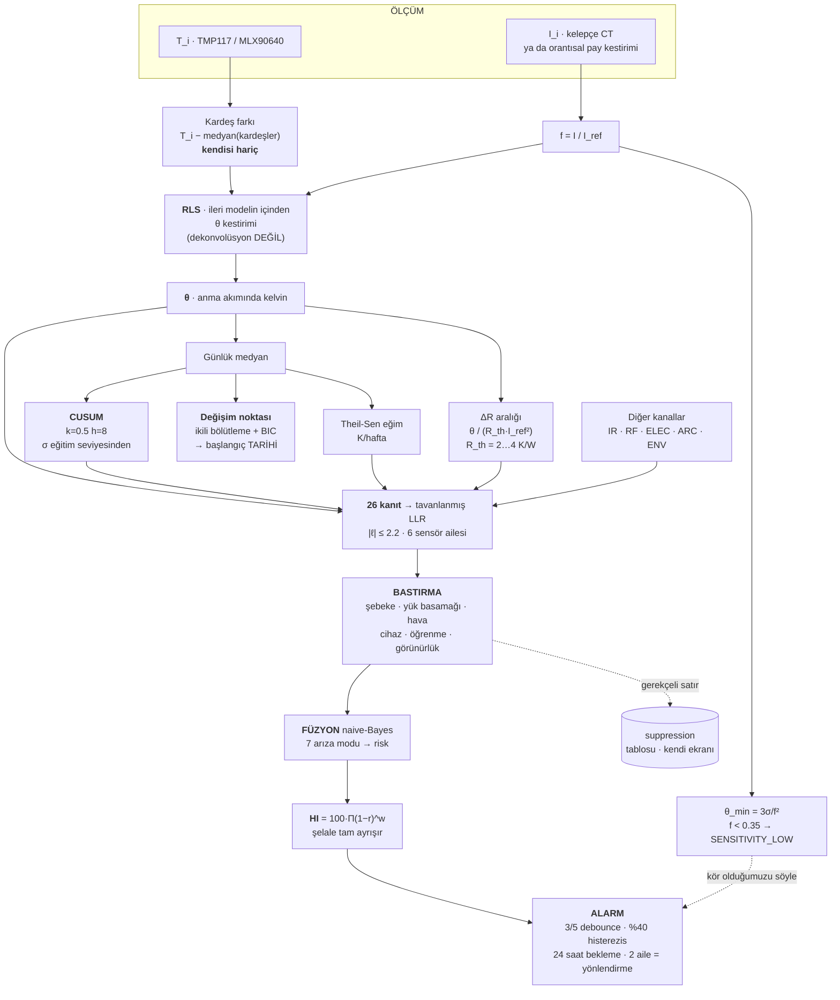

# 04 · Anomali Tespit Yöntemi

Bu belge, bir dağıtım merkezi mühendisinin **tartışabileceği** biçimde yazılmıştır. Her
eşiğin bir gerekçesi, her sayının bir aritmetiği, her yöntemin bir reddedilme gerekçesi
vardır. Kabul edilmesi istenen tek şey ölçüm gürültüsünün büyüklüğüdür ve o da tablodadır.

---

## 0. Tespit zinciri, bir bakışta



Aşağıdaki bölümler bu zincirin her kutusunu tek tek gerekçelendirir.

---

## 1. θ — türetim

### 1.1 Fizik

Bir cıvatalı bağlantıda ısınmanın kaynağı Joule kaybıdır:

```
P = ΔR · I²
```

burada ΔR, sağlam bir bağlantıya göre **fazla** temas direncidir. Bu güç, yerel bir ısıl
direnç üzerinden dağılır:

```
ΔT_fazla = P · R_th,yerel = ΔR · I² · R_th
```

Aynı fiderin diğer iki fazı da aynı akımı taşır, aynı havayı solur, aynı yaştadır ve aynı
yüzeyi gösterir; onlarda ΔR ≈ 0 olduğu için bu terim yoktur. Farkı alıp anma akımına
normalize edersek:

```
        T_i − medyan(T_kardeşler)
θ_i  =  ─────────────────────────      [anma akımında kelvin]
              (I / I_ref)²
```

### 1.2 Neyi neden götürüyor

| Karıştırıcı | Nasıl götürülüyor | Kalan hata |
|---|---|---|
| **Yük** | Joule ısınması I² ile gider; (I/I_ref)²'ye bölmek onu sadeleştirir | Konveksiyon P^0.8 olduğu için f^(2(n−1)) kalır: f = 0.27'de ~1.60× **fazla** raporlama. `thermal.theta_load_bias(f, n)` ile bölünür. Kalan yön **muhafazakârdır**: kusur hafif yükte daha kötü görünür, asla daha iyi değil. |
| **Ortam sıcaklığı, mevsim, güneş kazancı** | Kardeşler 20 mm arayla aynı havadadır; hava ne yaparsa üçüne birden yapar | Hava dalgası senaryosunda ölçülen θ kayması **0.0000 K** |
| **Yayıcılık (IR)** | Üç pabuç aynı yüzeyi, aynı açıdan, aynı piksel dizisine gösterir | Kenar pikseli karışımı → σ_m = 0.8 K (kelepçenin 0.2 K'i değil) |
| **Kabin konveksiyonu / havalandırma** | Kısmen | **Temiz bir sıfır değildir.** Havalandırma tıkandığında faza özgü sigorta kutbu terimi de büyür ve bu kardeşler arasında sadeleşmez: kelepçeli bağlantılarda ölçülen kayma **≤ 2.9 K**. Ayırt edici ölçüt θ'nın sıfır olması değil, **her bağlantının birlikte yükselmesidir**. |

### 1.3 Kardeş kim, kardeş kim değil

`assets.sibling_groups()`:

* `bottom:F01` … `bottom:F10` — her fiderin **üç fazı** bir akran kümesidir (10 küme).
* `bottom:N` — 10 nötr **kendi** grubunu oluşturur ve θ ile **yargılanmaz**.

Nötrün fazlarla kardeş olmamasının nedeni fizikseldir: nötr, dengesizlik akımını **artı**
üçün katı harmonikleri taşır, yani akımı fazlarınkinden farklıdır. Ona kural **H3**
uygulanır (§6).

**Kritik uygulama ayrıntısı:** medyan, bağlantının **yalnız kardeşleri** üzerinden alınır,
kendisi hariç. Üç faz üzerinde kendini de içeren bir medyan, kusurlu faz kardeşlerinden
birini geçtiği anda sessizce başka bir kardeşe atlar ve sinyalin ölçülen **%40'ını yer**.

### 1.4 θ'dan fazla dirence — ve neden hep bir aralık

```
ΔR = θ / (R_th · I_ref²)
```

`R_th,yerel` yalnız bir çarpan kadar bilinir, bu yüzden ΔR **asla tek bir sayı olarak**
raporlanmaz; varsayılan R_th aralığı hep yanındadır.

Baradaki yerel bir kaynak, **iki taraflı bir kanat** gibi davranır:

```
R_th = 1 / ( 2 · √(h · P · k · A) )
```

2×(100×10) mm² Cu için k = 400 W/mK, A = 2×10⁻³ m², P ≈ 0.44 m, h = 5–12 W/m²K
→ **R_th ≈ 0.24 … 0.38 K/W**.

240 mm²'lik bir **kablo pabucu** için ısının kaçacak tek yolu kablodur:
**R_th ≈ 2 … 4 K/W**.

| θ (K, 400 A'de) | ΔR aralığı (R_th = 2–4 K/W) | 400 A'de güç |
|---:|---|---:|
| 2.0 (İZLE) | 3.1 – 6.3 µΩ | 0.5 – 1.0 W |
| 5.0 (UYARI) | 7.8 – 15.6 µΩ | 1.25 – 2.5 W |
| 12.0 (KRİTİK) | 18.8 – 37.5 µΩ | 3.0 – 6.0 W |
| 25.0 (ACİL) | 39.1 – 78.1 µΩ | 6.3 – 12.5 W |

Referans noktaları: sağlam kalaylı cıvatalı bağlantı **2–5 µΩ**; 2312 A'de bu ~27 W'tır.
50 µΩ'a bozulmuş aynı bağlantı **267 W** harcar. 400 A'lik bir fider pabucu 50 µΩ'da
**8.0 W** harcar.

> **Bu belgede 3.44 K/W diye bir sayı geçmez.** Erken bir taslakta vardı; bir mertebe
> yanlıştı ve belgelenmiş bir arıza vakası için fiziksel olarak imkânsız olan 919 K'lik bir
> artış öngörüyordu. Düzeltildi.

---

## 2. θ nasıl kestiriliyor: ileri modelin **içinden** regresyon

### 2.1 Bir bağlantı bir direnç değil, bir ısıl kütledir

Ölçülen fazlalık yükü birinci derece gecikmeyle takip eder:

```
ΔT[k] = a · ΔT[k−1] + (1 − a) · θ · f[k]²        a = exp(−dt/τ),  f = I / I_ref
```

### 2.2 Dekonvolüsyon neden yapılmıyor

Cazip hamle bunu nokta nokta ters çevirmektir:

```
θ̂[k] = ( ΔT[k] − a·ΔT[k−1] ) / ( (1 − a) · f[k]² )      ← YAPMAYIN
```

Bu bir dekonvolüsyondur ve sensör gürültüsünü şu kazançla çarpar:

```
G = √(1 + a²) / (1 − a)
```

dt = 60 s, τ = 20 dk için a = 0.9512 ve **G = 28.3**. σ_m = 0.2 K'lik bir TMP117 çifti bu
durumda örnek başına **5.7 K standart sapmalı** bir θ kestirimi üretir — avladığımız 5 K'lik
kusurdan **büyüktür**. `panogoz/detector/theta.py` self-test'i iki kestiriciyi aynı sentetik
veri üzerinde çalıştırır ve iki bağıl standart sapmayı basar: bu, iddia edilmiş değil
**ölçülmüş** bir çarpandır.

### 2.3 Doğru hamle: ileri modeli koru, içinden regresyon yap

```
y[k] = ΔT[k] − a·ΔT[k−1]          (hedef)
x[k] = (1 − a) · f[k]²            (regresör)
y[k] = θ · x[k] + gürültü
```

Tek parametreli, unutma katsayılı **özyinelemeli en küçük kareler (RLS)**. RLS aynı bilgiyi
tek örnek yerine binlerce örnek üzerinde ortalar; gürültüsü etkin pencere uzunluğunun
kareköküyle küçülür. Maliyeti beş kayan nokta durum ve örnek başına ~10 işlemdir —
ölçüldü: **çağrı başına 2.67 µs**, yani 374 000 güncelleme/s. Bu, tüm zincirin ağ geçidinde
de koşabilmesinin nedenidir.

Sahada önemli iki ayrıntı:

* **Kovaryans şişmesi.** Pano hafif yüklüyken x küçüktür ve örnek θ hakkında bilgi
  taşımaz. Naif bir unutma katsayısı bu örneklerde P'yi şişirmeye devam eder ve sessiz bir
  geceden sonraki ilk bilgilendirici örnek devasa bir sıçrama üretir. **Bilgisiz örneklerde
  unutmuyoruz** ve P'yi tavanlıyoruz.
* **τ'nun doğru olması gerekmiyor.** Yarı-durağan yük altında en küçük kareler çözümü
  varsayılan a'ya **tam olarak duyarsızdır**: gerçek modeli normal denklemlere koyunca
  `θ̂ = θ · [(a − a′) + (1 − a)] / (1 − a′) = θ`. Yalnız gerçekten hızlı yük basamakları
  hata sızdırır ve sızıntı ikinci mertebedendir. τ'da %100 hata, sapmada birkaç yüzde
  maliyet demektir.

### 2.4 τ ızgarası

`identify_tau()` beş noktalı logaritmik bir ızgarada arar ve durur:

| τ (s) | 5 | 10 | 20 | 40 | 60 dk |
|---|---:|---:|---:|---:|---:|
| değer | 300 | 600 | 1200 | 2400 | 3600 |

Beşten fazla nokta aramanın anlamı yoktur: yukarıdaki duyarsızlık argümanı gereği ızgaranın
görevi mertebeyi yakalamaktır, τ'yu ölçmek değil.

---

## 3. Görülebilirlik tabanı — kör olduğumuz yeri söylemek

Yük faktörü f'te bir kusur, gözlemlenen fazlalıkta yalnız **θ·f²** üretir. Kardeş-fark
gürültüsü σ_m ve 3σ görülebilirlik şartıyla:

```
θ_min(f) = 3 · σ_m / f²
```

| Yük faktörü f | θ_min · TC (σ = 0.2 K) | θ_min · IR (σ = 0.8 K) | Durum |
|---:|---:|---:|---|
| 1.00 | 0.60 K | 2.40 K | tam görüş |
| 0.85 | **0.83 K** | 3.32 K | tam görüş |
| 0.70 | 1.22 K | 4.90 K | tam görüş |
| 0.60 | **1.67 K** | 6.67 K | iyi |
| 0.50 | 2.40 K | 9.60 K | iyi |
| 0.40 | **3.75 K** | 15.0 K | sınırda |
| **0.35** | **4.90 K** | 19.6 K | ← **eşik** |
| 0.30 | 6.67 K | 26.7 K | `SENSITIVITY_LOW` |
| 0.20 | **15.0 K** | 60.0 K | `SENSITIVITY_LOW` |
| 0.10 | 60.0 K | 240 K | pratikte kör |

**f ≈ 0.35'in altında sistem AZALTILMIŞ DUYARLILIKTA'dır ve bunu söylemek zorundadır.**
`SENSITIVITY_LOW` bayrağı kurulur, ekranda "şu anda küçük bir kusuru göremiyoruz" yazar,
SCADA'da `STATUS_WORD` bit 2 kurulur ve global blokta `PANELS_SENSITIVITY_LOW` sayacı
artar.

**Bu bir kusur değil, bir özelliktir.** Rakip bir ürün gece yarısı %15 yükte "her şey
normal" der; biz "şu anda 15 K'nin altını göremiyorum" deriz. İkincisi kullanılabilir bir
bilgidir.

Mutlak sıcaklık limitleri (§8) bu bayraktan **etkilenmez**: 130 °C bir pabuç, yükün ne
olduğundan bağımsız olarak 130 °C'dir.

---

## 4. Akran istatistiği

θ'nın kendisi bir farktır, ama fider içindeki hangi fazın aykırı olduğunu söylemek için bir
sağlam z-skoru kullanılır:

```
z = (değer − medyan(akranlar)) / (1.4826 · MAD(akranlar))
σ tabanı: medyanın %2'si   (üç elemanlı bir kümede MAD sıfır olabilir)
```

Ortalama ve standart sapma **kullanılmaz**: üç elemanlı bir kümede tek bozuk eleman
ortalamayı kendine doğru çeker ve standart sapmayı şişirir; yani kusurun kendisi kendi
görünürlüğünü azaltır. Medyan ve MAD bu geri beslemeye sahip değildir.

34 IR-only pabuç için akran kümesi yine kendi fiderinin üç fazıdır; farkları IR dizisinden
gelir ve gürültüsü 0.8 K'dir. Bu 34 bağlantı için **damar akımı yoktur** — hiçbir çıkışta
dağıtım şirketi CT'si yok — bu yüzden yük faktörü, analizörün faz akımından
`I_faz / 3250 A` (yedek olmayan fider anmalarının toplamı) orantısal pay varsayımıyla
kestirilir ve bu kestirim **her bağlantının Türkçe notunda etiketlenir**.

---

## 5. Sürüklenme: CUSUM

### 5.1 Neden günlük medyan üzerinde

θ, dakika ölçeğinde gürültülüdür. Avladığımız sinyal **0.2 K/hafta**'dır. ~1440 örneğin
günlük medyanı, ekibin panoyu açmasına, kapının önüne kamyon park etmesine ve tek bir bozuk
çerçeveye karşı sağlamdır; ve zaman sabiti haftalar olan bir süreç için doğru örnekleme
adımı gündür.

### 5.2 σ nereden gelir, nereden gelmez

σ, **eğitim SEVİYESİNİN** standart sapmasıdır: 14 günlük medyanın düz örnek standart
sapması.

Lag-1 farklarından kestirmek (klasik MR-çubuğu / 1.128 numarası) **yanlıştır.** θ günden
güne pozitif otokorelasyonludur — hava, yük deseni ve bağlantının kendi ısıl durumu devam
eder — bu yüzden lag-1 farkları varyansın yalnız yüksek frekanslı kısmını görür ve CUSUM
sapmasını fiilen sürükleyen düşük frekanslı varyansı **sistematik olarak eksik** tahmin
eder. Lag-1 otokorelasyonu 0.6 olan bir seride fark tabanlı kestirici gerçek seviye
sd'sinin yaklaşık **%63**'ünü verir; tek başına bu, ARL0'ı bir mertebeden fazla kısaltır.

σ **0.8 K'de tabanlanır.** On dört gün boyunca çok sessiz duran bir bağlantıya 0.1 K'lik
bir σ verilirse, hava değiştiği ilk gün kalıcı bir yanlış alarm üreticisine dönüşür.

### 5.3 Parametreler ve ARL0 aritmetiği

`k = 0.5` (σ birimlerinde) klasik seçimdir, 2k = 1σ'lık bir kaymayı yakalamak için
optimaldir. `h = 8` — ders kitabının 4 veya 5'i değil — yukarıdaki otokorelasyon nedeniyle.

Siegmund yaklaşımı:

```
ARL0 = [ exp(2·k·b) − 2·k·b − 1 ] / (2·k²),      b = h + 1.166

     = [ exp(9.166) − 9.166 − 1 ] / 0.5
     = [ 9566.5 − 10.166 ] / 0.5
     = 19 112 günlük örnek   ≙  bağlantı başına 52.3 yıl
```

1.166, kesikli bir rassal yürüyüşün sürekli bir sınırı aşarken yaptığı taşmanın süreklilik
düzeltmesidir. **Atlanamaz:** düşürülürse 19 112 → 5 944 olur, yani 3.2 kat hata.

### 5.4 Yayınlanan yanlış alarm hızı

`panogoz.detector.cusum` self-test'inin bastığı ölçülmüş filo aritmetiği:

| Filo | Bağlantı-gün/gün | Geçiş/gün | Yorum |
|---|---:|---:|---|
| 100 pano × 40 izlenen bağlantı | 4 000 | **0.209** | filoda ~4.8 günde bir yanlış CUSUM geçişi |
| 100 pano × 48 (her yol donatılsaydı) | 4 800 | 0.251 | 4.0 günde bir |
| Pano başına | 40 | — | **1.3 yılda bir** yanlış geçiş |

**Ve bir geçiş bir alarm değildir.** Kurallar katmanı üçünü birden ister:

```
cusum > 8   VE   θ_günlük ≥ 5 K   VE   son 5 günün 3'ü
```

Yukarıdaki sayılar bu nedenle alarm hızının **üst sınırıdır**, kendisi değil.

### 5.5 Dürüst uyarılar

1. Formül i.i.d. normal artışlar varsayar. θ'nın günlük medyanları pozitif
   otokorelasyonludur ve ρ katsayılı bir AR(1), birikmiş artış varyansını (1+ρ)/(1−ρ) ile
   şişirir. ARL0 h'ye **üstel** bağlı olduğu için ceza da üsteldir: ölçülen değerlerle
   ρ = 0.3 → 1 078 gün, ρ = 0.6 → 188 gün. h'nin 8 olmasının sebebi tam olarak budur;
   h = 5'te i.i.d. ARL0 zaten yalnız 938 gündür.
2. Sevk edilen yapılandırmada σ, 14 günlük medyandan **öğrenilir**; ölçüm, bunun ARL0'ı
   ~2.8 kat **uzattığını** gösterir (14 örneklik bir σ kestirimindeki gürültü, ARL0 ≈
   exp(2kb·(σ̂/σ)²) olduğu için ortalama koşu uzunluğunu uzatır). Hata **güvenli yöndedir**:
   ilan ettiğimizden daha az yanlış alarm.

### 5.6 Ne kadar hızlı yakalıyor

| Kayma | Siegmund ARL1 |
|---:|---:|
| 0.75σ | 28.7 gün |
| 1.00σ | 16.3 gün |
| 1.50σ | 8.7 gün |
| 2.00σ | 5.9 gün |
| 3.00σ | 3.6 gün |

Doğrusal sürüklenmede (σ = 0.8 K) h'nin aşılma zamanı:

| Eğim | h aşılıyor |
|---:|---:|
| 0.1 K/hafta | başlangıçtan 69.0 gün sonra |
| **0.2 K/hafta** | **39.4 gün sonra** |
| 0.5 K/hafta | 20.1 gün sonra |
| 1.0 K/hafta | 12.7 gün sonra |

Gerçek `cusum_update()` üzerinden gün gün koşturulan gürültüsüz 0.2 K/hafta sürüklenmesi
**49. günde**, yani başlangıçtan **35 gün sonra** h'yi aşar. Kapalı biçim tahmini 39.4 gün;
ikisi tutarlıdır.

---

## 6. Başlangıç tarihi: değişim noktası

CUSUM bir bağlantının sürüklendiğini söyler; **ne zaman başladığını** söylemez. Ve "ne
zaman", ürünün kurabildiği en ikna edici cümledir:

> *"C06 / L2 çıkış pabucu: bu bozulma yaklaşık 14 Temmuz'da başladı, 41 gün önce."*

Bu cümle bir bakım planlayıcısıyla konuşmayı değiştirir. *"Bu bağlantı 6 K sıcak"*, sensör
üzerine bir tartışma davetidir; *"bu bağlantı, adını söyleyebileceğim bir tarihten beri her
gün kötüleşiyor, işte serisi"* değildir. Ayrıca dağıtım şirketinin **zaten bildiği** bir
şeyle (bir manevra, bir fırtına, bir yük aktarımı, bir müteahhit ziyareti) ilişki kurmasını
sağlar — kök neden çoğu zaman odur.

**Yöntem:** ortalama-kayması maliyeti üzerinde tam ikili bölütleme. Her aday bölünme
noktası için bölüt içi kareler toplamı, x ve x² ön eklerinden O(1)'de hesaplanır; tüm tarama
O(n)'dir ve 40 bağlantı × 120 gün mikrosaniyeler sürer. Aday, değişim-noktası-yok modeline
karşı bir **BIC testinden** geçmelidir:

```
kabul  ⟺  n·log(SSE₀/n) − n·log(SSE₁/n)  >  BIC_PARAMS · log(n)      (+ fiziksel basamak tabanı)
```

**Değişim noktası yoksa `None` döndürmek zorunlu bir gerekliliktir.** Her zaman bir tarih
söyleyen bir dedektör, sağlam bir bağlantı için de tarih söyler; ve bir ekip bunun yüzünden
sağlam bir panoya ilk kez gittiğinde sistem kapatılır. 90 günlük serilerde σ = 0.8 K'de
ölçülen çalışma noktası: **%0.5 yanlış tarihleme**, 0.2 K/hafta rampasında **%95 tespit**.

**Rampa ve basamak.** Bozulan bir bağlantı genelde rampa yapar, basamak değil. Rampaya
basamak uydurmak kestirimi rampanın ortasına koyar, yani raporlanan başlangıç genelde
**gecikir**: 0.2 K/hafta rampasında ölçülen medyan gecikme ≈ **+18 gün**, gürültü
gerçeklemeleri üzerinden yayılım kabaca −18 … +37 gün. Bu yüzden arayüz tarihi bir
**aralıkla** verir ("yaklaşık 21 Ağustos, ±3 hafta"). Burada sahte kesinlik, tarihsizlikten
daha kötüdür.

**Bir tarih tek başına asla alarm değildir.** CUSUM ve seviye testinin zaten açtığı bir
alarmın kanıt satırıdır.

Eğim ayrıca **Theil-Sen** ile 21 günlük pencerede hesaplanır (K/hafta). Theil-Sen, en küçük
karelere göre aykırı değere sağlamdır; bir günlük bozuk medyan eğimi döndüremez.

---

## 6.1 İleri yön: eşiğe kalan gün

§5 ve §6 geçmişe bakar — CUSUM sürüklenmeyi **teyit eder**, değişim noktası
bozulmanın **başladığı** günü tarihler. Bakım planlayıcısının sorduğu soru ise
ileriye bakar: *bu pabuç ne zaman benim sorunum olacak?*

Cevap elimizdeki verinin içindedir. `slope_per_week()` zaten K/hafta cinsinden
bir eğim üretiyor; eksik olan eğimin **belirsizliği** ve sayı vermeyi **reddetme
kurallarıydı**. Yeni bir kestirici eklenmedi; var olan kestirici bir tarihe
çevrildi (`panogoz/detector/horizon.py`).

**Fayda iddiası sınırlıdır ve böyle satılır:** bir iş emrinin bu haftaya mı
gelecek aya mı yazılacağına karar vermeye yeter. Bir kesinti tarihini bu sayıya
göre planlamaya **yetmez**.

### 6.1.1 Aritmetik

Hedef, θ'nın **günlük** değerinin bulunduğu bandın bir üstüdür (§8'in merdiveni:
IZLE 2 K · UYARI 5 K · KRITIK 12 K · ACIL 25 K). Kalan kelvin, eğimin güven
aralığının üç ucuna bölünür:

```
gün_med = kalan_K · 7 / eğim_med
gün_lo  = kalan_K · 7 / eğim_hi      (hızlı uç -> az gün)
gün_hi  = kalan_K · 7 / eğim_lo      (yavaş uç -> çok gün)
```

`eğim_lo <= 0` ise üst gün sınırı **sonsuzdur**. Bu, "yükseliyor olabilir de
olmayabilir de" cümlesinin matematikten çıkan hâlidir; elle yazılan bir uyarı
değildir.

Yuvarlama yönü muhafazakârdır — aralık daralmaz, genişler: `gün_lo` aşağı,
`gün_med` en yakına, `gün_hi` yukarı.

Hedef **füzyon seviyesinden değil**, θ'nın kendi merdiveninden okunur. Ark
rölesi açmış ama θ'sı 3 K olan bir bağlantı KRITIK görünür; onun için "ACIL'e
kalan gün" hesaplamak, ısıl olmayan bir kanıtla ısıl bir projeksiyon kurmak
olurdu.

### 6.1.2 Belirsizlik: Sen (1968) rank aralığı

`theil_sen()` bütün ikili eğimleri üretip medyanını alıyor ve listeyi atıyordu.
Aynı listenin rank kuantilleri, eğimin **parametrik olmayan** güven aralığıdır:

```
N        = n(n-1)/2
Var(S)   = [ n(n-1)(2n+5) - Σ t_g(t_g-1)(2t_g+5) ] / 18
C        = z · sqrt(Var(S))
alt rank = floor((N - C) / 2)
üst rank = ceil((N + C) / 2) + 1
```

`t_g`, birbirine eşit θ değerlerinin grup büyüklükleridir. Zaman tarafında
bağlanma **olamaz**: `joint_daily`'nin birincil anahtarı `(day, panel_key,
joint_key)`.

Rank seçimi `floor`/`ceil+1` ile bilinçli olarak muhafazakârdır ve **bedeli
ölçüldü**: nominal %90 seviyede fiilî kapsama, n=21 · σ=0.8 K · 400 koşum · beş
tohumda **%88.0–93.2**. Bu yüzden belge ve arayüz "**%90 nominal**" der, "tam
%90" demez. Kapsama ölçek-bağımsızdır (σ 0.8 → 0.4'te aynı sayı): hem aralık hem
gürültü σ ile doğrusal ölçeklenir.

Bootstrap reddedildi: RNG bağımlılığı getirir ve 112 pano × 74 bağlantı ×
yeniden örnekleme ölçülmemiş bir CPU maliyetidir. Çoklu pencere duyarlılığı
(14/21/28 gün) reddedildi: okunması kolaydır ama bir güven aralığı **değildir**.

### 6.1.3 Susma sözleşmesi

Sözleşme tek cümledir: **gerekçe boş ise ve yalnız ise gün dolu.** Kapılar
sırayla değerlendirilir, ilk tutan kazanır ve tek bir kod döner.

| Sıra | Kod | Koşul |
|---|---|---|
| 0 | `IZLENMIYOR` | Bağlantı hiç ölçülmüyor (canlı bara bölmesi, gün 1 kapsamı dışı) |
| 1 | `NOTR_KAPSAM_DISI` | Nötr: serisi θ değil K_N'dir, mutlak merdiven uygulanmaz (§9, H3) |
| 2 | `ZIRVEDE` | θ >= 25 K; üstünde basamak yok |
| 3 | `YETERSIZ_GECMIS` | 21 günlük pencerede 14'ten az geçerli gün |
| 4 | `GORUNURLUK_DUSUK` | Pencere medyanı θ_min >= hedef eşik |
| 5 | `EGIM_YOK` | Medyan eğim <= 0 |

0, 1, 2 ve 5 **arıza değildir**; sistemin doğru çalıştığı durumlardır. 3 ve 4
körlüğün kendisidir ve §3'ün diliyle raporlanır.

**Görünürlük kapısının kriteri neden yüzde değil.** §8'in `SENSITIVITY_LOW`
bayrağı `sensitivity_pct < 100` eşiğini kullanır; bu bayrak için doğrudur,
projeksiyon için değildir — tam yükün altındaki her bağlantıyı susturur ve kolon
neredeyse hep boş çıkar. Fiziksel olarak doğru soru şudur: **θ_min hedef eşiğin
üstündeyse o eşiğe doğru yapılan projeksiyon anlamsızdır**, çünkü eşiğin kendisi
gürültü tabanının altında kalır. θ_min = 3σ/f² artık `joint_daily.theta_min`
olarak gün gün saklanıyor — şema kolonu baştan tanımlıyordu, `roll_daily()` onu
bu sürüme kadar yazmıyordu.

**14 gün nereden geliyor.** İstatistiksel güçten değil, pencere kapsamasından:
pencere 21 gün, 14 geçerli gün istemek pencerenin en çok bir haftasının boş
olmasına izin vermek demektir. Gürültüye karşı koruma bu kapıda değil, güven
aralığının **kendisindedir** — seri gürültülüyse alt sınır sıfırın altına iner,
üst gün sınırı sonsuz olur ve sayı kendi şüphesini taşır.

**90 gün tavanı.** Medyan 90 günü geçerse arayüz gün sayısı değil `>90 g` yazar.
21 günlük bir pencereden 412 günlük bir tarih türetmek, gözlem penceresinin
yirmi katına ekstrapolasyondur; ayrıca 90 gün ileri bir mevsim sınırını geçer ve
günlük medyanın gürültü tabanı yükle birlikte hareket eder.

Tavan bir susma **değildir** ve bunun ölçülmüş bir sonucu vardır: sağlıklı bir
pabuç, gürültü seviyesinde pozitif bir eğimle IZLE eşiğine 117–211 gün mesafede
görünebilir ve ekranda `IZLE'ye >90 g` yazar. Bu bir alarm değildir — §8'de IZLE
zaten "haftalık özet listesine girer, ekip çıkmaz" demektir — ve negatif
kontrollerin sözleşmesi buna göre yazılmıştır: ağır hedefe projeksiyon yok,
tavanın altında (takvime yazılabilir) gün yok.

### 6.1.4 İki itiraz, iki cevap

**Doğrusallık.** Model doğrusaldır. `thermal_runaway` süper-doğrusaldır — ısınan
bir temas direncinin artması daha fazla ısınmaya yol açar — yani o modda bu
projeksiyon **iyimserdir** ve gerçek tarih hesaplanandan erkendir. Sayı
gizlenmez: `model` alanı taşınır ve kanıt ekranı "gerçek tarih daha erken
olabilir" der. Süper-doğrusal bir model uydurmak, kalibre edecek saha verisi
olmadan ölçülemeyen bir iddia eklemek olurdu.

**Basamak ve rampa.** On gün önce 3 K'lık bir kademe atlayıp sonra düzleşen bir
seri, 21 günlük pencerede sahte bir rampa üretir. Pencerede bir değişim noktası
varsa (§6) projeksiyon **yalnız o günden sonrasını** kullanır. Modülün öz-testi
ikisini yan yana basar: aynı seride pencere bütünü +1.16 K/hafta derken, değişim
sonrası −0.04 K/hafta çıkar ve sistem susar.

`slope_k_per_week` tanımına **dokunulmadı**: §5'in `SLOPE_ESCALATE` kuralı ve
filo tablosunun eğim kolonu aynı anlamı korur. Projeksiyonun fiilen kullandığı
eğim ayrı raporlanır ve ikisi ayrıştığında kanıt ekranı nedenini yazar. İki
sayı, iki soru, iki yer.

### 6.1.5 Bu bölümün yapmadıkları

| Yapmadık | Neden |
|---|---|
| Süper-doğrusal ya da mevsimsel model | Kalibre edecek saha verisi yok; ölçmediğimiz bir modeli teklif etmeyiz |
| Dört basamağın hepsi için ayrı gün sayısı | Yalnız bir sonraki basamak; operatörün sorduğu soru bu |
| Nötr iletkenler için projeksiyon | Serisi K_N'dir, mutlak merdiven uygulanmaz |
| Bu sayıya dayanarak otomatik iş emri, ekip yönlendirme, kesinti planı | Projeksiyon bir **göstergedir**; aksiyon merdiveni §8'e bağlı kalır |
| SCADA register'ı | 48 register'lık pano bloğu **tam dolu**; büyütmek her panonun taban adresini kaydırır ve ICD v2.0'ı bozar. Eklemeli bir ETA bloğu tarif edildi, kurulmadı |
| `joint_state`'e kalıcılık | Türetilmiş bir sayıdır; `_refresh_stats` her turda `joint_daily`'den yeniden hesaplar. Sekiz ay sonra `SELECT` ile yeniden üretilemeyen bir istatistik kanıt değildir |
| Alarm ekranında gün sayısı | `/api/alarms` bir `incident` tablosu projeksiyonudur; canlı bir türetilmiş sayıyı oraya koymak iki kaynağı karıştırırdı |

---

## 7. Yedi arıza modu ve sağlık endeksinin tam ayrışması

### 7.1 Kanıttan moda

Hiçbir kanal tek başına karar vermez. Her gözlem **tavanlanmış log olabilirlik oranı**
olarak girer:

```
ℓ = clamp( birim_başına · (değer − eksen), −2.2, +2.2 )
```

Tavan işin özüdür. Mod başına önsel ≈ %2 (log-odds ≈ −3.9) olduğuna göre, tavanına
dayanmış **tek** bir kanal bir modun riskini ancak `sigmoid(−3.9 + 2.2) = 0.16`'ya
taşıyabilir. 200 °C okuyan takılı bir sensör, nişanı kaymış bir IR dizisi, biri bağlantıyı
yeniden sıktığı için kaçmış bir CUSUM — hiçbiri **tek başına** KRİTİK üretemez. İki bağımsız
kanal üretebilir. Bu, iki kanallı yönlendirme kuralının bir politika belgesi yerine
**aritmetikle** ifade edilmiş hâlidir.

Modlar naive-Bayes ile birleşir:

```
L_m = logit(önsel_m) + Σ_i c_i · ℓ_i        r_m = sigmoid(L_m)
```

`c_i`, i kanıtının m moduna **bağlaşımıdır**. Kütükte **26 kanıt tanımı**, **6 sensör
ailesi** ve **7 mod** vardır.

| Aile | Ölçüm ilkesi | Kanıtları |
|---|---|---|
| **TC** | TMP117, kablo damarı | θ, θ CUSUM, θ eğimi |
| **IR** | MLX90640 dizisi | pabuç mutlak sıcaklığı, diziden θ |
| **RF** | HFCT / TEV / ultrasonik | Qmax, darbe hızı, 30 g eğilim, TEV, yüzen imza, yüzey imzası |
| **ELEC** | Entes MPR-53CS | yük faktörü, fider/anma, akım THD, I_N/faz, K_N eğilimi |
| **ARC** | ABB TVOC-2 | arızalı dedektör, haberleşme yok, aktif hata, otokontrol yaşı, ışık uyarısı, takılı değil |
| **ENV** | SHT41 | bölme havası, hava yükselişi, yoğuşma payı, bağıl nem |

**İki hemfikir kanal = iki farklı ölçüm İLKESİ**, aynı termometreden türetilmiş iki
istatistik değil. θ ile CUSUM'u aynı TMP117 üretir; onlar **bir** ailedir. Aynı pabuğu hem
kelepçenin hem dizinin sıcak görmesi **iki** ailedir. Kitin bilinçli örtüşmesinin sebebi
budur: altı kelepçe ve bir dizi, 6. ve 7. çıkışa aynı anda bakar.

### 7.2 Yedi mod

| Mod | Türkçe | Ağırlık w_m | Aksiyon |
|---|---|---:|---|
| `loose_connection` | Gevşek bağlantı | 0.30 | Tork anahtarıyla yeniden sık, temas yüzeyini kontrol et |
| `overload` | Aşırı yük | 0.15 | Yük profilini incele, fider dengeleme / kapasite artırımı |
| `arc_integrity` | Ark koruma bütünlüğü | 0.15 | Dedektörleri kontrol et, otokontrol sonucunu doğrula |
| `thermal_runaway` | Isıl kaçış / soğutma kaybı | 0.10 | Havalandırma menfezleri ve filtreler |
| `harmonic_neutral` | Harmonik nötr yüklenmesi | 0.10 | 3. harmoniği ölç, filtre veya dengeleme |
| `moisture` | Nem / yoğuşma | 0.10 | Kablo kanalı sızdırmazlığı, varsa ısıtıcı |
| `insulation` | Yalıtım zayıflaması | 0.10 | PD trendini izle, planlı kesintide yalıtım ölçümü |

Ağırlıklar toplamı tam olarak 1'dir ve bu, import anında assert edilir.

### 7.3 Sağlık endeksinin ayrışması

```
HI = 100 · Π_m (1 − r_m)^{w_m}
```

Logaritma alındığında:

```
ln(HI/100) = Σ_m w_m · ln(1 − r_m)
```

Eksiklik **hiçbir atıf sezgiseli olmadan** ayrışır. Arayüze verilen şelale, tam teleskopik
kısmi çarpımları kullanır; `delta_hi` sütunu kayan nokta hassasiyetinde `HI − 100`'e
toplanır ve self-test bunu assert edip artığı basar.

Bu, ürünün en çok sorgulanacak sayısının (tek bir "sağlık puanı") arkasında bir sihir
olmadığının kanıtıdır: puan, yedi riskten hangisinin ne kadar payı olduğu tam olarak
söylenebilir biçimde kurulmuştur.

### 7.4 Naive Bayes'in dürüst zayıflığı

Naive Bayes ilişkili kanıtı **fazla sayar**. Tek bir TMP117'den gelen θ + CUSUM + eğim,
`risk(loose_connection)`'ı 0.86'ya ve HI'yi 55'e itebilir. Bu bilinçlidir ve **çevrelenmiştir**:
aile tavanı şiddeti UYARI'da tutar ve ekip yönlendirmesini engeller. Ama yalnız risk
sayısına bakan bir gözlemci tek bir sensörden yüksek bir değer görür. Kodun docstring'i
bunu açıkça söyler; belge de söylüyor.

---

## 8. Şiddet merdiveni ve mutlak limitler

### 8.1 θ eşikleri, IR termografi pratiğine dayandırılmış

| Seviye | θ (anma akımında K) | IR termografi pratiğindeki karşılığı | Aksiyon |
|---|---:|---|---|
| BILGI | < 2.0 | — | Kayda alınır |
| **IZLE** | ≥ 2.0 | "benzer bileşene göre 1–3 K": olası kusur, izle | Haftalık özet, ekip çıkmaz |
| **UYARI** | ≥ 5.0 | "4–15 K": muhtemel kusur, uygun zamanda onar | İş emri açılır |
| **KRITIK** | ≥ 12.0 | "> 15 K benzer bileşene göre": ciddi | 7 gün içinde ziyaret |
| **ACIL** | ≥ 25.0 | acil müdahale bandı | Derhal ekip, SMS + sesli |

Temizleme eşiği, kaldırma eşiğinin **%60'ıdır** (histerezis 0.60): 5.0 K'de açılan bir alarm
3.0 K'de kapanır. Histerezissiz bir eşikte tam eşik üzerinde duran bir bağlantı, her
değerlendirmede bir olay üretir; sonsuza kadar.

**Bizim eşiklerimiz o pratikten bir yönde daha katıdır:** ΔT'yi ölçtüğümüz an değil, **anma
akımına normalize edilmiş** hâliyle raporlarız. %40 yükte ölçülen 2 K'lik bir fark, anma
akımında 12.5 K'dir; klasik termografi bunu "1–3 K, izle" diye yazar, biz KRİTİK deriz. Fark,
kamera kullanan kişinin yükü hesaba katmamasıdır.

### 8.2 Mutlak sıcaklık limitleri — ve bunların bir çıkarım olduğu

| Limit | Değer | Kaynak |
|---|---:|---|
| Yerel kritik | **110 °C** | **Mühendislik çıkarımı** — bkz. aşağı |
| Yerel acil | **130 °C** | **Mühendislik çıkarımı** |
| Ağ geçidi yerel kuralı | 90 °C | Sunucu erişilemezken de geçerli olan muhafazakâr eşik |
| Malzeme sert sınırı | **232 °C** | Kalay kaplamanın erime noktası |

> **DÜRÜSTLÜK NOTU — bu paragrafı atlamayın.** TS EN 61439-1, bara **cıvatalı bağlantısı**
> için sayısal bir sıcaklık artışı limiti **koymaz**; erişilebilir yüzeyler, terminaller ve
> el ile kumanda organları için Çizelge 8'e atıf yapar ve baralar için "komşu parçalara
> zarar vermeme" ölçütüne bırakır. **O çizelgenin sayıları bize verilen belgelerde yoktu.**
> Bu yüzden 110/130 °C bir standart alıntısı değil, **mühendislik çıkarımıdır**: 105 °C
> sınıfı XLPE/PVC kablo yalıtımının uzun süreli sınırı, kalayın 232 °C'lik erime noktası ve
> bakır oksidasyon hızının 120 °C üzerinde belirgin biçimde artması bir arada
> değerlendirilerek seçilmiştir. Gerçek Çizelge 8 değerleri elimize geçtiğinde bu iki sayı
> **tek satırda** değişir (`detector/engine.py`: `T_JOINT_KRITIK_C`, `T_JOINT_ACIL_C`).
> Bu, [11-ACIK-SORULAR.md] S7'dir.

Mutlak limitler `LEARN_MODE` sırasında da, `SENSITIVITY_LOW` sırasında da **aktiftir**.
Devreye almanın ikinci gününde 130 °C olan bir pabuç, ne kadar geçmişimiz olduğundan
bağımsız olarak 130 °C'dir.

---

## 9. Diğer kurallar

### 9.1 Kural H3 — nötr

Üçün katı harmonikler **sıfır bileşendir** ve nötrde **aritmetik** toplanır:

```
I_N = 3 · h3 · I₁
```

Ayrıştırma:

```
I_N,temel      = 3 · |I₀|              (analizör fazörlerinden)
harmonik fazla = √( max(0, I_N² − I_N,temel²) )
K_N            = ΔT_N / I_N²
```

Karar tablosu:

| K_N | ΔT_N | Teşhis | İş emri |
|---|---|---|---|
| Normal | Yüksek | **Harmonik yüklenme** | Filtre / dengeleme / derating |
| Kendi eğilimine göre **yükseliyor** | Yüksek | **Nötr bağlantısı bozuk** | Tork anahtarıyla yeniden sık |

Aynı sıcak bara, **iki farklı iş emri**. Bir termometre + eşik sistemi bu ikisini asla
ayıramaz ve her ikisinde de yanlış ekibi gönderir.

> **Uygulama uyarısı:** kanal kütüğünde akım **açısı** kanalı yoktur, bu yüzden `_run_h3`
> nominal 0 / −120 / +120 aralığına düşer. MPR-53CS bunları reg 66/68/70'te fiilen
> raporlar. Yaklaşıklık I_N,temel'i **eksik**, dolayısıyla harmonik fazlayı **fazla**
> tahmin eder — yani daha **ucuz** iş emrine doğru sapar. K_N bunu bağımsız olarak yakalar.
> `mpr.i_angle_l{1,2,3}_deg` kanalları eklendiği gün motor onları adıyla okur, kod
> değişmez.

**Türkiye AG fiderleri ağır biçimde tek fazlı yüklüdür; %20–40 faz dengesizliği RUTİNDİR.**
Hiçbir yerde denge varsayılmaz; her hesapta ölçülen faz akımları kullanılır.

### 9.2 Yoğuşma

Su havadan yoğuşmaz; çiy noktasının **altına düşmüş bir YÜZEYDE** yoğuşur. Şalt
ekipmanında sevk edilen hemen her "çiy noktası alarmı" çiy noktasını ölçülen **hava**
sıcaklığıyla karşılaştırır — yani asla yoğuşamayacak olan tek sıcaklıkla — ve bu yüzden geç
alarm verir ya da hiç vermez.

TEDAŞ panosu bunu özellikle kötüleştirir: Madde 2.2.8.6 Not:2 pano tabanını **tamamen
açık** bırakır ve kablo kanalı dağıtım merkezinin en soğuk, en nemli hacmidir.

```
Magnus-Tetens, Alduchov-Eskridge (1996):   a = 17.62,  b = 243.12 °C
γ  = ln(RH/100) + a·T/(b+T)
T_d = b·γ / (a − γ)                        kontrol: 20 °C / %50 → 9.26 °C

En soğuk yüzey, ortamın birinci derece gecikmesi olarak modellenir:
T_duvar[k] = a·T_duvar[k−1] + (1−a)·T_hava[k],   τ ≈ 90 dk

pay = T_duvar − T_çiy
```

τ = 90 dk uydurma değildir: birkaç kilogram çelik ve bakırın, bir yüzünde doğal
konveksiyonla toplu zaman sabitidir ve kablo kanallarında fiilen görülen sabah gecikmesini
yeniden üretir. **Bir modeldir, model olduğunu söylüyoruz** ve ürettiği pay bir **kestirim**
olarak raporlanır.

Neden boolean değil pay: payın bir gradyanı vardır, operatör riskin bir hafta boyunca
gecelerde büyüdüğünü görür. Boolean ise ancak plan yapmak için çok geç olduğunda haber
verir.

Şiddet: 400 V'ta ıslak yüzey atlama yapmaz; **yüzey kaçağı (tracking)** başlatır. Nem filmi
kaçak akım taşır, karbonlaşmış izler bırakır, izler büyür. Bu aylar-yıllar süren bir süreçtir
ve AG giriş kesicisi olmayan bir panoda faz-toprak arızasıyla biter — temizlemek OG tarafı
ve tüm dağıtım merkezi demektir. Bu yüzden yoğuşma **tek başına** İZLE ya da UYARI'dır;
**yükselen bir PD Qmax ile birlikte** KRİTİK olur, çünkü artık iki bağımsız fiziksel kanal
hemfikirdir.

### 9.3 RF kanalı: ne ölçüyoruz, ne ölçmüyoruz

* 400 V'ta **klasik kısmi deşarj oluşmaz** (Paschen minimumu 327 V).
* Ölçtüğümüz şey **gevşek bağlantı mikro-arkıdır**.
* **pC eşdeğeri** olarak, dB cinsinden raporlanır. **IEC 60270 izlenebilir DEĞİLDİR.**
* AG'de **tek başına asla ekip yönlendirmez.** Yalnız ısıl bulguyu destekler. Bu,
  `prpd_classify.severity()`'nin yapısal olarak **UYARI'da tavanlanmasıyla** zorlanır.

PRPD sınıfları ve fiziği:

| Sınıf | Türkçe | Faz imzası |
|---|---|---|
| `GURULTU` | Gürültü | Faz ilişkisi yok |
| `BOSLUK` | İç boşluk deşarjı | Gerilimin **yükselen eğimlerinde**, iki kutupta simetrik |
| `YUZEY` | Yüzey kaçağı | Geniş, gerilim tepesine yakın, asimetrik |
| `KORONA` | Korona | Tek kutupta yoğun, dar |
| `YUZEN` | Yüzen elektrot / gevşek bağlantı | **Akım sıfır geçişlerinde** kümelenmiş, düzenli genlikli tarak |

> **Erken bir taslakta "mikro-arklar akım tepelerini takip eder" yazıyordu. YANLIŞTI.**
> Bozulan bir bağlantıdaki seri ark, akım sıfıra yaklaşırken söner ve yeniden tutuşur;
> darbeleri **akım sıfır geçişlerinde** kümelenir. Gerilim güdümlü kısmi deşarj ise
> **gerilimin yükselen eğimlerinde** kümelenir. Bu ayrım, YUZEN sınıfını ayıran ölçüttür ve
> bir daha yanlış yazılmayacaktır.

---

## 10. Bastırma listesi — söylemediklerimiz ve nedenleri

Filo izlemede en zor sorun tespit değildir. Tek bir operatörün yüz panonun **doğru ama
işe yaramaz** alarmlarını okuyamamasıdır. Her bastırma kuralı tek bir soruya cevap verir:

> Bu okuma pano hakkında mı, yoksa şebeke, hava, yük ya da kendi cihazımız hakkında mı?

Pano dışındaki her şey bir pano arızası olamaz; `suppression` tablosuna, operatörün
okuyabileceği Türkçe bir gerekçeyle yazılır. **O tablo kendi ekranı olan bir üründür.**

| Kod | Tetikleyici | Gerekçe |
|---|---|---|
| `GRID_THD_3PH` | Üç fazın gerilim THD'si **birlikte** yükseldi (> %5 ve her biri kendi taban çizgisinin > %1.5 üstünde) — **yalnız kanıtı harmoniğin kendisi olan modlara** (`harmonic_neutral`, `insulation`) | Pano bir **yüktür**, kaynak değil; üç fazın gerilim bozulmasını kendi üretemez. Kaynak dışarıdadır; bu modlar için bu yeterlidir. **Bu tek desen, yüz panoyu yönetilebilir kılan şeydir**: bölgesel bir olay aksi hâlde yüz dürüst dedektörden yüz eşzamanlı "anomali" üretir. |
| `GRID_THD_3PH_CANDIDATE` | Aynı tetikleyici — fakat **ısıl modlara** (`loose_connection`, `overload`, `thermal_runaway`) uygulanan hâli | **Aynı ölçüm tesis içinden de gelebilir.** Büyük bir sürücü, UPS ya da redresör bu panonun beslediği taraftadır; üç faza birden harmonik akım basar ve gerilim bozunumu ortak yukarı akış empedansı üzerinde oluşur. Analizör ikisini ayırt edemez. Bu yüzden ısıl bulgu **silinmez, bir kademe geriletilir** (llr −0.5, tam bastırmanın −1.5'i değil) ve ekip vetosu konmaz. Atfın kesinleşmesi için panonun üretemeyeceği bir teyit gerekir: frekans penceresi, inrush sınıflandırması ya da filo genelinde eşzamanlılık. |
| `INRUSH` | Yük basamağı + yüksek akım THD, trafo devreye alma imzası | TEDAŞ EK-I/11 Not 5 zaten termik rölenin inrush'ta açmasını yasaklar; aynı kuralı biz de uygularız |
| `GRID_FREQUENCY` | f < 49.5 Hz veya f > 50.5 Hz | Bölgesel bir olay sürüyor; ısıl göstergeler pencere boyunca askıya alınır |
| `LOAD_STEP` | Son 15 dk'da yük %X değişti | θ **kararlı hâl** için tanımlıdır; bağlantının τ'su kadar, 3τ boyunca askıya alınır |
| `SENSITIVITY_LOW` | f < 0.35 | Bir **görünürlük** durumu, pano arızası değil |
| `DE_ENERGISED` | Panoda akım yok | Hiçbir ısıl gösterge anlamlı değil. **Modül durumu**, pano arızası değil |
| `STALE` | Veri yaşı > 90 s | Bayat görüntüden alarm üretilmez; son iyi değeri sessizce tekrar yayınlamak da yapılmaz |
| `LEARN_WEEK` | Devreye almadan itibaren 7 gün | Yalnız taban çizgisi toplanır. **Mutlak limitler bu pencerede de aktiftir; pencere hiçbir zaman kör değildir** |
| `MAINTENANCE` | Operatör bakım moduna aldı | Gerekçesi ve süresi kayıtlı |
| `THD_I_UNGATED` | En yüksek faz akımı < CT anmasının %10'u | Register %99.9'da doyar; düşük yükte okunan akım THD'si fizikî olarak anlamsızdır |
| `DEVICE_MOUNT_LOST` | Kelepçe kabloyla temasını kaybetti | Okunan sıcaklık artık **havanın** sıcaklığıdır. **CİHAZ iş emri** — bağlantıyı sıktırmayın |
| `DEVICE_AIM_SHIFTED` | Dizinin üç referans noktası eşleşmiyor | Pikseller artık aynı pabuçlara bakmıyor. **CİHAZ iş emri** |
| `DEVICE_CELL_LOW` | Pil zayıf | Ölçüm sürüyor, güvenilirliği düşüyor. **CİHAZ iş emri** |
| `DEVICE_STUCK` | Aynı değer N saniyedir değişmiyor | Takılı bir sensör kusursuz bir bağlantı gibi de görünebilir, korkunç bir bağlantı gibi de |
| `DEVICE_DRIFT` | Günde X K sapıyor | Sapan sensör **CİHAZ** iş emri üretir, tork iş emri **DEĞİL** |
| `OFFLINE` | Cihaz çevrimdışı | Kapsadığı bağlantılar için ısıl gösterge **yoktur**; "veri yok" ile "sorun yok" aynı şey değildir |

Bastırılan her satır, gerekçesi, sayıları ve zaman damgasıyla saklanır. Operatör *"78 °C
okudun, neden bana söylemedin?"* diye sorduğunda cevap ekranda, kendi dilinde, hazır durur.

### 10.1 Tazelik eşikleri cihazın sözleşmesinden türetilir, sunucuda sabit değildir

`STALE` ve `OFFLINE` gibi kararlar "kaç saniyedir ses yok" sorusunun cevabıdır ve o sorunun
doğru cevabı **düğümün ne sıklıkta konuşmayı taahhüt ettiğine** bağlıdır. Firmware'in
uyarlanabilir kadansı üç değer alır (`firmware/node/node.h`):

| Kadans | Periyot | Ne zaman |
|---|---:|---|
| `IDLE` | 900 s | Normal |
| `WATCH` | 60 s | θ yüksek ya da tırmanıyor |
| `BURST` | 10 s | Olay patlaması |

Sunucuda sabit bir 180 s çevrimdışı penceresi kullanmak, **on beş dakikalık uykunun üçüncü
dakikasında sağlıklı bir düğümü ölü ilan eder** ve beşinci dakikada kardeş okumasını atar;
yani ürünün tasarlandığı kadansta diferansiyel dedektör sessizce devre dışı kalır.

Bu yüzden düğüm yayın aralığını **her veri çerçevesinde `dev.period_s` kanalıyla ilan eder**
ve sunucu üç ayrı soruyu üç ayrı pencereyle cevaplar:

| Soru | Pencere | Taban |
|---|---|---|
| Cihaz hâlâ konuşuyor mu? | 3 × kendi periyodu | 180 s |
| Analizör okuması taze mi? | 3 × **ağ geçidinin** periyodu (analizörü RS-485 ile o okur) | 180 s |
| İki kardeş okuma çıkarılabilecek kadar yakın mı? | 2 × pano üzerindeki en uzun periyot | 300 s |

Periyodunu ilan etmeyen bir kaynak (eski besleme, elle anlık görüntü) eski sabit eşikleri
aynen alır: **geniş pencere ilan ederek kazanılır, varsayılmaz.**

Bedeli açıkça yazılmalıdır: `IDLE` kadansında iki kardeş okuma 900 s arayla alınabilir ve
pabucun ısıl zaman sabiti de ~900 s'dir. θ yük normalize olduğu için (θ = ΔT/f²) yavaş yük
değişimi bölünerek düşer, fakat ortak-mod sadeleşmesi `BURST` kadansındaki kadar güçlü
değildir. Bu, pilli bir düğümü 15 dakika kadansta çalıştırmanın gerçek sınırıdır.

---

## 11. Reddettiğimiz yöntemler ve neden

Bir yöntemi kullanmamak da bir tasarım kararıdır ve gerekçesi yazılmalıdır.

### 11.1 Sabit eşik

Reddedildi çünkü bir bağlantının mutlak sıcaklığını durumu değil **yükü ve mevsimi**
belirler. Ağustosu atlatacak bir eşik şubatta kördür. Bu, tüm projenin var oluş nedenidir
(§1). **Ama tamamen atılmaz:** mutlak limitler (§8.2) her koşulda aktif kalır, çünkü 130 °C
her mevsimde 130 °C'dir. Eşiği reddetmek, eşiği **tek** karar mekanizması yapmayı
reddetmektir.

### 11.2 Tek sınıflı SVM (one-class SVM)

Reddedildi. İki gerekçe:

1. **Kalibre edilmiş skor yok.** Karar fonksiyonu bir olasılık değildir; ölçeği veriye,
   çekirdeğe ve ν'ye bağlıdır. Bir dağıtım şirketine "bu bağlantının anomali skoru −0.37"
   demek, hiçbir şey dememektir. Bizim çıktımız kelvin ve mikroohmdur.
2. **İncelenemeyen yüzey.** RBF çekirdekli bir karar sınırı, bir bakım mühendisine
   gösterilemez. Ekibi yönlendirmenin ön şartı, gerekçenin ekranda okunabilmesidir; "ruled
   out" bloğu ([05] §5) bir SVM'den üretilemez.

### 11.3 Pano başına LSTM / derin otokodlayıcı

Reddedildi. Üç gerekçe ve birincisi öldürücüdür:

1. **Yapısal körlük.** Kayan bir pencerede eğitilen bir otokodlayıcı, yavaş sürüklenmeyi
   normalin bir parçası olarak **öğrenir ve yeniden üretir**; yeniden yapılandırma hatası
   küçük kalır. Yani tam olarak avladığımız **0.2 K/hafta** sinyaline yapısal olarak
   kördür. Pencereyi dondurursanız mevsime kayarsınız; kaydırırsanız kusuru öğrenirsiniz.
   Bu bir hiperparametre sorunu değil, yöntemin tanımından gelen bir çelişkidir.
2. **Elimizde olmayan geçmiş.** Aylarca **temiz** veri ister. Sağlanan veri sahtedir
   (README §6), sahada henüz hiç veri yoktur ve θ'nın tüm satış argümanı **birinci gün**
   çalışmasıdır.
3. **İşletme yükü.** 100 panoya özel 100 model; her biri yeniden eğitim, sürüm, sapma
   izleme ve bir arıza durumunda "hangi model bunu kaçırdı" sorusu demektir. Bir dağıtım
   şirketinin varlık yönetim ekibi bunu üçüncü ayda bırakır.

### 11.4 Ham sıcaklıklar üzerinde denetimsiz kümeleme

Reddedildi: kümeler mevsimi ve günün saatini bulur, arızayı değil. Bunu bir kez denedik ve
kümelerin ortalamaları tam olarak ortam sıcaklığının çeyreklikleri çıktı.

### 11.5 Mutlak sıcaklık üzerinde z-skoru

Reddedildi: dağılım mevsimsel olarak kayar, bu yüzden z sabit bir anlam taşımaz. θ zaten bir
farktır ve farkın dağılımı durağandır — asıl kazanç budur.

### 11.6 Ne kullanıyoruz, tek satırda

**Fizik tabanlı bir kestirici (θ), bilinen bir ileri model içinden özyinelemeli en küçük
karelerle; klasik istatistiksel süreç kontrolü (CUSUM, değişim noktası, Theil-Sen); ve
tavanlanmış log-olabilirlik füzyonu.** Hepsi incelenebilir, hepsinin birimi vardır, hiçbiri
eğitim verisi istemez.

---

## 12. Belgelendi, kodlanmadı

| Konu | Durum |
|---|---|
| `mpr.i_angle_l{1,2,3}_deg` akım açısı kanalları | Kanal kütüğünde yok; H3 nominal faz aralığına düşüyor (muhafazakâr yönde) |
| `lug_theta_ir_k` (IR dizisinden bağımsız θ) | Füzyonda kanıt olarak **tanımlı**, dedektör tarafından henüz **beslenmiyor** |
| `k_n_slope` (K_N eğilimi) | Aynı: tanımlı, beslenmiyor; H3'ün sayısal dalı bunu bekliyor |
| Yeniden başlatmaya dayanıklı debounce | Debounce ve temizleme pencereleri bellekte; olay satırları kalıcı |
| TS EN 61439-1 Çizelge 8 sayıları | Elimizde yok; 110/130 °C mühendislik çıkarımı olarak etiketli |
| RF kanalının IEC 60270 kalibrasyonu | Yapılmadı ve **yapılmayacağı beyan ediliyor** (AG'de izlenebilir değil) |
| Eşiğe kalan gün için SCADA register bloğu | **Yazılmadı.** 48 register'lık pano bloğu tam dolu; eklemeli bir ETA bloğu §6.1.5'te tarif edildi, kurulmadı |
| Ufuk projeksiyonunun saha kalibrasyonu | Kapsama nominal %90'a karşı **simülasyonda** ölçüldü (%88-93). Gerçek haber verme süresi ancak etiketli saha geçmişiyle ölçülebilir |
