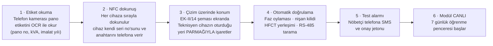

# 05 · Saha Uygulaması ve İşletim

Bir panonun kurulumu, devreye alınması, doğrulanması ve on yıl boyunca işletilmesi.

---

## 1. Tek profil var: PROFİL B

**1. gün kiti yalnız şu üç yüzeye dokunur:**

1. Alt kablo bölmesi (EK-II/14 "En az 400 mm", Madde 2.2.8.6 Not:2 ile tabanı tam açık),
2. Ölçü / iç ihtiyaç kolonundaki DIN ray,
3. Madde 2.2.12'nin gerektirdiği mevcut 1 fazlı 10 A priz.

**Başka hiçbir yere girilmez. Bara bölmesine asla girilmez.**

### 1.1 Bara bölmesi profilini yazmadık — sildik

Erken bir taslakta "Profil A: bara bölmesi enstrümantasyonu" vardı. Kaldırıldı. Gerekçe:

> **Bu panoda AG giriş kesicisi YOKTUR.** Madde 2.2.10.2.vi "direk bara bağlantı" der.
> Panoyu enerjisiz yapmanın tek yolu, tüm ikincil dağıtım merkezini **OG tarafından**
> karartmaktır.

Sonuçları:

* Bara bölmesine girmek ya (a) bir dağıtım merkezini karartmak ya (b) 2312 A taşıyan
  çıplak bir baranın üstündeki kapağı enerjili açmak demektir.
* (a) bir kurulum işi için kabul edilemez bir müşteri etkisidir.
* (b) enerjili çalışmadır ve **kişisel koruyucu donanımı dağıtım şirketinin kendi
  IEEE 1584 ark-flaş enerji etüdü belirler.**

### 1.2 PPE hakkında söylemediğimiz şey

**Bu belgede hiçbir cal/cm² sayısı yoktur ve bu bilinçlidir.**

Bir tedarikçinin, müşterinin kendi tesisi için ark-flaş olay enerjisi belirlemesi tehlikeli
bir davranıştır. Olay enerjisi kaynak empedansına, koruma açma süresine, çalışma
mesafesine ve muhafaza geometrisine bağlıdır; bunları yalnız dağıtım şirketinin kendi
etüdü bilir. Kuralımız şudur:

> **Dağıtım şirketinin geçerli bir IEEE 1584 (ya da eşdeğer) olay enerjisi etüdü yoksa,
> montaj bekler.** Bunu biz belirlemeyiz.

Profil B, alt kablo bölmesinde yalıtımlı kablo damarları üzerinde çalışmadır; buna rağmen
enerjili bir panonun içidir ve dağıtım şirketinin enerjili çalışma prosedürü, iş izni
sistemi ve PPE matrisi **aynen** geçerlidir. Aşağıdaki liste bunun **yerine geçmez**, ona
**ek**tir:

| Kalem | Neden |
|---|---|
| İş izni (permit-to-work), iki kişi, biri gözlemci | Tek başına enerjili pano içinde çalışılmaz |
| IEC 60900 yalıtımlı el aletleri | Düşen bir anahtar iki barayı köprüler |
| Yüz siperi + ark dereceli giysi — **seviyeyi DSO etüdü belirler** | §1.2 |
| Sınıf 0 eldiven + deri üst eldiven | Yalıtımlı damar da olsa temas riski |
| Metal takı yok, dielektrik ayakkabı | Standart |
| Elde IR termometre / termal kamera | Adım 3'teki güvenlik kapısı için |
| Yalıtkan örtü (matting) | Alet ve parça düşürme riski |

---

## 2. Ziyaret öncesi hazırlık (ofis, ~20 dk)

Sahaya çıkmadan cevaplanması gereken üç soru, çünkü hepsi montaj süresini değiştirir:

| Soru | Etkisi | Kaynak |
|---|---|---|
| Panoda Entes MPR-53CS var mı (Madde 2.2.11 seçenek 1) yoksa elektronik sayaç + 3 ampermetre mi (seçenek 2)? | Seçenek 2'de **Modbus yoktur**; yük faktörü yalnız kelepçe CT'lerinden gelir, 34 IR pabucu için oran kestirimi yapılamaz | Varlık kaydı / fotoğraf |
| Panoda ABB TVOC-2 var mı, varsa COM modülü takılı mı? | COM yoksa ark durumu okunamaz; `ARC_STATE.NOT_FITTED` kurulur ve ekranda öyle görünür | Varlık kaydı |
| Madde 2.2.8.1.iv anten çıkışı (gland) fiilen var mı? | Varsa anten 4 dk; yoksa LTE anteni kabin içinde kalır (12–20 dB kayıp) ya da ziyaret ertelenir | Fotoğraf / saha ön keşfi |

Bu üçü sırasıyla [11-ACIK-SORULAR.md] S2, S3 ve S1'dir ve **filo genelinde yüzdeleri
bilinmiyor.**

Kutu hazırlığı: 9 cihaz, modül kimliğine önceden bağlanmış NFC etiketleri, 2 yedek kelepçe,
1 yedek hücre seti, RS-485 için 2 × 1.5 m ekranlı çift bükümlü kablo, kablo bağı, etiket.

---

## 3. Kurulum prosedürü — bir pano, iki kişi

Toplam hedef süre: **2 saat 30 dakika** (ilk beş kurulumda 3.5–4 saat bekleyin).

| # | Adım | Süre | Kim | Not |
|---:|---|---:|---|---|
| 1 | Varış, iş izni teyidi, PPE giyme, alanın emniyete alınması | 15 dk | İkisi | DSO prosedürü |
| 2 | Alt kablo bölmesi kapağının açılması (elle sökülebilir; Form 2B ayrımı bara bölmesini kapalı tutar) | 5 dk | A | **Bara bölmesi kapağı AÇILMAZ** |
| 3 | **GÜVENLİK KAPISI:** hiçbir şeye dokunmadan elde termal kamera ile tüm pabuç sırasının taranması | 10 dk | B | Herhangi bir pabuç **> 110 °C** ise: **DUR**, montaj yapma, arıza olarak bildir. Zaten bozulmuş bir bağlantının yanında çalışmak, ölçmek için değil onarmak için gidilecek bir durumdur |
| 4 | Faz tanımlama ön okuması: kablo renkleri (Madde 2.2.10.5: L1 gri, L2 siyah, L3 kahverengi, N açık mavi) ve pozisyon sırası fotoğraflanır | 10 dk | B | §5'teki 2/3 oylamasının 1. ve 2. oyu |
| 5 | 6 × TC kelepçenin çıkış 6 ve 7 damarlarına takılması; her kelepçe pabuçtan 50–100 mm aşağıda, kablonun kendi kılıfı üzerinde, çıplak metale ≥ 25 mm | 30 dk | A + B | Emniyet teli kablo kanalı askısına — **pabuç civatasına değil** |
| 6 | TN-IR mıknatıs kaidesinin bölme tabanına oturtulması, yukarı nişanlama, nişan sihirbazının çalıştırılması | 20 dk | A | Üç referans noktası (bölme köşesindeki vida başları) kilitlenene kadar bitmez |
| 7 | PD-01'in M12 topraklama saplamasına (Madde 2.2.6.2.iii) montajı; HFCT'nin **PE iletkenine** kenetlenmesi | 15 dk | B | **HFCT ASLA FAZ İLETKENİNE TAKILMAZ.** 400 A × 6 mV/A = 2.4 V_pp, dedektörü boğar ve ölçüm anlamsızlaşır. Adım 12'de otomatik doğrulanır |
| 8 | Ölçü kolonunda GW-01'in DIN raya takılması, 10 A prize bağlanması | 10 dk | A | Priz, 6 A gG "İç İhtiyaç" devresinden beslenir |
| 9 | RS-485'in TVOC-2 ve MPR-53CS'e indirilmesi (2 ayrı hat, X2 ve X3) | 20 dk | A | ⚠ **Bu adım, panonun enerjili olduğu koşulda bir iletken indirmeyi gerektirir. DSO çalışma kurallarının buna izin verip vermediği [11] S4'tür. İzin yoksa bu adım planlı bir kesintiye ertelenir; sistem RS-485 olmadan da çalışır, yalnız analizör ve ark kanalları kapalı kalır** |
| 10 | Antenin Madde 2.2.8.1.iv mühürlü çıkışından dışarı alınması | 5 dk | B | Gland yoksa: kabin içi anten + kayıt |
| 11 | **Dizüstüsüz devreye alma** (§4) | 15 dk | B | Telefon + NFC |
| 12 | **Ayrılmadan önce doğrulama** (§6) | 20 dk | İkisi | Liste tamamlanmadan bölme kapatılmaz |
| 13 | Kapak kapatma, etiketleme, fotoğraf, iş izninin kapatılması | 15 dk | İkisi | Modül etiketi: pano kimliği + QR |

---

## 4. Dizüstü bilgisayarsız devreye alma

Bir dağıtım şirketi ekibi sahaya dizüstü bilgisayar ve seri kablo taşımaz; taşısa bile
konfigürasyon ekranı ile uğraşacak zamanı yoktur. Devreye alma **bir telefonla** yapılır.

**Neden bu üç girdi ve başka hiçbir şey:**

* **Etiket OCR'ı** varlık kimliğini insan hatası olmadan bağlar. Elle yazılan pano
  numarası, filo yönetiminde en sık görülen tek hatadır.
* **NFC dokunuş**, cihazın kimliğini ve şifreleme anahtarını fiziksel yakınlık şartıyla
  aktarır. Yanlış modüle kayıt yapmak fiziksel olarak zorlaşır.
* **Çizim üzerinde parmakla işaretleme**, koordinat girmekten hızlıdır ve dijital ikizi
  gerçekliğe bağlayan tek adımdır. Teknisyen bir metin kutusuna "x=568" yazmaz.

Devreye alma paketi telefon çevrimdışı olsa da tamamlanır ve kapsama alanına girildiğinde
yüklenir; dağıtım merkezleri çoğu zaman bodrumdadır.

---

## 5. Faz tanımlama: 2/3 oylaması

Bir kelepçenin hangi faza ait olduğunu **yanlış** bilmek, θ'nın kardeş gruplamasını
bozar — ve yanlış gruplanmış bir θ, ölçüm yapmamaktan **daha kötüdür**, çünkü kendinden
emin biçimde yanlıştır. Sahada kablo etiketi ile gerçek faz, birbirini yeterince sık
tutmaz. Bu yüzden üç bağımsız oy alınır ve **en az ikisi** aynı sonucu vermelidir:

| Oy | Yöntem | Güç | Zayıflık |
|---|---|---|---|
| **1 · Renk** | Madde 2.2.10.5: L1 gri, L2 siyah, L3 kahverengi, N açık mavi | Anında, aletsiz | Sonradan yapılan işlerde renk uyulmamış olabilir |
| **2 · Konum** | Pabuç sırasındaki fiziksel sıra, EK-II/14 çizimiyle karşılaştırılır | Anında | Aynı zayıflık |
| **3 · Akım korelasyonu** | Kelepçenin CT'si 15 dakika boyunca örneklenir; analizörün `I_L1 / I_L2 / I_L3` serileriyle korelasyonu hesaplanır, en yüksek olan kazanır | **Fiziksel kanıt, etikete bakmaz** | Analizör yoksa (Madde 2.2.11 seçenek 2) kullanılamaz; ayrıca çok dengeli ve düz bir yükte ayırt edici gücü düşer |

Üç oy uyuşmazsa modül **`CONFIG_MISMATCH`** ile canlıya alınır, θ hesaplanmaz ve ekip
uyarılır. Üçüncü oy alınamıyorsa (analizör yok) modül iki oyla canlıya alınır ama bu durum
kalıcı bir not olarak kayda geçer.

---

## 6. Ayrılmadan önce doğrulama listesi

**Bu liste tamamlanmadan bölme kapatılmaz ve ekip sahadan ayrılmaz.** Sistem listeyi
telefonda gösterir ve her satırı kendisi işaretler; teknisyen "tamam" tuşuna basarak
geçemez.

| # | Kontrol | Geçme ölçütü | Neden bu ölçüt |
|---:|---|---|---|
| 1 | Cihaz sayısı | **9/9 çevrimiçi** | Kit donmuştur; 8 kabul edilebilir değildir |
| 2 | Radyo seviyesi | Her cihaz **RSSI > −95 dBm** | −95'in altında metal kabinde çok yollu sönümleme kaybettirir |
| 3 | Kelepçe sıcaklıkları | 6 kelepçe okuyor, aralarındaki yayılım < 5 K | Yeni panoda büyük yayılım = montaj hatası |
| 4 | Kelepçe akımları | Her kelepçe akımı, analizörün ilgili faz akımının orantısal payının **±%15**'i içinde | CT yönü, oranı ve faz eşlemesinin tek seferde doğrulanması |
| 5 | **Faz oylaması** | 3 oydan **≥ 2'si** uyuşuyor | §5 |
| 6 | TN-IR nişanı | `ir.aim_ok = 1`, üç referans noktası kilitli | Kilitlenmemiş bir dizi hiçbir şey ölçmüyor demektir |
| 7 | TN-IR kapsama | 10 aktif çıkışın 40 pabucu da çerçevede | Geniş açı lens hesabı ([02] §2.1) sahada doğrulanır |
| 8 | **HFCT yerleşimi** | 50 Hz geri kaçış seviyesi eşiğin **altında** | **HFCT'nin PE'de olduğunun, faz iletkeninde olmadığının fiziksel kanıtı.** Faz üzerindeyse seviye 6 mV/A ile fırlar ve test düşer |
| 9 | RS-485 · TVOC-2 | reg 1300 okunuyor, firmware sürümü (reg 800/801) raporlandı | FW < 03.00.00 ise dedektör sağlık kayıtları (222/223) **yoktur** ve ekranda öyle yazar |
| 10 | RS-485 · MPR-53CS | Word sırası otomatik tespit edildi, frekans 49.5–50.5 Hz, CT oranı (reg 32769) = 500 | Yanlış CT oranı tüm akımları ölçekler; frekans, kelime sırasını doğrulayan en güvenli değerdir |
| 11 | Sunucu | Modül haritada, `DATA_VALID` kurulu, `DATA_AGE_S` < 30 s | Uçtan uca yol kanıtlanmış olur |
| 12 | **Test alarmı** | Nöbetçi telefona SMS ulaştı ve **onay jetonu** ile kapatıldı | Bildirim yolunun sahada, o gün, o SIM ile çalıştığının kanıtı. Aylar sonra ilk gerçek alarmda öğrenilmez |
| 13 | Öğrenme penceresi | `LEARN_MODE` kuruldu, bitiş tarihi ekranda | Ekip ne zaman gerçek alarm bekleyeceğini bilir |
| 14 | Fotoğraf | 4 fotoğraf (bölme genel, kelepçeler, TN-IR, ağ geçidi) yüklendi | Sonraki ziyaretin referansı |

---

## 7. Öğrenme haftası

Devreye almadan sonraki **7 gün**:

* Yalnız taban çizgisi toplanır: kardeş medyanları, K_N referansı, PD taban seviyesi,
  yoğuşma payının günlük ritmi.
* CUSUM eğitim penceresi 14 gündür ve öğrenme haftasından sonra da devam eder; CUSUM
  fiilen **21. günde** silahlanır.
* **Mutlak sıcaklık limitleri (90 / 110 / 130 °C) bu pencerede de aktiftir.** Pencere
  hiçbir zaman kör değildir. Devreye almanın ikinci gününde 130 °C olan bir pabuç, ne kadar
  geçmişimiz olduğundan bağımsız olarak 130 °C'dir.
* Ekrandaki rozet "ÖĞRENME (3/7 gün)" der. Operatörün, sessizliğin neden sessizlik olduğunu
  bilmesi gerekir.

---

## 8. Filo işletimi

### 8.1 Günlük ritim

| Ritim | Ne olur | Kim |
|---|---|---|
| Sürekli | ACİL alarm → SMS + sesli arama, 15 dk içinde onay yoksa 2. kademe | Nöbetçi mühendis |
| Sürekli | KRİTİK alarm → SMS (24 saat bekleme sonrası, ACİL muaf) | Nöbetçi mühendis |
| Günlük | Dedektör günlük medyanları yuvarlar, CUSUM ilerler, değişim noktaları güncellenir | Otomatik |
| Haftalık | UYARI ve İZLE kuyruğunun gözden geçirilmesi; iş emirlerinin planlanması | Bakım planlayıcı |
| Haftalık | **Bastırılmış alarm ekranının okunması** — 100 panoda haftada ~20–60 satır | Bakım planlayıcı |
| Aylık | Cihaz sağlığı: pil yüzdeleri, RSSI eğilimi, sıra boşluğu sayaçları | Sistem sorumlusu |
| Yıllık | Ark rölesi otokontrol takibi (`SELFTEST_DUE`), varlık kaydı mutabakatı | Sistem sorumlusu |

### 8.2 İki iş emri türü — asla karıştırılmaz

| Tür | Örnek | Gider mi |
|---|---|---|
| **PANO iş emri** | "C06 / L2 pabucunu tork anahtarıyla yeniden sıkın" | Elektrik ekibi, pano işi |
| **CİHAZ iş emri** | "TC-03 kelepçesi düştü, yerine oturtun" / "TN-IR nişanı kaydı" / "PD-01 pili zayıf" | Aynı ekip, ama **panoya dokunmadan** |

Bu ayrım pazarlama değil, hayatta kalma meselesidir. Sapan bir sensör yüzünden bir ekibi
sağlam bir bağlantıyı sıkmaya göndermek, sistemin güvenilirliğini bir seferde bitirir.
Bastırma kuralları (`DEVICE_*`) bunu yapısal olarak engeller: cihaz sorunları **hiçbir
zaman** pano arızası olarak sınıflandırılmaz.

### 8.3 OTA politikası

| Kural | Değer |
|---|---|
| İmza | Ed25519, cihazda gömülü kök anahtar; imzasız görüntü **çalışmaz** |
| Sıra | 1 kanarya pano → 72 **saat** bekleme → filonun %5'i → 72 saat → kalan |
| Ağ geçidi | A/B bölmesi, otomatik geri dönüş (watchdog 3 kez başarısız olursa eski bölme) |
| Pil düğümleri | OTA yalnız planlı pencerede, sub-GHz üzerinden; **tahmini hücre < %40 ise yapılmaz** (bir OTA ≈ 6 mAh, TC düğümünde 25 günlük bütçe) |
| Kilit | Panoda **açık bir olay varken** o panoda hiçbir OTA yapılmaz |
| Geri dönüş | Pil düğümlerinde değiştirilemez "golden image"; her zaman geri dönülebilir |
| Kayıt | Her OTA denetim zincirine (hash zincirli `audit` tablosu) yazılır |

### 8.4 Yedek parça (100 modüllük filo için)

| Parça | Adet | Gerekçe |
|---|---:|---|
| TC kelepçe | 6 | Filonun %1'i |
| TN-IR düğümü | 2 | Filonun %2'si; en pahalı tek algılayıcı |
| PD-01 düğümü | 2 | %2 |
| GW-01 ağ geçidi | 3 | %3 — tek arıza noktası olduğu için daha yüksek |
| ER14250 / ER14505 / ER26500 | 30 / 8 / 8 | 8. yıl toplu değişimden bağımsız |
| Ayrılabilir HFCT | 3 | Kelepçe mekanizması en kırılgan parça |
| RS-485 kablo seti, gland, etiket | 10 set | Sarf |

### 8.5 Ziyaretler arası ortalama süre (MTBSV)

> **VARSAYIM (etiketli):** aşağıdaki tamamen bir **parça sayımı** güvenilirlik
> kestirimidir. Sahada hiçbir birim çalışmamıştır; ölçülmüş MTBF yoktur.

Varsayılan düğüm arıza hızı: MTBF 300 000 saat (λ = 3.33×10⁻⁶/saat). Düşük görev döngülü,
sızdırmaz, hareketli parçasız bir düğüm için muhafazakâr bir değerdir.

| Olay | Yıllık hız / modül | Ziyaret gerektirir mi |
|---|---:|---|
| Herhangi bir düğüm elektronik arızası (9 düğüm) | 0.260 | **Ertelenebilir** — tek kelepçe kaybı θ'yı bozmaz, ekrana yazılır |
| Kaide kaybı / nişan kayması | 0.130 | Ertelenebilir |
| Ağ geçidi arızası | 0.029 | **Ertelenemez** — modül tamamen kör |
| Aynı üçlüde iki kelepçe kaybı | 0.020 | **Ertelenemez** — kardeş kümesi düşer |
| SIM / haberleşme, sahada müdahale gerektiren | 0.030 | **Ertelenemez** |
| **Ertelenemez toplam** | **0.079/yıl** | → **MTBSV ≈ 12.6 yıl / modül** |
| **Ertelenebilir toplam** | 0.390/yıl | 8. yıldaki toplu ziyarete biner |

100 modüllük bir filo için: yılda **≈ 8 plansız ziyaret**, artı 8. yılda tek bir toplu
hücre değişim kampanyası. Bu rakam, aynı filoda bugün yapılan **yılda 200 termografi
ziyaretinin** yanında küçüktür ([07-MALIYET-FAYDA.md] §4).

---

## 9. TEDAŞ uyum notu — Madde 3.1

**Madde 3.1**, bir bileşen değişikliğinde yalnızca **o bileşenin etkilediği doğrulamaların**
yeniden koşturulmasını ister. Buna göre değerlendirme:

| Doğrulama | Etkileniyor mu | Gerekçe |
|---|---|---|
| 10.2 Malzeme ve parçaların dayanıklılığı | Hayır | Pano malzemesi değişmiyor |
| 10.3 Koruma derecesi (IP2X) | **Sınırda** | Anten glandı Madde 2.2.8.1.iv'ün zaten öngördüğü mühürlü çıkıştır; yeni delik açılmıyorsa etkilenmez. **Delik açılıyorsa etkilenir** |
| 10.4 Yalıtım mesafeleri | Hayır | Bara geometrisine, kesitine ve terminal adımına dokunulmuyor; 85 mm dışlama bölgesi korunuyor |
| 10.5 Koruma devresi | Hayır | PE'ye ek bir HFCT kelepçesi takılıyor, iletken kesilmiyor, sökülmüyor |
| 10.6 Kumanda organları | Hayır | Yok |
| 10.7 Kısa devre dayanımı | Hayır | Bara kesiti, adımı ve mesnetleri değişmiyor |
| 10.9 Yalıtım özellikleri | Hayır | Yeni bir yalıtım bariyeri eklenmiyor |
| **10.10 Sıcaklık artışı** | **EVET** | Bölmeye ek kütle ve (küçük de olsa) ek kayıp giriyor; ayrıca kelepçe kablo damarını kısmen örtüyor |
| 10.11 Mekanik işletim | Hayır | Hareketli parça yok |
| **10.12 EMC** | **EVET** | Panoya iki radyo vericisi ve bir anahtarlamalı güç kaynağı giriyor |
| 10.13 Mekanik dayanım | Hayır | Gövde ve mesnet sistemi değişmiyor |

**Gerçekçi sonuç: yalnız 10.10 ve 10.12 yeniden koşturulmalıdır.** Hiçbir tip testli
bileşen değiştirilmiyor, hiçbir bara kesiti değişmiyor.

> **Ve Madde 3.1 hesapla doğrulamayı yasaklar.** Yani "kelepçenin ek kaybı 0.03 W'tır,
> ihmal edilebilir" demek yeterli değildir; **fiziksel test bütçelenmelidir.**

| Test | Kapsam | Gösterge maliyet (VARSAYIM) | Gösterge süre |
|---|---|---:|---|
| 10.10 Sıcaklık artışı | 1600 kVA panoda 2312 A ile tam yük testi | €12 000 – €18 000 | 4–6 hafta |
| 10.12 EMC | Emisyon + bağışıklık, pano seviyesinde | €6 000 – €9 000 | 3–4 hafta |

Bu **bir kerelik**, tip başına yapılan bir masraftır; 100 panoya da 10 000 panoya da aynı
test hizmet eder. 100 modüllük bir pilotta modül başına €180–270, 1000 modülde €18–27'ye
iner. [07-MALIYET-FAYDA.md] §2'de tek seferlik kalem olarak yer alır.

### 9.1 Ve dürüstçe: bir düzenleme boşluğu var

**TEDAŞ-MLZ/2003-06.B'nin hiçbir maddesi, hizmetteki bir panoya sonradan ekipman
takılmasından bahsetmez.** Şartname bir panonun **imalatını ve kabulünü** yönetir; sahadaki
bir panoya retrofit yapılmasını ne yasaklar ne izin verir — konuyu hiç ele almaz.

Madde 3.1'i yukarıdaki gibi uygulamak **bizim yorumumuzdur** ve bir yorum olduğunu
söylüyoruz. Bu boşluğu kapatacak olan bir tedarikçi değil, dağıtım şirketinin kendi iç
prosedürüdür: "hizmetteki AG panosuna izleme ekipmanı montajı" için bir talimat
yazılmalıdır. Bu, [11-ACIK-SORULAR.md] listesinin sonunda bir kalem olarak durur ve
kanımızca **projenin en önemli açık maddesidir** — teknik olan her şey çözülebilir, bu
çözülmezse hiçbir şey monte edilemez.

---

## 10. Belgelendi, kodlanmadı

| Konu | Durum |
|---|---|
| NFC ile devreye alma akışı | Tasarlandı; NFC yongası ve mobil uygulama **yapılmadı** |
| Etiket OCR'ı | Akışta var; uygulanmadı |
| EK-II/14 üzerinde parmakla konumlandırma ekranı | Tasarlandı; mobil uygulama yok |
| İmzalı OTA dağıtım altyapısı | Politika yazıldı; sunucu tarafı ve cihaz bootloader'ı yok |
| 10.10 ve 10.12 testleri | **Yapılmadı**; bütçelendi |
| Saha güvenilirlik verisi | Yok; MTBSV bir parça-sayımı kestirimi |
| DSO iş kurallarıyla uyum (enerjili RS-485 indirme) | Bilinmiyor — [11] S4 |
| "Hizmetteki panoya retrofit" iç prosedürü | Yok; dağıtım şirketi yazmalı |
