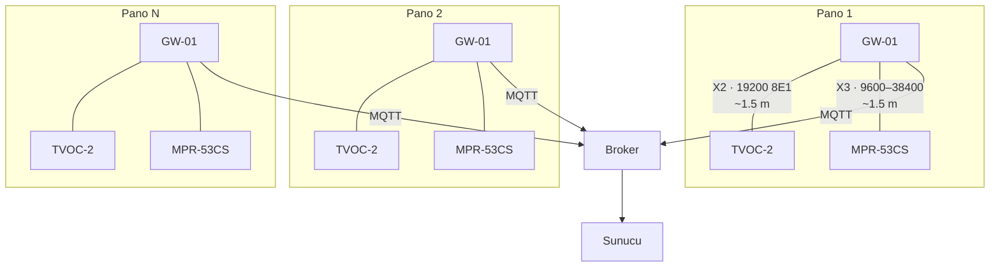

# 06 · Ölçeklenebilirlik

100 → 1000 → 10 000 pano. Bu belgedeki her kaynak sayısı **ölçülmüştür**, iddia
edilmemiştir; ölçüm komutu her tablonun altındadır.

---

## 1. Ölçüm yöntemi

Aşağıdaki üç sayı, bu projenin kendi kodu üzerinde, bu makinede ölçülmüştür.

| Ölçülen | Sonuç | Nasıl |
|---|---:|---|
| Tek RLS güncellemesi (`theta.rls_update`) | **2.673 µs** = 374 169 çağrı/s | 200 000 çağrılık döngü |
| Toplama, kalıcılık **hariç** (`engine.observe`, `persist_samples=False`) | **206.6 µs / zarf** = 4 841 zarf/s | 3 240 zarflık gerçek akış |
| Toplama, SQLite kalıcılığı **dahil** | **2 312 µs / zarf** = 433 zarf/s | 12 960 zarflık bir pano-günü |
| Tam pano değerlendirmesi (`engine.evaluate`, 40 bağlantı + 9 cihaz) | **12.95 ms / pano-çevrimi** | 20 çevrimlik ortalama |
| Dijital ikiz, tek pano adımı | 2.4 ms | `sim/panel.py` |
| Dijital ikiz, 112 panolu filo adımı | 270 ms | `sim/fleet.py` |
| SCADA: 100 panonun tamamının taranması (4800 register) | **39 istek / 19.0 ms** | `tests/test_scada.py` |
| SCADA: bir SCADA ön yüzünün 1 Hz'de fiilen yaptığı iki istek | medyan **0.72 ms** | Aynı |

---

## 2. Yük profili — türetilmiş

### 2.1 Zarf ve nokta hızı

```
Modül başına cihaz                                9
Yayın kadansı                                     1/dk
  → modül başına                                  0.15 zarf/s
Kanal (seri) sayısı, modül başına                ~120
  → modül başına                                  2.0 nokta/s
```

| Filo | Zarf/s | Nokta/s | Kanal (seri) |
|---:|---:|---:|---:|
| 100 pano | **15** | **200** | 12 000 |
| 1 000 pano | 150 | 2 000 | 120 000 |
| 10 000 pano | 1 500 | 20 000 | 1 200 000 |

### 2.2 CPU — ölçülen sayılarla

**Toplama (hesap, kalıcılık hariç):** 206.6 µs/zarf

| Filo | Zarf/s | Bir çekirdeğin yüzdesi |
|---:|---:|---:|
| 100 | 15 | **%0.31** |
| 1 000 | 150 | **%3.10** |
| 10 000 | 1 500 | **%30.99** |

**Dedektör (θ + CUSUM + akran + eğilim), 1/dk çevrimle:** 12.95 ms/pano

| Filo | Çevrim/s | Bir çekirdeğin yüzdesi |
|---:|---:|---:|
| 100 | 1.67 | **%2.16** |
| 1 000 | 16.7 | **%21.6** |
| 10 000 | 167 | **%216** (= 2.2 çekirdek) |

**RLS kestiricileri.** Modül başına 40 izlenen bağlantı vardır; bunların 30'u faz
iletkenidir ve θ taşır (10 nötr, kural H3 ile yargılanır ve θ hesaplanmaz).

| Filo | θ kestiricisi | Güncelleme/s (1/dk) | Bir çekirdeğin yüzdesi |
|---:|---:|---:|---:|
| 100 | 3 000 | 50 | **%0.013** |
| 1 000 | 30 000 | 500 | %0.134 |
| 10 000 | 300 000 | 5 000 | %1.34 |

**Bu tabloyu okumanın doğru yolu:** RLS kestiricileri, insanların "ölçeklenmez" diye
korktuğu kısımdır ve pratikte **hiç görünmez**. 10 000 panoda bile bir çekirdeğin %1.3'ü.
Asıl ölçekleyen `evaluate()` çevrimidir ve o da 10 000 panoda 2.2 çekirdektir.

### 2.3 Gerçek darboğaz: yazma yolu

SQLite kalıcılığı **hesabın 11 katı** maliyetlidir (2 312 µs vs 206.6 µs). Bu, demo için
tamamen yeterlidir ama ölçek hikâyesinin dürüst yerine konması gerekir:

| Filo | SQLite ile toplama | Yorum |
|---:|---:|---|
| 100 | %3.5 çekirdek | Rahat |
| 1 000 | %34.7 çekirdek | Hâlâ tek çekirdek |
| 10 000 | %347 çekirdek | **SQLite burada biter** |

**Hedeflenen üretim yolu TimescaleDB'dir ve henüz yazılmamıştır** (sürücü, hipertablo
cümleleri ve toplu `COPY` yazma yolu yok — bkz. `panogoz/store/db.py`). Aşağıdaki hesap,
o yol yazıldığında ne olacağının yayınlanmış Timescale başarım verisinden türetilmiş
kestirimidir; ölçüm değildir. Tasarım, zarf başına tek bir toplu `COPY` kullanır. 100 pano
için bu **15 yazma işlemi/saniye** ve **200 satır/saniye** demektir; bir Timescale düğümü
toplu ekleme ile **100 000 satır/s** mertebesinde yazar. Yani:

```
100 pano   :  200 satır/s  /  100 000 satır/s  =  binde 2
1 000 pano :  2 000 satır/s                    =  yüzde 2
10 000 pano:  20 000 satır/s                   =  yüzde 20
```

**Toplama katmanı bu sistemin darboğazı değildir ve öyle olduğunu söylemek yanlış olur.**
Bu, iyi bir haber değil, sadece doğru bir hesaptır: veri hacmi bu problemin zor kısmı
değil.

### 2.4 Depolama

[01-SISTEM-MIMARISI.md] §5.2'deki saklama politikasıyla:

| Filo | Kararlı hâl disk | Duyarlılık (1.5–4 B/nokta) |
|---:|---:|---|
| 100 | **≈ 18 GB** | 11 – 29 GB |
| 1 000 | ≈ 180 GB | 110 – 290 GB |
| 10 000 | ≈ 1.8 TB | 1.1 – 2.9 TB |

500 GB'lık tek bir NVMe 100 panoda 25 kat, 1000 panoda 2.5 kat baş boşluğu bırakır.
10 000 panoda 4 TB'lik bir dizi gerekir — sunucu odasında sıradan bir kalem.

---

## 3. Sunucu boyutlandırma

| Filo | Öneri | Ölçülen kullanım | Baş boşluğu |
|---|---|---|---|
| **100 pano** | 2 vCPU / 8 GB / 250 GB NVMe | Hesap < %6 çekirdek, disk 18 GB | Çok yüksek |
| **1 000 pano** | 4 vCPU / 16 GB / 1 TB NVMe | Hesap ≈ %25 çekirdek, disk 180 GB | Yüksek |
| **10 000 pano** | Bölge başına 4 düğüm: 8 vCPU / 32 GB / 2 TB | Hesap ≈ 2.5 çekirdek toplam | Orta |

**Baş boşluğunu süslemiyoruz, olduğu gibi söylüyoruz:** 1000 panoda tüm PANO GÖZ hesabı
(toplama + dedektör + kurallar) tek bir çekirdeğin **dörtte birinden azını** kullanır.
2 vCPU / 4 GB'lık bir makine bu hesabı taşır. 4 vCPU / 16 GB önermemizin sebebi PANO GÖZ
değil, **TimescaleDB ve REST/WebSocket katmanıdır**: veri tabanı sorgu önbelleği ve eşzamanlı
arayüz oturumları RAM ister.

Yani ölçek sorusunun cevabı şudur: **bu sistem 1000 panoda pahalı bir sunucu istemez.
İsterse, o istek dedektörden değil veri tabanından gelir.**

### 3.1 10 000 panoda parçalama

Panolar birbirinden **tamamen bağımsızdır** — bir panonun θ'sı başka bir panonun verisine
bakmaz. Tek istisna, "filonun %20'sinden fazlası bir saat içinde alarm verdi mi" sistemik
kuralıdır ve o da bir sayaçtır.

Dolayısıyla parçalama önemsizdir: `hash(panel_key) % N`. Ama pratikte doğru bölme çizgisi
teknik değil **kurumsaldır**: dağıtım şirketi bölgesine göre (ADM / GDZ, sonra il).
Nedeni, her bölgenin kendi nöbet vardiyası, kendi SCADA'sı ve kendi bakım planlayıcısı
olmasıdır. Bölge başına bağımsız bir yığın + salt okunur bir federe görünüm, hem
ölçeklenir hem organizasyona uyar.

### 3.2 Broker

| Filo | Eşzamanlı TLS bağlantısı | Mesaj/s | Yorum |
|---:|---:|---:|---|
| 100 | 100 | 15 | Tek Mosquitto, ayarsız |
| 1 000 | 1 000 | 150 | Tek Mosquitto; `max_connections` ve dosya tanıtıcı limiti ayarlanır |
| 10 000 | 10 000 | 1 500 | **Bölge başına broker.** Tek düğümde 10 000 kalıcı TLS oturumu mümkündür ama tek arıza noktasıdır |

Mesaj hızı hiçbir noktada sorun değildir (tek bir Mosquitto düğümü on binlerce mesaj/s
taşır). Ölçekleyen şey **bağlantı sayısı ve TLS el sıkışma yığılmasıdır**: 10 000 ağ
geçidi bir elektrik kesintisinden sonra aynı anda bağlanmaya çalışır. Bunun için ağ
geçitlerinde **rastgeleleştirilmiş üstel geri çekilme** (0–300 s jitter) vardır ve bu bir
ölçek özelliğidir, bir hata toleransı ayrıntısı değil.

---

## 4. RS-485 topolojisi — ve asla kurmadığımız bus

### 4.1 Klasik itiraz

> *"100 cihazı 19200 baud'luk bir RS-485 hattına koyarsanız, bir tam tarama 2.3 saniye
> sürer. Bu sistem ölçeklenmez."*

**İtiraz doğrudur.** Aritmetiği:

```
19200 baud, 8E1 → karakter başına 11 bit → 1.74 kar/ms
FC 03 isteği    : 8 bayt              →  4.58 ms
20 register yanıtı: 5 + 40 = 45 bayt  → 25.78 ms
Cihaz dönüş süresi (tipik)            → 15 ms
3.5 karakterlik sessizlik              →  2.01 ms
                                        ─────────
cihaz başına                          ≈ 47.4 ms      (iyimser 23 ms)

100 cihaz × 23 ms  =  2.3 s     ← itirazın sayısı
100 cihaz × 47.4 ms = 4.7 s     ← gerçekçi sayı
```

### 4.2 Cevabımız: o bus'ı kurmuyoruz

**Her panonun kendi kısa hattı ve kendi master'ı vardır.** Ölçekleme seri hatta değil,
**broker'da** olur.



**1000. panoyu eklemek, diğer 999 panonun seri hattına sıfır yük ekler.** Ölçeklenen şey
paylaşılan bir kaynak değildir.

### 4.3 Tek panonun bus bütçesi — ölçülmüş plan

Ağ geçidinin gerçek okuma planı (`poller.plans()` çıktısı):

| Plan | Blok | Register | Kadans |
|---|---:|---:|---|
| `tvoc.state` (reg 1300–1306) | 1 | 7 | 1 Hz |
| `tvoc.live` (200–212, 220–221) | 2 | 15 | 1 Hz |
| `tvoc.identity` (500, 800–801) | 2 | 3 | devreye almada |
| `tvoc.trip_log` (7 kayıt, delikli) | 8 | 43 | olay üzerine |
| `tvoc.error_log` (6 kayıt, delikli) | 10 | 55 | olay üzerine |
| `mpr.measurement` (0–265) | 3 | 266 | 0.1 Hz (derin okuma) |
| `mpr.settings` | 2 | 7 | devreye almada |

Bus zamanı, yukarıdaki 19200 8E1 aritmetiğiyle:

| Hat | Saniyede geçen zaman | Doluluk |
|---|---:|---:|
| X2 (TVOC-2, 1 Hz durum + canlı) | ≈ 99 ms | **%9.9** |
| X3 (MPR-53CS, 0.1 Hz derin okuma, 266 register 3 blokta) | ≈ 38 ms | **%3.8** |

Yani her iki hatta da **%90'ın üzerinde baş boşluğu** vardır. TVOC-2 ve MPR-53CS'in **ayrı
hatlarda** olmasının sebebi ise başarım değildir: TVOC-2 varsayılan olarak 19200 8E1'dir,
MPR-53CS ise sahada 9600 ile 38400 arasında herhangi bir yerde bulunabilir. İki farklı hızı
tek hatta zorlamak, sahada saatler yiyen bir uyuşmazlıktır.

### 4.4 Delikli register haritası neden ölçek meselesi

TVOC-2'nin açma kaydı 7 girdi, adım 7'dir ve **106, 113, 120, 127, 134, 141, 148**
adreslerinde **delik** vardır. Bir deliği kapsayan tek bir okuma **exception** döndürür.
Naif bir master 100–148 arasını tek istekte okumaya çalışır, hata alır, tekrar dener ve
hattı meşgul eder. `plan_blocks()` deliklerin etrafından dolaşarak 8 blok üretir ve
`verify_plan()` bunu import anında doğrular. Ölçekte bu bir başarım kalemidir: 1000 panoda
her biri gereksiz yere yeniden deneyen 1000 master, bir sorun ölçeğidir.

---

## 5. Ne ölçeklenmez, dürüstçe

| Kalem | Sınır | Ne yapılır |
|---|---|---|
| **Operatörün dikkati** | Bir nöbetçi mühendis günde 5–10 gerçek alarmdan fazlasını işleyemez | **Asıl ölçek kısıtı budur.** Bastırma, roll-up, iki kanallı yönlendirme ve seviye merdiveni tam olarak bunun için vardır. 100 panoda tasarım hedefi haftada **≤ 3 telefon çaldıran alarm**tır |
| SQLite yazma yolu | ~10 000 panoda tükenir | TimescaleDB sürücüsü yazılır (aynı `schema.sql`); bugün mevcut değildir |
| Tek broker TLS bağlantısı | ~10 000 | Bölge başına broker |
| Modbus TCP slave, tam filo taraması | 100 pano = 39 istek = 19 ms | Zaten sorun değil; SCADA fiilen 2 istek yapar |
| `MAX_PANELS` (ICD) | **200** | 1000+ panoda ICD'nin `MAX_PANELS` değeri artırılmalı ya da bölge başına ayrı slave açılmalıdır. Şu anki harita 200 panoya kadar sabittir (`1000 + 48×200 = 10 600`) |
| Alarm fırtınası | Saatte 8 KRİTİK ile tavanlanır (`STORM_CAP_PER_HOUR`), **ACİL muaf** | Tavan bir ACİL'i susturabilseydi tavan değil arıza olurdu |

**`MAX_PANELS = 200` bilinçli bir hackathon sınırıdır ve 1000 panoya çıkarken
değiştirilmesi gereken tek sözleşme sabitidir.** Bunu saklamıyoruz.

---

## 6. Ölçekte işletme

| Filo | İşletme yükü | Kim |
|---|---|---|
| 100 | 0.1 FTE sistem sorumlusu + mevcut bakım planlayıcı | Mevcut kadro |
| 1 000 | 0.25 FTE sistem sorumlusu, bölge başına bir planlayıcı | Mevcut kadro + kısmi |
| 10 000 | 1–2 FTE platform, bölge başına planlayıcı | Yeni kadro |

Kurulum kapasitesi: iki kişilik bir ekip günde **2 modül** kurar (2.5 saat/modül + yol).
100 modül = **25 ekip-günü**. 1000 modül = 250 ekip-günü ≈ bir ekip için bir yıl, ya da
dört ekip için üç ay.

**Kurulum kapasitesi, yazılım değil, projenin gerçek takvim kısıtıdır.**

---

## 7. Belgelendi, kodlanmadı

| Konu | Durum |
|---|---|
| TimescaleDB üzerinde ölçüm | **Yapılmadı ve yapılamaz: sürücü yazılmadı.** Sayılar SQLite'ta ölçüldü; Timescale rakamları yayınlanmış başarım verisinden türetildi ve **varsayım olarak etiketlendi** |
| Çok düğümlü parçalama | Tasarım kararı; uygulanmadı |
| Bölge başına broker federasyonu | Tasarım kararı; kurulmadı |
| Ağ geçidi geri çekilme jitter'ı | Politika yazıldı; `MqttBus` sürücüsünde uygulanmadı |
| `MAX_PANELS` > 200 | Sözleşme sabiti; değiştirilmedi |
| 10 000 panoluk yük testi | Yapılmadı; en büyük ölçülen filo 112 panodur |
