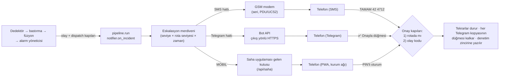

# 12 · Bildirim Kanalları ve Saha Uygulaması

Şartname madde 7: *"Kritik durumların yalnızca monitoring ekranında gösterilmesi yeterli
değildir… SMS, WhatsApp veya benzeri anlık bildirim kanalları üzerinden uyarı gönderebilecek
bir mekanizma."* Bu belge o mekanizmanın **gerçek** hâlini anlatır: üç kanal, tek merdiven,
her kanalda aynı iki onay kapısı — ve neyin doğrulandığını, neyin doğrulanmadığını.

Sahibi: K4 · Kod: `panogoz/notify/` · Testler: `tests/test_notify_*.py`, `tests/test_gsm_serial.py`,
`tests/test_saha_api.py`

---

## 0. Bir sayfada

| Kanal | Ne için | Nerede çalışır | Durum |
|---|---|---|---|
| **SMS** | Telefon kapalı uygulama, kapalı Wi-Fi, fiber kesik: yine ulaşır | Ağ geçidinin kendi GSM modemi (seri port) | **Simüle** varsayılan. Gerçek modem sürücüsü yazıldı ve sahte modemle test edildi; **donanımla denenmedi** |
| **Telegram** | "Kapı zili": telefonu çaldırır, düğmeyle onay | Bot API, çıkış yönlü HTTPS | Sahte Bot API'ye karşı test edildi; **gerçek bot anahtarıyla denenmedi** (anahtar bizde yok) |
| **Saha uygulaması** | Ayrıntı: ölçümler, konum, neden alarm verildi, iş emri | Bu sunucu, kurum ağı (PWA) | Çalışıyor; Chrome'da elle doğrulandı. **Gerçek Android/iOS telefonda denenmedi** |

Üçü aynı eskalasyon merdivenine bağlıdır (`notify/escalation.py`). Bir olay KRİTİK ya da
ACİL olunca üçü **birlikte** çıkar; her biri ayrı bir `notification` satırıdır, ayrı bir
gönderim hattında yürür, biri çökerse ya da takılırsa diğerleri etkilenmez.

**Tek cümle:** Telegram telefonu çaldırır ve *bir şey olduğunu* söyler; ayrıntı kurum
ağındaki uygulamanın arkasında durur; SMS ikisi de yokken ulaşan yoldur.

---

## 1. Mimari



**Tespit döngüsü ağa dokunmaz.** `on_incident` tespit iş parçacığından çağrılır. Telegram
isteği ya da seri modem saniyelerce takılabilir; bu yüzden gerçek bir kanal yapılandırıldığında
gönderim **asenkron** çalışır: satır `KUYRUKTA` olarak yazılır, kanal başına ayrı bir işçi
gönderir ve satırı `GONDERILDI` ya da `HATA` yapar. Yavaş bir modem Telegram'ı geciktirmez
(`test_dispatch_never_blocks_the_caller_when_the_network_is_slow`). Simüle modem anlıktır ve
eşzamanlı kalır (prova ve testler deterministik).

**Gerçek kanallar süreç başına isteğe bağlıdır.** `notify.local.json` bir geliştirici
makinesinde dursa bile `pytest` ya da bir yardımcı betik gerçek SMS/Telegram göndermez: dosya
yalnızca başlatıcı (`run_local`) `PANOGOZ_NOTIFY_LIVE=1` koyduğunda okunur
(`test_a_process_that_did_not_ask_for_live_channels_gets_the_safe_default`).

---

## 2. Kanal seçimi ve veri mahremiyeti değerlendirmesi

> Görev 4.1'in istediği: *seçim gerekçesi ve veri mahremiyeti değerlendirmesi yazılı olsun.*
> Görev belgesi ayrıca der ki: *"kanal seçimi on-premise kısıtını ilgilendirir, kararı gruba
> danış."* Telegram'ı takım arkadaşımız önerdi; bu belge o karara girdidir, **kararın
> kendisi takımındır.**

### 2.1 Neden Telegram

- **Ücretsiz ve onay gerektirmez.** WhatsApp Business API başvuru, şablon onayı ve iş hesabı ister
  (bkz. `escalation.whatsapp_status()` — yapılmamasının gerekçeleri orada); bir Telegram botu
  dakikalar içinde açılır.
- **Çıkış yönlüdür.** Bot, mesajları `getUpdates` ile *kendisi çeker*. Sunucuya dışarıdan hiçbir
  bağlantı gelmez, açık port, genel IP, alan adı ya da sertifika gerekmez. Bir trafo merkezi
  ağında tek gerekli kural: `api.telegram.org:443` çıkışı.
- **Düğmeyle onay.** Satır içi ✅ Onayla düğmesi, SMS'te yazılan `TAMAM 42 4712`'nin yerini alır;
  iki onay kapısı yine de çalışır (§5).
- **Sıfır bağımlılık.** Yalnızca standart kütüphane (`urllib`); `requirements.txt` büyümedi.

### 2.2 Neyi riske atar

Telegram **kamu bulutudur.** Şartname açıkça *Public Cloud kullanılmamalıdır* der ve gerekçesi
"verilerin Public Cloud'da tutulmasının uygunluğu netleşmediği"dir. Bu, gerilimin kendisidir:

| Risk | Gerçek durum |
|---|---|
| Mesaj içeriği Telegram sunucularında durur | **Evet.** Bot mesajları uçtan uca şifreli **değildir** (yalnız istemci–sunucu şifreli). |
| Alıcının telefon/hesap bilgisi Telegram'dadır | **Evet.** Nöbetçi personelin Telegram hesabı kişisel hesaptır; kurumsal yönetimi yoktur. |
| KVKK m.9 (yurt dışına aktarım) | Telegram'a giden her kişisel veri için hukuki dayanak gerekir. Bu belge hukuki görüş değildir. |
| Telegram erişilemez ya da engellenir | Olur. Bu yüzden Telegram **tek yol değildir** (§0). |

### 2.3 Azaltma: veri-asgarileştirilmiş ayna

`escalation.whatsapp_status()`'un "uyumlu seçenek" olarak yazdığı çözümün kendisi: *yalnız
"pano + seviye + onay kodu" dışarı çıkar, ölçüm çıkmaz.* Bu kod bunu **varsayılan** yapar:

| Mesajda ne var | `minimal` (**varsayılan**) | `standard` |
|---|:---:|:---:|
| Pano anahtarı, bağlantı adı, seviye, arıza türü | ✓ | ✓ |
| Yapılacak iş ("bağlantıyı torkla") | ✓ | ✓ |
| Onay kodu | ✓ | ✓ |
| θ, sıcaklık, "eşiğe kalan gün" | — | ✓ |
| Konum / koordinat | — | — |
| Sensör serisi, ham ölçüm | — | — |

`standard`, ölçümlerin kamu bulutuna çıkması yönünde **bilinçli bir karardır**
(`telegram.privacy`), varsayılan değildir. Konum hiçbir kipte Telegram'a gitmez.

**Kapatma anahtarı:** `notify.local.json`'dan `telegram` bölümünü silmek (ya da ortam
değişkenini kaldırmak) kanalı tamamen kapatır; merdivende Telegram basamağı sessizce atlanır.

**Bir başkası bota yazarsa:** Bot kullanıcı adı herkese açıktır. Nöbet listesinde olmayan biri
`/start` yazarsa **yalnızca kendi sohbet numarasını** öğrenir ve "nöbet listesinde değilsiniz"
görür; hiçbir olay bilgisi göremez, onay veremez, `/durum` çalışmaz
(`test_start_command_tells_a_stranger…`, `test_durum_command_is_for_the_rota_only`).

### 2.4 Önerim

Jüri sunumunda Telegram şu cümleyle sunulmalı: *"Telegram bizim için bir kapı zilidir, ev
değil. Şirket içinde kalan ayrıntıya uygulamadan bakılır."* Bu, şartnamenin on-premise
kısıtını ihlal etmediğimizi değil, **ihlalin yüzeyini bilerek en aza indirdiğimizi** söyler ve
dürüst olan budur. Takım kanalı yine de istemezse tek satırla kapanır.

---

## 3. Kurulum

### 3.1 Telegram botu (5 dakika)

1. Telegram'da **@BotFather** → `/newbot` → bir ad ve `..._bot` ile biten kullanıcı adı verin.
   BotFather size `123456789:AAH...` biçiminde bir **token** verir. Bu bir paroladır.
2. Repoda: `copy notify.example.json notify.local.json` ve dosyayı doldurun (`telegram.token`,
   `rota[].number`). **`notify.local.json` git'e girmez** (`.gitignore`); token'ı hiçbir yere
   yapıştırmayın.
3. Botunuza Telegram'dan `/start` yazın. Bot **sohbet numaranızı** söyler. Bunu
   `rota[].telegram_chat_id` alanına yazın. (Bot henüz çalışmıyorsa: sunucuyu başlatın, sonra
   `/start` yazın; yanıt gelir.)
4. Sunucuyu başlatın; açılış özeti şunu yazmalı:
   `Telegram     AKTIF   @botunuz  gizlilik: minimal`
5. Doğrulama (PowerShell):
   ```powershell
   $b = [Text.Encoding]::UTF8.GetBytes('{"to":"Nöbetçi tekniker"}')
   Invoke-RestMethod -Method Post -Uri http://127.0.0.1:8080/api/notify/test `
     -ContentType 'application/json; charset=utf-8' -Body $b
   ```
   → telefonunuza "🧪 PANO GÖZ · TEST" gelmeli. (Windows PowerShell 5.1, `charset` verilmezse
   gövdeyi ISO-8859-1 yollar ve `ö`, `ç` bozulur; ölçüldü. Bu yüzden baytlar açıkça UTF-8.) (Test bir **olay değildir**; konsola düşmez.
   Saldırgan ya da yanlış tıklama SMS yağdırmasın diye 10 s'de bir ve yalnız *adıyla seçilmiş*
   bir kişiye gider.)

### 3.2 Ortam değişkenleri (dosya yerine)

`PANOGOZ_TELEGRAM_TOKEN`, `PANOGOZ_TELEGRAM_PRIVACY`, `PANOGOZ_TELEGRAM_API`,
`PANOGOZ_PUBLIC_URL`, `PANOGOZ_SMS_PROVIDER`, `PANOGOZ_SMS_PORT`, `PANOGOZ_NOTIFY_CONFIG`
(dosya yolu). Ortam değişkeni dosyanın üstündedir. Geçersiz yapılandırma, **alan adını
söyleyen** bir hatayla başlangıcı durdurmaz, bildirim katmanını `degraded` yapar; hata iletisi
asla bir sır içermez.

### 3.3 Gerçek SMS (GSM modem)

Gereken: bir SIM ve seri/USB üzerinden AT komutu konuşan bir GSM modülü (SIM800/SIM7600 kartı,
USB GSM modem). `notify.local.json` → `"sms": {"provider": "serial", "port": "COM5"}` ve
`python -m pip install pyserial`.

```
python -m panogoz.notify.gsm_serial --list           # portlar
python -m panogoz.notify.gsm_serial --probe COM5     # SMS GÖNDERMEZ: kayıt, sinyal, operatör
python -m panogoz.notify.gsm_serial --send COM5 +905XXXXXXXXX "test"   # GERÇEK SMS
```

Sürücü **PDU modunda** gönderir ve her mesaj UCS2'dir: Türkçe karakterler (ı ş ğ İ Ş Ğ) GSM
03.38'de yoktur ve iki parçalı birleşik SMS (2 × 67 karakter, `escalation.compose`'un bütçesi) yalnız
PDU modunda kullanıcı verisi başlığı (UDH) taşıyabilir. PDU baytları 3GPP TS 23.040'a göre
**elle türetilmiş bir referans vektöre** karşı test edilir (`test_pdu_matches_a_hand_derived_vector`).
Cevap SMS'leri ("TAMAM 42 4712") metin modunda `AT+CMGL` ile okunur.

### 3.4 Sunucuyu telefondan erişilebilir yapmak

```powershell
.\baslat.ps1 -Telefon                # --host 0.0.0.0
```

Açılış özeti telefonun açacağı adresi yazar (`Saha uygulamasi  http://192.168.x.x:8080/saha/`).
Telefon ve bilgisayar **aynı ağda** olmalı. Windows güvenlik duvarı gelen bağlantıyı sorabilir;
bunu siz onaylarsınız (bu araç güvenlik ayarı değiştirmez). `public_url`'yi bu adrese ayarlayın:
Telegram mesajındaki "Saha uygulamasında aç" düğmesi onu kullanır.

---

## 4. Saha uygulaması

`http://<sunucu>:8080/saha/` — düz JavaScript, bağımlılık yok, dış istek yok. Giriş: nöbet
listesinden **ad + PIN**. Bir olay `#/olay/42` ile doğrudan açılır.

| Ekran | İçerik |
|---|---|
| **Giriş** | Marka, nöbet listesinden **üye kartları** ve dört-sekiz haneli PIN için **rakam tuş takımı** (eldivenle basılır; masaüstünde fiziksel klavye de çalışır). Yanlış PIN'de noktalar sallanır. |
| **Gelen kutusu** | Üstte **özet kartı**: "N olay onay bekliyor" (nabız atar) ya da "Bekleyen onay yok". "Bana gelenler" / "Tümü". Her kartta seviye rozeti (▲ ◆ ■ + Türkçe etiket), pano, bağlantı ve onay bekleyen olayda **onay süresi çubuğu**: süre merdivenin kendi sayısıdır (ACİL 15 dk, KRİTİK 45 dk; `escalation.ACK_DEADLINE_S`), dolunca "üst kademeye bildirildi" yazar. |
| **Alarm örtüsü** | Onay bekleyen olay varken tam ekran; nabız halkaları, siren, titreşim, **ONAYLA**, Ayrıntı, 5 dk sessiz. Sekme başlığı `🔴 (1) ONAY BEKLİYOR`. Örtü yalnız içeriği değişince yeniden kurulur (aksi halde animasyon üç saniyede bir baştan başlar ve parmağın altındaki düğme kaybolabilir). |
| **Olay ayrıntısı** | Ne yapmalı · **iş emri adım göstergesi** (Onay → Yolda → Sahada → Tamam) · konum ve yol tarifi · ölçümler: **θ ölçeği** (θ, mutlak basamakların — İzle 2, Uyarı 5, Kritik 12, Acil 25 K — hangi bölgesinde; eşikler `detector.engine.THETA_ABS_LADDER`'den gelir, telefonda ikinci bir kopya yoktur) ve θ, T, ΔT, yük, eğim, fazla direnç *aralığı*, eşiğe kalan gün · **neden alarm verildi** · **neler elendi** · kanal etiketli zaman çizgisi. Bir sonraki adım (**ONAYLA**, Yola çıktım, Sahadayım, İşi tamamladım) ekranın altında **opak, sabit bir çubukta** durur: başparmağın altında ve arkasındaki yazı görünmez. |

Uygulamanın en ayırt edici yanı, konsolun ayırt edici yanıyla aynıdır: telefonda da **"neden
alarm verdim / neyi eledim"** görünür. θ ölçeği bir uyarıyla gelir: ölçek θ'nın *mutlak*
basamağıdır, olayın seviyesi birden çok kanıttan çıkar ve ölçekten farklı olabilir (ark olayı
gibi); ekran bunu yazar. Ölçüm olmayan bir olayda (ör. ark, pano düzeyi) ölçüm
hücreleri gösterilmez; bir pabucun akım kelepçesi yoksa "Akım 0 A" yazmaz.

**Onay** oturumla yapılır. Olay kodunu (4 hane) telefonda yazmak gerekmez: o kod, SMS'te
*tahmin edilen* bir olay numarasının alarmı susturmasını önler; PIN'li bir oturum ondan güçlü
bir faktördür. Sunucu kodu kendisi uygular ve **kod telefona hiçbir zaman gönderilmez**
(`test_detail_never_carries_the_ack_token_or_a_secret`).

### 4.1 Uygulamanın yapamadığı — dürüstçe

1. **Uygulama kapalıyken uyandırılamaz.** Push servisi yoktur: FCM/APNs/Web Push aktarıcısı
   kamu bulutudur, on-premise kısıtıyla çelişir. Uygulama **açıkken ya da arka planda
   yaşarken** çalar. Kapalı telefonu SMS ve Telegram çaldırır — merdivenin üç kanallı olma
   sebebi budur.
2. **HTTP üzerindeki bir LAN adresi "güvenli bağlam" sayılmaz.** Tarayıcı böyle bir sayfada
   service worker, sistem bildirimi, ekranı açık tutma ve "ana ekrana ekle"yi kapatır.
   `http://127.0.0.1` ve `localhost` güvenlidir (bu yüzden bilgisayarda hepsi çalıştı).
   Telefonda seçenekler:
   - **Kalıcı (doğru) çözüm:** HTTPS. `docker-compose.yml`'deki ters vekil (K2 görev 2.2)
     kurum içi bir CA ile sertifika verir; CA telefona MDM ile yüklenir.
   - **Prova çözümü A:** Android Chrome → `chrome://flags/#unsafely-treat-insecure-origin-as-secure`
     → `http://<sunucu-ip>:8080` ekleyin → etkinleştirip yeniden başlatın. (Yalnız o telefonda.)
   - **Prova çözümü B:** USB hata ayıklama ile `adb reverse tcp:8080 tcp:8080`, telefonda
     `http://localhost:8080/saha/` açın.
   - Bunların hiçbiri yapılmazsa: **ses, titreşim ve tam ekran alarm yine çalışır**, uygulama
     bunu ayarlarda yazar; yalnız sistem bildirimi ve kurulum yoktur.
3. **Yerel APK değildir.** Bu bir PWA'dır. Yerel bir APK için TWA (Bubblewrap) ya da Capacitor
   sarmalayıcısı gerekir; Android SDK/JDK bu makinede yok, denenmedi.
4. **Oturumlar bellektedir.** Sunucu yeniden başlarsa herkes yeniden giriş yapar. PIN rastgele
   üretilirse (yapılandırmada yoksa) her başlangıçta değişir ve **yalnız konsola** yazılır.
5. **PIN dört hanelidir.** Bu bir parola değil, LAN'daki bir telefon için kolaylık kilididir;
   beş yanlış denemede o ad **60 s** kilitlenir (kilit, adın var olup olmadığını sızdırmasın
   diye girilen ada göre tutulur — bedeli: biri bir meslektaşı bir dakika kilitleyebilir; SMS ve
   Telegram onayı etkilenmez).

---

## 5. Eskalasyon ve onay

| Seviye | t=0 | +15 dk | +30 dk | +45 dk | Tekrar |
|---|---|---|---|---|---|
| İzle | Pano | | | | — |
| Uyarı | E-posta, sohbet, **uygulama (sessiz)** | | | | — |
| **Kritik** | SMS + Telegram + Uygulama → **seviye 1** | seviye 2 (üçü de) | Sesli → seviye 1 | seviye 3 (üçü de) | SMS+Telegram, 5 dk |
| **Acil** | SMS + Sesli + Telegram + Uygulama → **seviye 1 ve 2** | seviye 3 | | | SMS+Telegram, 3 dk |

Yalnız KRİTİK ve ACİL telefona çıkar (`contracts.channels.DISPATCH_SEVERITIES`, ayar değil
sözleşme). UYARI uygulamada **sessiz** bir kayıttır: gelen kutusuna düşer, çalmaz, titretmez.
Tekrarlar en çok 24 kez gider; sonrası bir mesajlaşma değil bir **nöbet** sorunudur ve öyle
kaydedilir.

**Her kanalda iki kapı, hep:**

1. *Gönderen nöbet listesinde mi?* SMS: telefon numarası. Telegram: `tg:<kullanıcı no>`
   (bir grup sohbetinin numarası **onaylayamaz**; `telegram_user_id` gerekir). Uygulama:
   PIN'le açılmış oturum.
2. *Olay kodu doğru mu?* SMS/Telegram: mesajdaki 4 hane (`sha256(tuz | olay no)`). Uygulama:
   sunucu uygular.

**Bir kanaldan onay her yerde geçerlidir:** tekrarlar durur ve o olayın **her Telegram
kopyasının** düğmesi kalkar, "✅ Onaylandı · Nöbetçi tekniker · uygulama · 15:42" yazar;
seviye 2'deki amir, seviye 1 zaten aldı diye boşuna koşmaz
(`test_an_ack_on_one_channel_strikes_the_buttons_on_every_telegram_message`). Onay
denetim zincirine (`audit`) hangi kanaldan geldiğiyle yazılır.

**İş emri durumu** (`yolda → sahada → tamam`) yalnız onaylanmış olay için, yalnız ileri ve
`audit` zincirine (`workorder.status`) yazılır — şema değişmedi. Konsol `GET
/api/notify/is-emri/{id}` ile okuyabilir (K3 için). **"Tamamladım" olayı kapatmaz**:
sensörler yedi gün temiz okuyunca alarm yöneticisi kendisi kapatır; uygulama bunu yazar.

---

## 6. Demo provası (görev 4.5)

```powershell
copy notify.example.json notify.local.json     # doldur (bir kez)
.\baslat.ps1 -Telefon                          # açılış özetini oku: Telegram AKTİF mi?
$b = [Text.Encoding]::UTF8.GetBytes('{"to":"Nöbetçi tekniker"}')      # UTF-8 bayt: bkz. §3.1
Invoke-RestMethod -Method Post -Uri http://127.0.0.1:8080/api/notify/test `
  -ContentType 'application/json; charset=utf-8' -Body $b                 # hat çalışıyor mu
# telefonda: http://<LAN-IP>:8080/saha/ → giriş
# konsolda demo panelinden "Ark olayı enjekte et"  (ya da:)
Invoke-RestMethod -Method Post -Uri http://127.0.0.1:8080/api/scenario/ark_olayi `
  -ContentType 'application/json' -Body '{"panel_key":"SOKE-14"}'
```

Beklenen: ~5–10 saniye içinde telefon Telegram'da ACİL mesajını gösterir, uygulamada tam ekran
alarm açılır (uygulama açıkken); ✅ düğmesine ya da ONAYLA'ya basınca diğer kanaldaki mesaj
da "Onaylandı" olur. **Süre**, docs/08 §5'teki 4–13 s aralığıyla uyumludur; tek sayı olarak
söylenmez.

### 6.1 Canlı demoda telefonu ne çaldırır — ve ne çaldırmaz

**Bulundu ve düzeltildi.** Konsolun "Ark olayı enjekte et" düğmesi yalnız `{panel_key}`
gönderiyordu; simülatörde `ark_olayi` varsayılanı `at_s=3600` olduğundan ark, tıklamadan
**1 saat sonra** oluyordu. docs/08 §5 sunumcuya bu düğmeye basıp 4–13 s gecikmeyi anlatmasını
söylüyor; düzeltmeden önce sunumcu bir saat boş telefonla konuşurdu. Artık sunucu, gecikme
verilmemişse arkı 3 s sonraya alır (`api/app.py`, `LIVE_DEMO_AT_S`;
`test_the_consoles_ark_button_rings_a_phone_without_an_hour_of_waiting`).

**Bulundu, düzeltilmedi (bilerek).** Ark dışındaki senaryolar canlı demoda telefonu çaldırmaz:
KRİTİK bir olay `rules/alarms.py::_maybe_dispatch`'in **24 saatlik bekleme** ve **iki bağımsız
ölçüm ailesi** kapılarından geçmeden gitmez (ACİL muaf). Ölçülen: 12 panolu 45 günlük koşumda
SOKE-14 gevşek bağlantısı şu iki nedenle bildirilmedi: *"Tek kanal teyidi (TC)"* ve *"24 saat
bekleme süresi dolmadı"*. Bunlar birer **güvenlik özelliğidir** (yanlış alarm, "telefon
susturulur" demektir); demoyu kolaylaştırmak için gevşetilmediler. Sunumda bunu **özellik
olarak** anlatmak mümkündür: *"Sistem KRİTİK'i telefona çıkarmadan önce 24 saat ve iki bağımsız
teyit bekler; ark ise beklemez."* Ark dışı bir senaryoyu canlı çaldırmak gerekirse karar
takımındır (bir `PANOGOZ_DEMO_DWELL_S` ayarı eklenebilir; **eklenmedi**, çünkü güvenlik
kapısını bir ortam değişkenine bağlamak ayrı bir tartışmadır).

---

## 7. Sırlar ve güvenlik özeti

| Sır | Nerede durur | Nerede **asla** durmaz |
|---|---|---|
| Bot token'ı | `notify.local.json` (git-ignore) ya da ortam değişkeni | Varsayılanlarda, `repr`'de, hata iletisinde, `transcript`'te (`/bot<gizli>/…`), `notification` satırlarında, `/api/notify/status`'ta |
| Saha PIN'leri | `notify.local.json`; verilmezse rastgele, yalnız konsola | Herhangi bir API yanıtında |
| Olay kodu | Veritabanı (`incident.ack_token`), SMS ve Telegram mesajı | Saha uygulamasına giden hiçbir yanıtta |
| SIM PIN | `notify.local.json` | Transcript'te |

- **Konsol/API hâlâ kimliksizdir** (demo kararı, `app.py` başlığında yazılı). Bu belgenin
  getirdiği iki yeni uç kimliksiz erişilebilir: `GET /api/notify/status` (sır içermez) ve
  `POST /api/notify/test` (yalnız adla seçilmiş rota üyesine, 10 s aralıkla). Üretimde ikisi de
  ters vekil kimlik doğrulamasının arkasına alınmalıdır.
- Denetim zinciri: `login`, `login.fail`, `ack`, `ack.reject`, `workorder.status`, `test`
  kayıtları hash zincirine yazılır.

---

## 8. Testler

```
python -m pytest tests/test_notify_telegram.py tests/test_notify_ladder.py tests/test_gsm_serial.py `
                 tests/test_notify_config.py tests/test_saha_api.py tests/test_notify_e2e.py -q
```

| Dosya | Neyi kilitler |
|---|---|
| `test_notify_telegram.py` | Telegram'ın telde ne gönderdiği; token'ın hiçbir yerde görünmemesi; ağ kopunca istisna değil `ok=False`; 429; özel adres URL düğmesinin reddinde düğmesiz yeniden deneme; uzun yoklama başlar/durur |
| `test_notify_ladder.py` | Her basamağın her kanala açılması; UYARI'nın çalmaması; onaysız KRİTİK'in tekrarı; bir kanaldan onayın hepsini durdurması; iki onay kapısı; `minimal` modda ölçüm sızmaması; **eşiğe kalan gün satırının SMS'e girmesi (bulunan hata)**; asenkron gönderimin çağırıcıyı bloke etmemesi |
| `test_gsm_serial.py` | PDU baytları (elle türetilmiş vektör), birleşik SMS, AT diyalog sırası, `>` gelmeyince ESC, `+CMS ERROR`, takılı olmayan modem, SIM PIN, gelen kutusu, durumun modemi kilitlememesi |
| `test_notify_config.py` | Sırların yeri, doğrulama iletileri, canlı kanalın yalnız başlatıcıdan açılması |
| `test_saha_api.py` | Oturum, kilitlenme, "yanlış ad ≡ yanlış PIN", kim neyi görür, onay kodunun telefona gitmemesi, iş emri sırası |
| `test_notify_e2e.py` | **Gerçek `Runtime`** + üretim fabrikası: senaryo → Telegram → onay → her kopyanın düğmesinin kalkması → konsol ve uygulama tutarlılığı; konsol düğmesi |

Testin gerçekten iş gördüğü, `_after_ack` bilerek devre dışı bırakılarak gösterildi: hem uçtan
uca hem merdiven testi beklenen yerde düştü; dosya bit bit geri yüklendi.

---

## 9. Doğrulanmadı — açıkça

| Konu | Durum |
|---|---|
| **Gerçek Telegram'a teslim** | **Yapılmadı.** Bot anahtarı bizde yok. Kod, Bot API'nin tel biçimini konuşan yerel bir sahte sunucuya karşı test edildi; Telegram'ın belirli bir mesajı kabul ettiği kanıtlanmadı. İlk gerçek denemede olabilecekler: HTML ayrıştırma hatası, URL düğmesi reddi (yedek yol var), 429. |
| **Gerçek GSM modem** | **Yapılmadı.** Modemler yankı, `>` zamanlaması ve SMSC ayarında farklılaşır. İlk komut: `--probe`. |
| **Gerçek telefonda uygulama** | Yalnız masaüstü Chrome (400 px çerçeve, 127.0.0.1) ile doğrulandı: düzen, yatay kaydırma yok, akış, service worker. **Android/iOS'ta, gerçek titreşim/siren/bildirim/ekran kilidi denenmedi.** iOS Safari'nin PWA bildirim kısıtları ayrı bir konudur. Ekran görüntüsü yakalama bu ortamda kararsızdı; düzen DOM ölçümleriyle (taşma, metin, akış) doğrulandı. |
| **Siren sesi** | Web Audio ile üretilir, tarayıcı ilk dokunuştan önce sesi açmaz; uygulama bunu örtüde yazar. Sesin duyulabilirliği (telefon hoparlörü, gürültülü trafo binası) ölçülmedi. |
| **Telegram + KVKK/hukuk** | Bu belge hukuki görüş değildir; §2 bir girdidir. |
| **Yük** | Merdiven 100+ pano için tasarlandı; alarm fırtınası sınırı (`STORM_CAP_PER_HOUR`) hâlâ geçerli. Telegram'ın sohbet başına hız sınırı bu ölçekte ölçülmedi. |

## 10. Belgelendi, kodlanmadı

| Konu | Durum |
|---|---|
| Web Push / FCM / APNs | **Yok, bilerek** (kamu bulutu) |
| WhatsApp | **Yok, bilerek** (`escalation.whatsapp_status`) |
| Yerel APK | Yok; TWA/Capacitor sarmalayıcısı belgelendi, kurulmadı |
| Oturumların kalıcılığı / çok sunuculu paylaşımı | Yok; bellekte |
| QR ile doğrudan bağlantı (K3 görevi 3.3) | Bağlantı biçimi (`/saha/#/olay/<id>`) hazır; QR üretilmedi |
| Ekip atama (olayı belirli bir kişiye) | Yok; olay rota seviyesine gider |
| SMS için ikinci yol (SMPP) | `sms.SmppSender` simülasyonu duruyor; gerçek bağlantı yok |
| Alarm konsolunda iş emri durumunun gösterimi | Uç hazır (`/api/notify/is-emri/{id}`), konsol tarafı K3'te |
| Telegram `/durum` dışı komutlar (`/sessiz`, nöbet devri) | Yok; görev 4.2'nin "sessize alma ve nöbet devri" maddesi **açık** |
