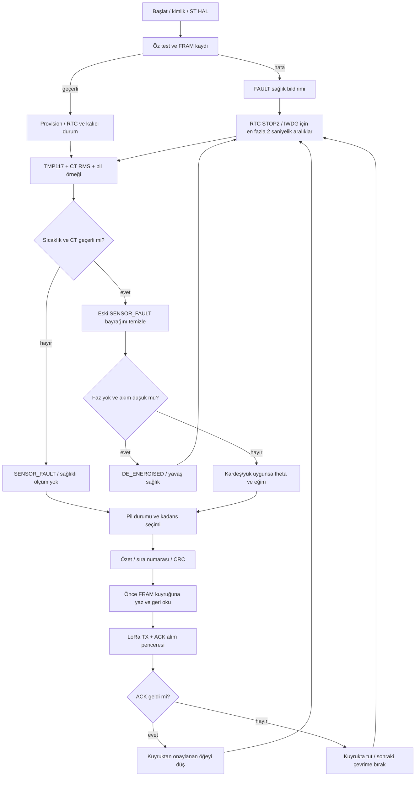
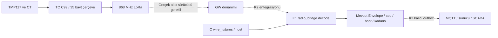
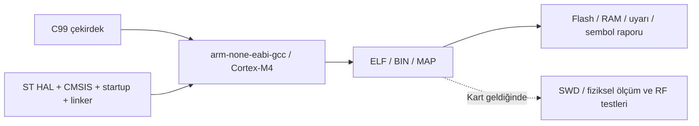

# B1 uç düğüm akışları

Bu diyagramlar TC B1 hedefini ve mevcut tamsayı çekirdeğini özetler. IR/PD/GW uygulama portları tamamlanmış değildir; host senaryoları donanım çalıştırma kanıtı sayılmaz.

## Ölçüm / yayın

## K1 / K2 veri sınırı

Düz oklar veri biçimi/yerel işlevi, kesik oklar tamamlanmamış gerçek donanım entegrasyonunu gösterir. Ortak `panogoz/contracts/` değiştirilmez.

## Hedef yazılım teslimi

Hedef 0x08000000'den başlar. OTA durum makinesi yalnız hostta benzetilir; TC B1'de imzalı bootloader bulunmadığından hedef flash güncellemesi kapalıdır.
