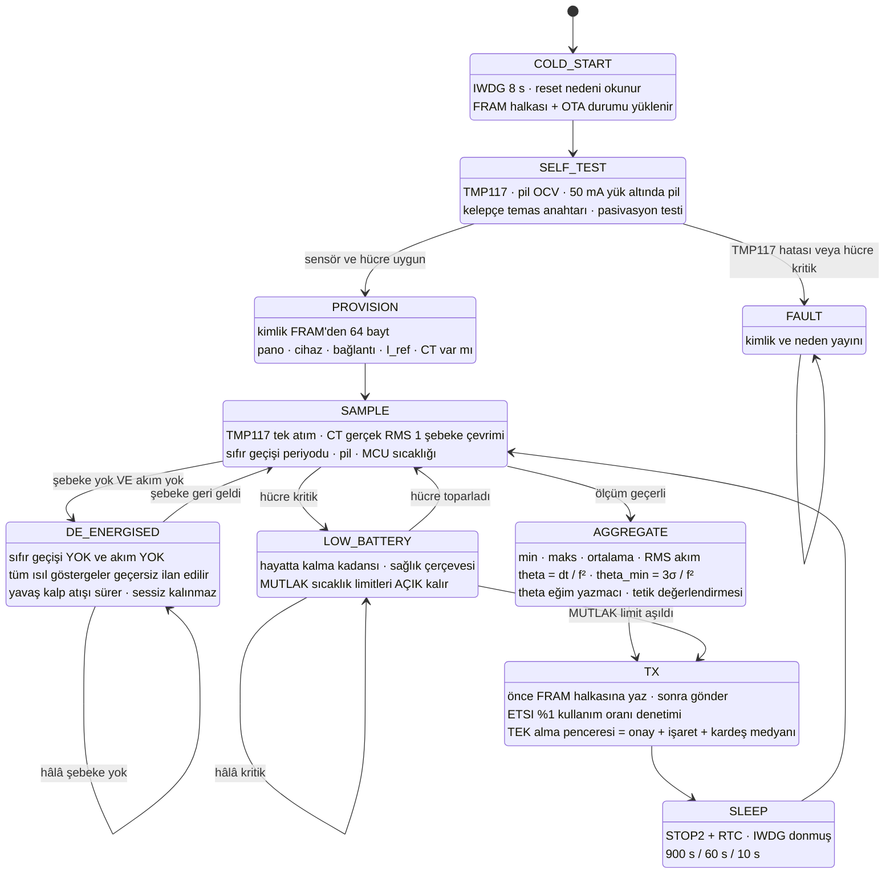
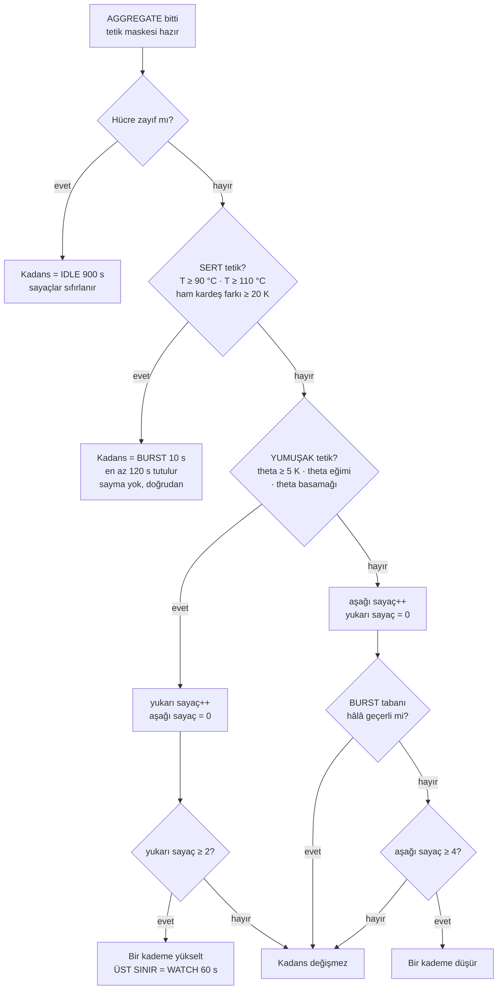
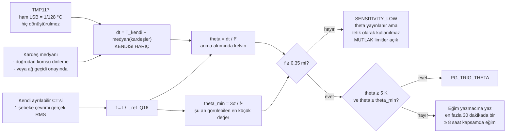
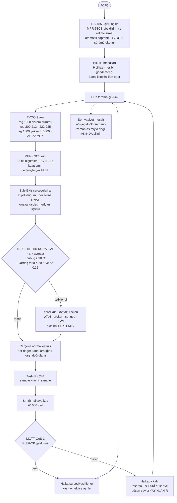
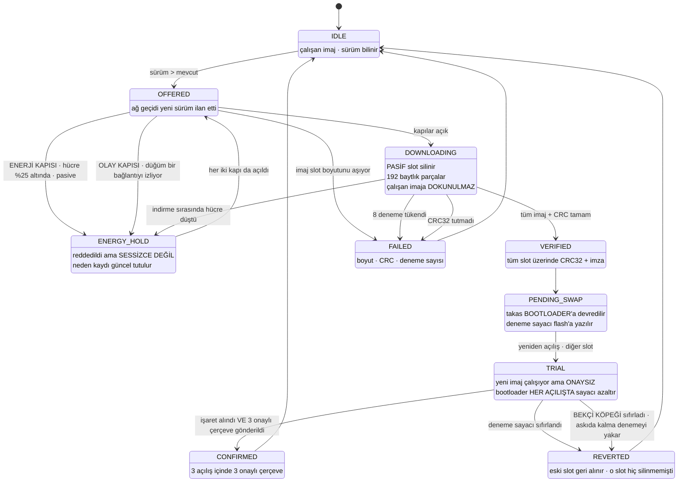
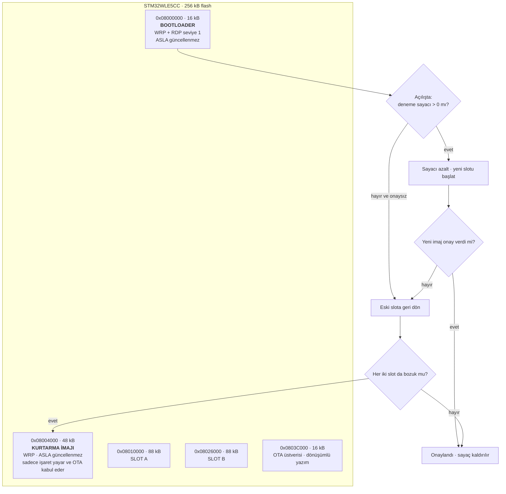
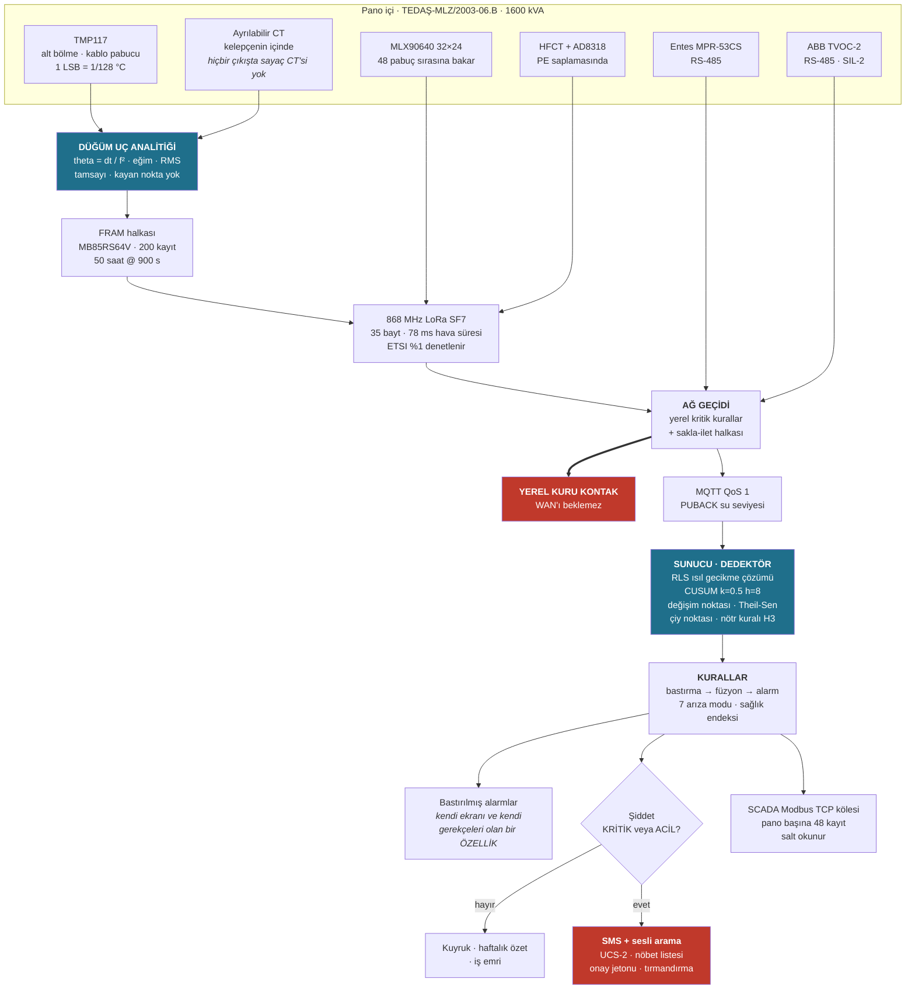
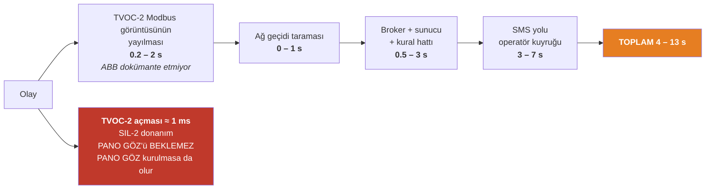
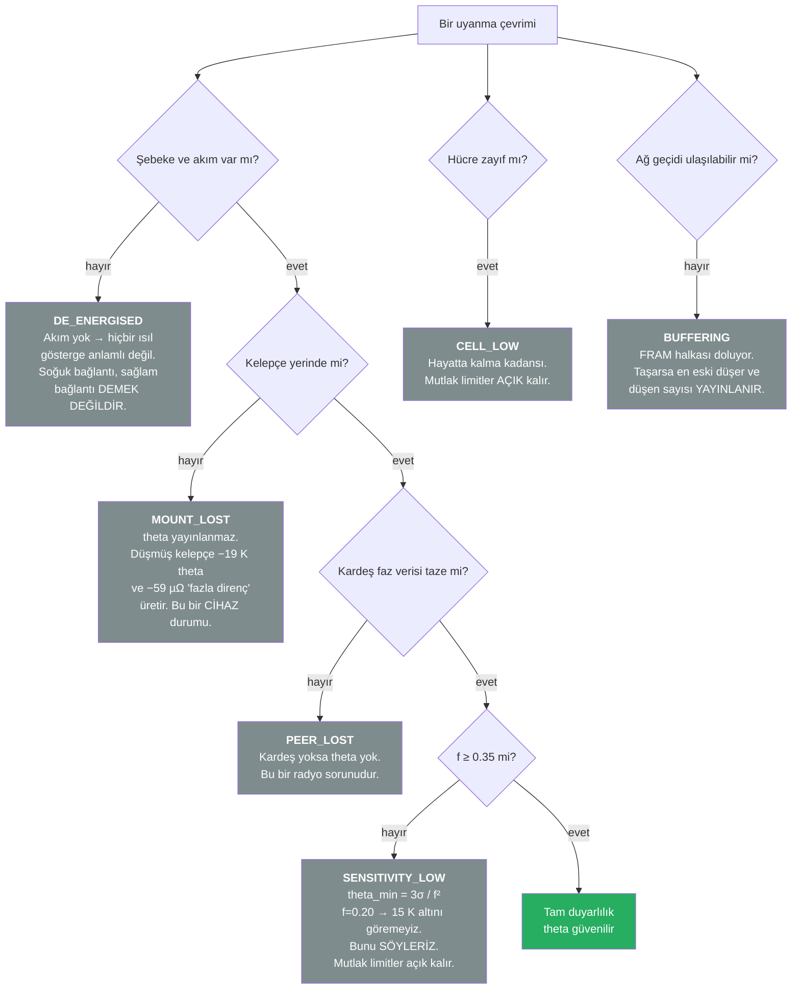

# PANO GÖZ — Akış Diyagramları

> Şartnamenin 3. maddesi mikrodenetleyici kaynak kodunu, programın çalışma
> mantığını ve mümkünse bir akış diyagramını istiyor. Bu dosya o akış
> diyagramlarını içerir. Hepsi Mermaid; olduğu gibi sunuma yapıştırılabilir.
>
> Kaynak kod: `firmware/node/` — C99, kayan nokta yok, libm yok, ilk
> kurulumdan sonra dinamik bellek ayırma yok. Çalışma mantığının anlatımı:
> `firmware/README.md`.

---

## 1. Düğüm ana döngüsü (STM32WLE5CC)

Isıl kelepçe düğümünün (TC-01…TC-06) durum makinesi. `DE_ENERGISED` ve
`LOW_BATTERY` birer hata yolu değil, **birinci sınıf durum**: sistem kör
olduğunda bunu söyler, kör olduğu anı panonun arızasıyla karıştırmaz.

### 1a. Kadans kararı — 2 yukarı / 4 aşağı histerezis

Kadans yanlış ayarlanırsa on üç yıllık düğüm altı aylık düğüme dönüşür.
Bu yüzden **yumuşak** tetikler en fazla `WATCH`'a çıkar; `BURST` yalnızca
şu anda olan bir şey içindir.

### 1b. Bir uyanma çevriminde theta

---

## 2. Ağ geçidi ana döngüsü (DIN ray, ölçü kolonu, mevcut 10 A priz)

Ağ geçidi panodaki şebeke beslemeli ve WAN radyolu tek cihazdır. Dört işi
vardır ve saat 03:00'te önem sırası budur.

> **Neden Sparkplug B değil:** Sparkplug 3.0 DDATA için QoS 0 **zorunlu**
> kılar. Dayanıklılık iddiamız PUBACK ile ilerleyen bir su seviyesine
> dayanıyor ve QoS 0'da PUBACK yoktur. Şartnamenin yasakladığı bir
> mekanizmaya dayanan garanti, garanti değildir. Sparkplug'ın işe yarayan
> dört fikri — birth, last will, cihaz başına sıra numarası, death/rebirth —
> kırk satırda korunmuştur.

---

## 3. OTA — takas ve geri alma durum makinesi

Bu panoda **AG giriş kesicisi yoktur** (Madde 2.2.10.2.vi, "direk bara
bağlantı"). Panoyu enerjisiz bırakmak, tüm dağıtım merkezini OG tarafından
karartmak demektir. Bu yüzden tuğlalanmış bir düğüm "gidip yeniden
programlarız" değil, "bir mahalleye kesinti planlarız" demektir.

Bir düğümün tuğlalanması için **dört bağımsız şeyin** aynı anda bozulması
gerekir.

### 3a. Neden tuğlalanamaz — flash haritası

Açılış döngüsü, düğümü yok etmek yerine **geri alır**. Bekçi köpeği
sıfırlaması bir denemeyi yakar; üç sıfırlama eski imajı geri getirir.

---

## 4. Uçtan uca veri yolu — sensörden SMS'e

### 4a. Bildirim gecikmesi — tek bir sayı DEĞİL, bir ARALIK

**PANO GÖZ koruma değildir.** Yukarıdaki zincirin tamamı bir *bildirimi*
kısaltır, bir *açmayı* değil. Açma, yazılım devrede olmadan, ayrı bir SIL-2
cihazda, yaklaşık 1 milisaniyede olur.

---

## 5. Kör olduğumuz durumlar — hepsi ayrı raporlanır

Bir izleme sisteminin en tehlikeli hâli, göremediği bir şeyi "sorun yok"
diye raporlamasıdır. Bu durumlar pano arızalarıyla **asla** karıştırılmaz.

