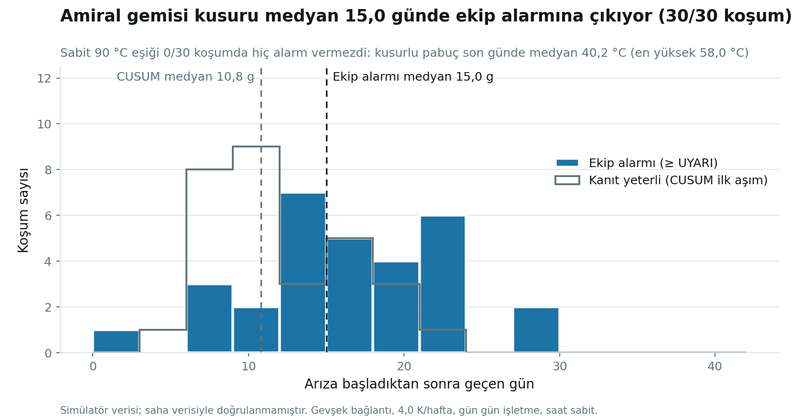
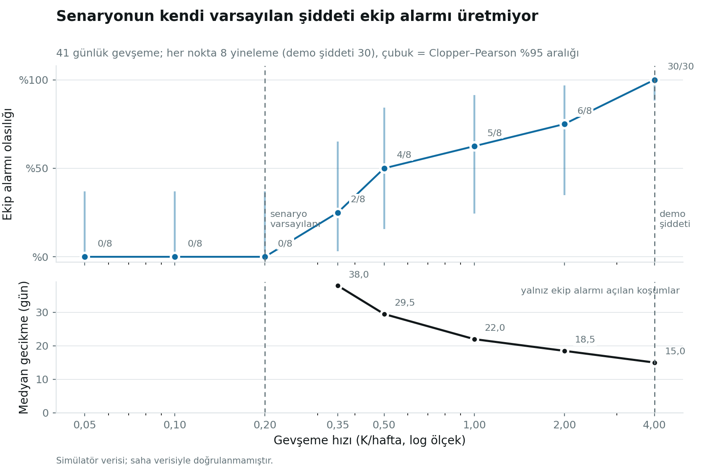

# Doğruluk raporu — PANO GÖZ (görev 4.4)

> **Bu sayıların hiçbiri saha verisiyle doğrulanmış değildir.** Hepsi fizikten türetilmiş bir simülatör üzerindedir; simülatörün varsayımlarını değil, dedektörün BU varsayımlar altındaki davranışını ölçer. Gerçek yanlış alarm oranı ancak etiketli saha geçmişi olan bir pilotta ölçülebilir (README §6).

## Özet

* **Kayma tipi arızalar yakalanıyor.** Amiral gemisi (gevşek bağlantı, 4,0 K/hafta): 30/30 koşumda ekip alarmı (≥ UYARI) açıldı; arıza başladıktan medyan **15,0 gün** sonra (%10–%90: 7,9–23,0 gün). Kusurlu pabucun son sıcaklığı medyan 40,2 °C, en yüksek 58,0 °C: **90 °C'lik sabit eşik 0/30 koşumda hiç alarm vermezdi.**
* **Panel düzeyi modlar ve ark dedektörü arızası zayıf.** 10 alarm-beklenen senaryodan 2'inde TÜM koşumlarda ekip alarmı açıldı (gevsek_baglanti, ark_olayi); 2'inde bazı koşumlarda (hizli_gevseme, notr_gevsek); 5'inde hiçbirinde (harmonik_yuk, asiri_yuk, havalandirma_tikali, yogusma, dedektor_arizasi); 1'i tasarım gereği yalnız İZLE'ye çıkar (pd_yuzen). Tabloda tepe risk yazılı: bunlar "algılanmıyor" değil, **varsayılan senaryo şiddetinde birleşik risk alarm eşiğine (≥ 0,40 İZLE, ≥ 0,65 UYARI) ulaşmıyor** demektir; nedeni (şiddet, füzyon ağırlığı, eşik) bu ölçümle ayrılamaz.
* **Duyarlılık: varsayılan şiddet alarm üretmiyor.** Gevşek bağlantı senaryosunun kendi varsayılanı (0,2 K/hafta) 41 günde ekip alarmı verme olasılığı %0 (0/8); demonun 4,0 K/haftası %100. `faults.py` bu senaryoyu `expect_alarm: True` ilan ediyor.
* **Yanlış alarm bütçesi.** Arızasız pano, 20 koşum × 53 gün = 1060 pano-günü: ekip alarmı (≥ UYARI) **26 olay** (11/20 koşumda); yıllık oran 8,95 olay/pano-yıl, %95 üst sınır 13,12. Telefona çıkan (≥ KRİTİK): 2 olay, üst sınır 2,49 olay/pano-yıl. **docs/04 §5.4'ün analitik yanlış CUSUM geçişi 0,76 olay/pano-yıl'dır; ölçülen ≥ UYARI oranının %95 ALT sınırı 5,85: analitik rakam uçtan uca ölçümle desteklenmiyor** (bkz. §3).
* **Negatif kontroller:** 7 senaryo × ~6 koşum = 42 koşumda ekip alarmı (≥ UYARI) **1** kez açıldı. Bu koşumlar yalnız 7 değerlendirme günü içerir; yanlış alarmlar zamanla biriktiği için 53 günlük sağlıklı koşumlarla (aşağıdaki bütçe) doğrudan kıyaslanmamalıdır.

## 1. Tespit matrisi — 17 senaryo

Sütunlar: **Ekip** = beklenen olay ≥ UYARI seviyesine çıktı · **İZLE** = yalnız izleme listesine düştü · **Kaçtı** = hiç olay yok · **Gecikme** = arıza başlangıcından ekip alarmına medyan gün · **Risk** = tepe birleşik risk medyanı (≥ 0,40 İZLE, ≥ 0,65 UYARI; ark için mutlak kural, risk yok) · **Bayrak** = `expect_flags` koşum sonunda kurulu · **Y.ufuk** = HEDEF DIŞI bir pabuç için takvime yazılabilir (< 90 g) "eşiğe kalan gün" üretilen koşum.

| Senaryo | Beklenen | n | Ekip | İZLE | Kaçtı | Gecikme (g) | Risk | Bayrak | Y.ufuk |
|---|---|--:|--:|--:|--:|--:|--:|--:|--:|
| Gevşek bağlantı (yavaş) | alarm · loose_connection | 30 | 30 | 0 | 0 | 15,0 | 0,73 | — | 3/30 |
| Hızlı gevşeme | alarm · loose_connection | 6 | 5 | 0 | 1 | 14,0 | 0,69 | — | 2/6 |
| Nötr bağlantısı gevşek | alarm · loose_connection | 6 | 3 | 3 | 0 | 13,0 | 0,49 | — | 2/6 |
| Harmonik yüklenme | alarm · harmonic_neutral | 6 | 0 | 0 | 6 | — | 0,51 | — | 0/6 |
| Sürekli aşırı yük | alarm · overload | 6 | 0 | 1 | 5 | — | 0,44 | — | 0/6 |
| Havalandırma tıkalı | alarm · thermal_runaway | 6 | 0 | 0 | 6 | — | 0,15 | — | 3/6 |
| Yoğuşma | alarm · moisture | 6 | 0 | 0 | 6 | — | 0,09 | — | 1/6 |
| Yüzen elektrot / mikro-ark | alarm · insulation | 6 | 0 | 6 | 0 | — | 0,63 | — | 1/6 |
| Ark olayı | alarm · arc_integrity | 6 | 6 | 0 | 0 | ≤ 5 dk | mutlak kural | 0/6 | 0/6 |
| Ark dedektörü arızası | alarm · arc_integrity | 6 | 0 | 0 | 6 | — | mutlak kural | — | 2/6 |

* **Yüzen elektrot / mikro-ark:** 6/6 İZLE. 400 V'ta klasik PD oluşmaz ve PD kanalı AG'de tek başına ekip yönlendirmez; İZLE beklenen sonuçtur (README §7, docs/04 §9.3).
* **Ark olayı:** 6/6 ekip alarmı; gecikme değerlendirme aralığıdır (5 dk). Bildirim gecikmesi bu raporda ölçülmez (docs/08 §5).
* **Ark dedektörü arızası:** 0/6. docs: reg 222/223 yalnız FW ≥ 03.00.00'da bulunur; simülatörün bu yazmaçları dedektörün beklediği biçimde sunup sunmadığı bu ölçümle ayrılamaz (doğrulanmadı).
* **Yoğuşma:** senaryo yalnız 05:12–07:42'de ve 3 gün süreli; koşum bu pencerenin içinde ölçer (arıza 2,5 gün önce başladı).
* **Bayrak sözleşmesi (görev 4.3):** 5 senaryonun ilan ettiği bayrak HİÇBİR koşumda kurulmadı: ark_olayi (DE_ENERGISED); sensor_takildi (STALE); sensor_kaydi (SENSOR_DRIFT); dugum_sessiz (STALE); pano_enerjisiz (DE_ENERGISED).

Negatif kontroller (sessiz kalmalı): **Yanlış** = ekip alarmı açıldı · **İZLE** = yalnız izleme kaydı (arka plan gürültüsü dahil) · **Sessiz** = olay yok.

| Senaryo | n | Yanlış | İZLE | Sessiz | Bayrak | Y.ufuk | Bastırma gerekçesi |
|---|--:|--:|--:|--:|--:|--:|---|
| Sensör takıldı | 6 | 1 | 1 | 4 | 0/6 | 3/6 | — |
| Sensör kayması | 6 | 0 | 2 | 4 | 0/6 | 4/6 | — |
| Düğüm sessiz | 6 | 0 | 2 | 4 | 0/6 | 2/6 | OFFLINE |
| Sıcak hava dalgası (negatif kontrol) | 6 | 0 | 2 | 4 | — | 2/6 | — |
| Şebeke olayı (negatif kontrol) | 6 | 0 | 2 | 4 | — | 2/6 | GRID_THD_3PH, GRID_THD_3PH_CANDIDATE |
| Trafo devreye alma (negatif kontrol) | 6 | 0 | 2 | 4 | — | 5/6 | — |
| Pano enerjisiz (negatif kontrol) | 6 | 0 | 2 | 4 | 0/6 | 2/6 | — |

## 2. Haber verme süresi (grafik 1)



Amiral gemisi, 30 yineleme. Kanıtın yeterli olduğu an (CUSUM ilk aşımı) arızadan medyan 10,8 gün sonra; ekip alarmı (3/5 gün kuralı + iki bağımsız ölçüm ilkesi) medyan 15,0 gün sonra. Fark bilinçlidir: alarm kapıları gürültüden korur ve gecikme bedelidir. 0 koşumda ekip alarmı hiç açılmadı.

## 3. Yanlış alarm bütçesi

Arızasız pano (20 koşum, 1060 pano-günü, ilk 7 gün ısınma hariç): İZLE ve üstü 51 olay, UYARI ve üstü 26, KRİTİK ve üstü 2. UYARI'lı koşum oranı 11/20 (%95 aralık %32–%77). "Yanlış ufuk" (sağlıklı pabuç için < 90 günlük "eşiğe kalan gün"): 4/20 koşum. Bu, `tests/test_negative_pipeline.py`'nin saate göre değişen kırmızı testinin ölçülmüş hâlidir. Yanlış UYARI'ların koşum başından ilk görüldüğü gün: medyan 32,0, en erken 9,0 (ısınma 7 gün; bu değerler ısınma sınırına yakınsa yanlış alarmların bir kısmı öğrenme haftası artefaktıdır).

**Dağılım eşit değil:** 9/20 koşum hiç yanlış UYARI üretmedi, en kötü koşum 6 üretti; olaylar birkaç pabuçta yığılmıyor (16 farklı pabuç/mod). Poisson varsayımı gevşektir; aralıklar bu yüzden olduğundan dar olabilir.

**Belgeyle çelişki.** docs/04 §5.4, 100 pano × 40 bağlantı için filoda günde 0,209 yanlış CUSUM GEÇİŞİ hesaplar (= 0,76 olay/pano-yıl) ve docs/08 §10 jüri cevabı bunu "üst sınır" diye sunar. Uçtan uca ölçülen ≥ UYARI olay oranı 8,95 olay/pano-yıl (%95 aralık 5,85–13,12) ve geçişten daha ağır bir olaydır. Analitik hesap gürültünün bağımsız ve Gauss olduğunu varsayar; simülatörün sağlıklı pabuç dağılımı ya da dedektörün gürültü varsayımı bundan sapıyor olabilir (bu ölçümle ayrılamaz). **Jüri cevabı sunumdan önce güncellenmeli.**

## 4. Duyarlılık eğrisi (grafik 2)



| Gevşeme hızı (K/hafta) | n | Ekip alarmı | Olasılık | %95 aralık | Gecikme medyanı (g) |
|--:|--:|--:|--:|--:|--:|
| 0,05 | 8 | 0 | %0 | %0–%37 | — |
| 0,10 | 8 | 0 | %0 | %0–%37 | — |
| 0,20 | 8 | 0 | %0 | %0–%37 | — |
| 0,35 | 8 | 2 | %25 | %3–%65 | 38,0 |
| 0,50 | 8 | 4 | %50 | %16–%84 | 29,5 |
| 1,00 | 8 | 5 | %62 | %24–%92 | 22,0 |
| 2,00 | 8 | 6 | %75 | %35–%97 | 18,5 |
| 4,00 | 30 | 30 | %100 | %88–%100 | 15,0 |

## Yöntem ve sınırlar

* Her koşum ayrı süreçte, **gerçek boru hattından** geçer (simülatör → ağ geçidi → dedektör → bastırma → füzyon → alarm yöneticisi) ve **gün gün** işletilir; alarmın ilk açıldığı an gerçek alarm yöneticisinden okunur. İlk 7 gün ısınmadır (üretimde `LEARN_MODE`).
* Duvar saati **sabitlenir**: aynı tohum ve saat bit bit aynı sonucu verir; saat kaydırılınca θ tepesi ve "eşiğe kalan gün" değişir (simülatör mutlak zamana bağlı). Yineleme = (tohum, saat kayması).
* Pano **tam donanımlı** (analizör + ark rölesi) seçilir. Demo filosunda 14 panonun yalnız 7'sinde ark rölesi var; rölesiz panoda ark alarmı VERİLEMEZ — bu bir dağıtım koşuludur, dedektör kusuru değil.
* Tespit = beklenen olay, **hedef eklemde** (eklem modları) ya da aynı modda (panel modları), ≥ UYARI. Başka eklemdeki olay hedefi yakalamış sayılmaz.
* Aralıklar Clopper–Pearson (oranlar) ve kesin Poisson (olay oranları), iki yanlı %95. Küçük n'de aralıklar geniştir ve öyle okunmalıdır.
* Kaçırılan panel modları için **neden** tanı konmadı: risk yükseliyor ama eşiğe ulaşmıyor; senaryo şiddeti mi, füzyon ağırlığı mı, eşik mi bu ölçümle ayrılamaz.

## Yeniden üretme

```
python -m sunum.rapor               # koşumları çalıştır, raporu ve grafikleri üret
python -m sunum.rapor --kayittan    # kayıtlardan raporu yeniden üret
python -m pytest tests/test_dogruluk.py -q   # her sayı kayıttan üretilebiliyor mu, koşum tekrarlanabilir mi
```
